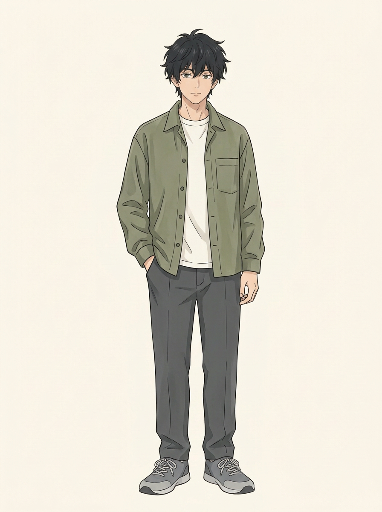
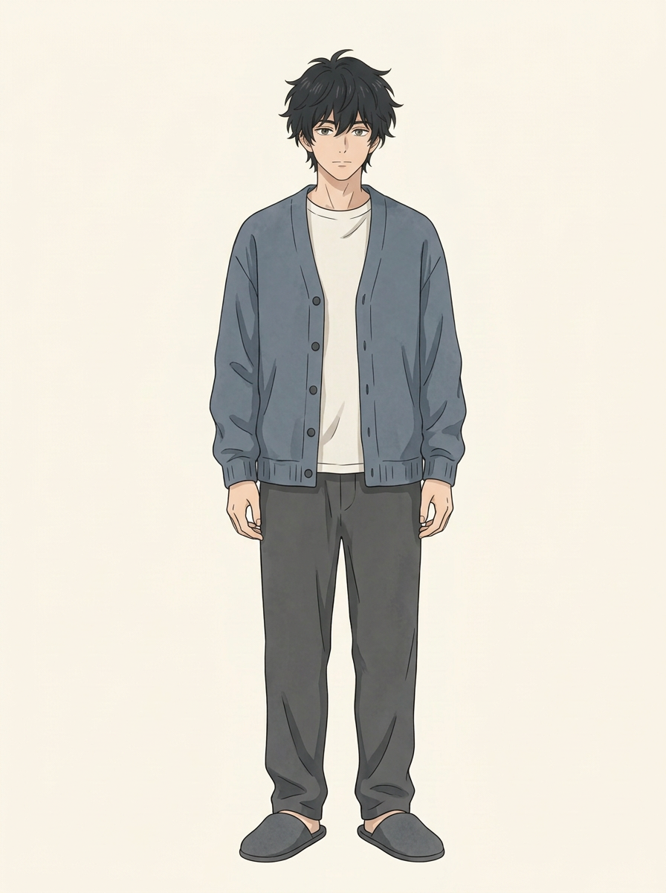
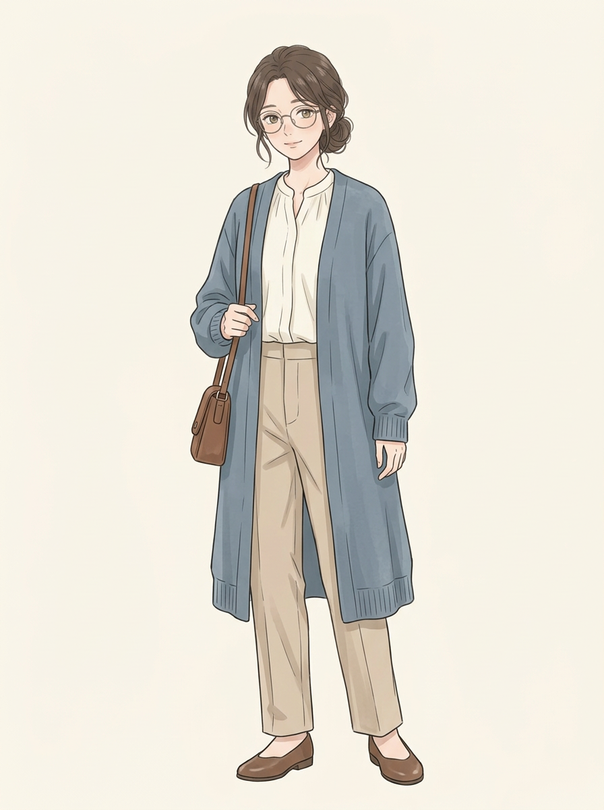
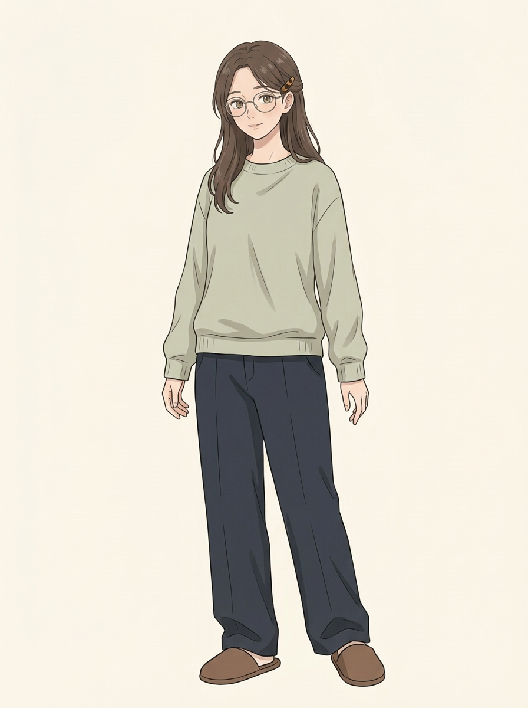
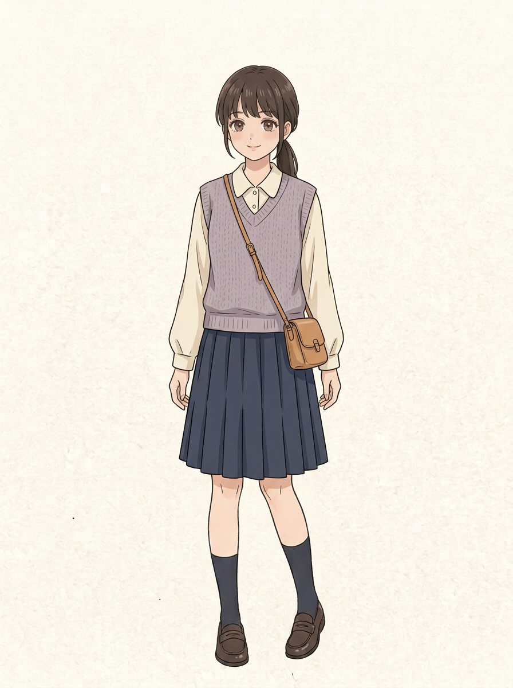
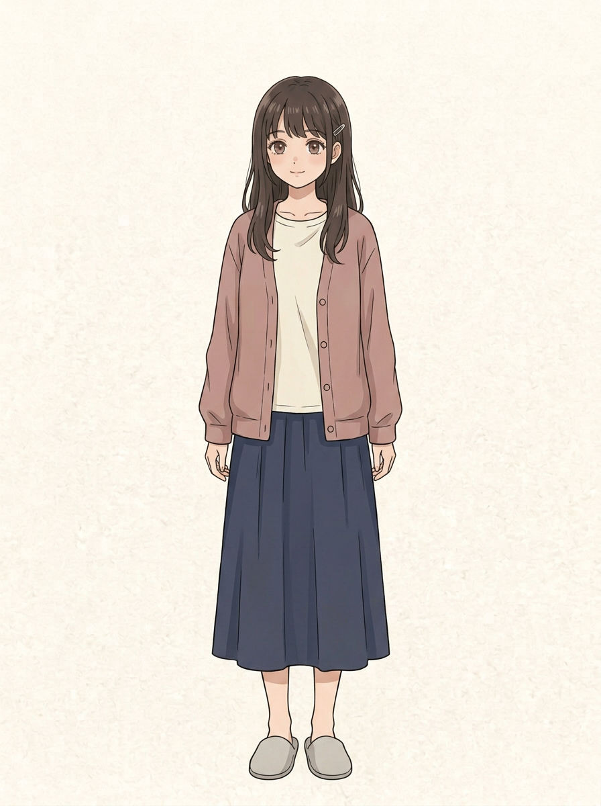
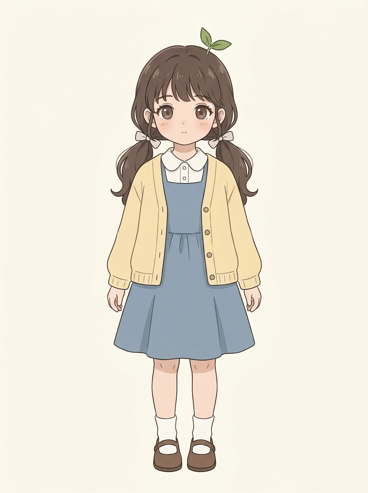
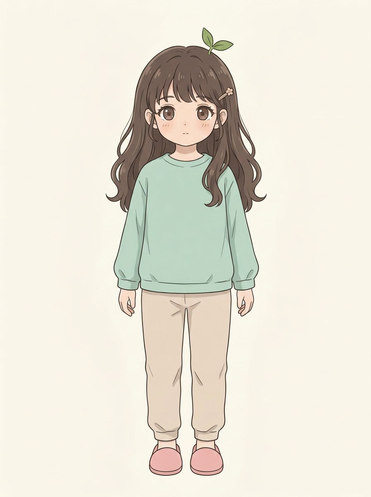

# 四位主角｜服装与发型候选 v1

每位角色各两套新造型：一套外出、一套居家；均为新生成的独立单人设定图。它们是供查看的候选，并非已定稿，也没有替换原人设或已完成的漫画。父母、大哥不在本次范围。

后续按剧情的场景和时间段选择；连续场景中同一人物的服装、鞋袜、发型及发饰保持一致，换装或整理发型要有合理的段落过渡。角色脸型、年龄感及标志特征仍以原人设为准，AI生图可能偏离，使用前须结合剧情复核。

## 二弟｜外出：橄榄绿外衫

浅色内搭、深灰长裤与运动鞋，保留黑色碎发。

## 二弟｜居家：蓝灰开衫

浅色内搭、深色长裤和拖鞋，黑色碎发。

## 姐姐｜外出：蓝灰长开衫

浅色上衣、米色长裤和棕鞋，眼镜、低盘发与小挎包。

## 姐姐｜居家：浅鼠尾草绿上衣

深色宽松长裤、拖鞋、眼镜，棕发放下并用发夹固定。

## 妹妹｜外出：淡紫针织背心

浅色衬衫、深蓝裙、深色袜与棕鞋，棕发低马尾及棕色挎包。

## 妹妹｜居家：豆沙色开衫

浅色上衣、深蓝长裙和拖鞋，棕发放下并用小发夹固定。

## 小满｜外出：浅黄开衫

浅蓝背带裙、白袜与棕鞋，低双马尾，保留芽芽发饰。

## 小满｜居家：薄荷绿上衣

米色长裤、粉色拖鞋，棕发放下并保留芽芽发饰。

