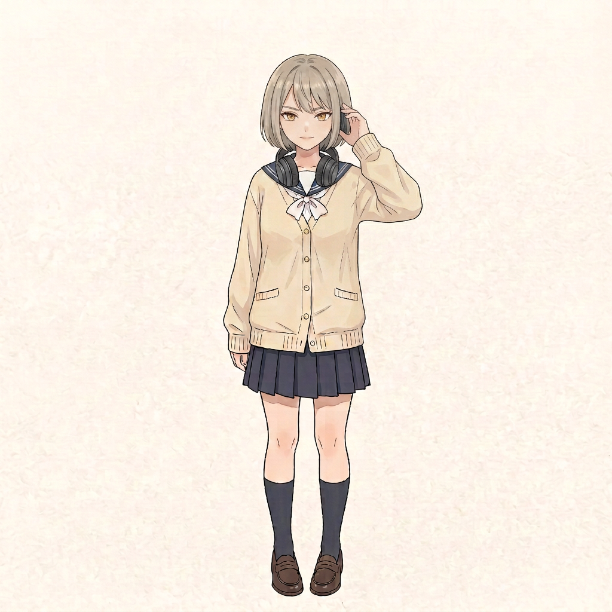
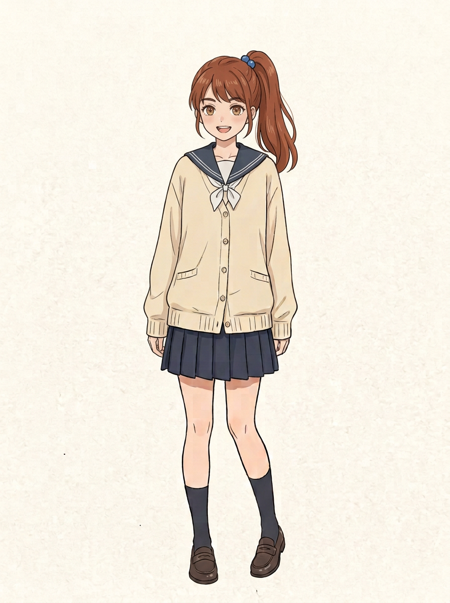

# 学生会另外两位成员｜形象与性格试案

用户要求学生会四名成员均为女生、各有特点、脸和发色有区别，未来星野也会认识她们。四人包括辰希、她的好友以及本目录两位新设计；名字、具体经历和人物关系未定。

## 耳机会长（暂称）

- 视觉提案：灰金短发、较利落的眉眼、脖子上的深色耳机；与辰希的深棕双辫、好友的蓝黑长发区别。
- 性格提案：稳重而有主见，会先听别人说完再整理意见；喜欢音乐，对活动的声音与节奏很敏感。可以有认真过头、学着放松的成长空间，不是只会冷淡或夸妹妹。
- 校园作用：组织讨论、明确共同目标；会把需要沟通的事情交给擅长沟通的委员。
- 后续相识构想：校内活动开放给家属时，她因准备活动认识来参加的星野；先从一次正常交流中欣赏他认真听人说话。具体情节与关系走向待用户决定。
- `耳机会长.png` 是较早的候选，仍保留；`耳机会长_v2.png` 尝试让她的眼神、表情与好友区分，均未被用户定稿。

## 活泼委员（暂称）

- 视觉提案：暖栗红色高马尾、蓝色发绳、明亮眉眼和爽朗表情；与另外三人发型发色区分。
- 性格提案：热情、行动快，愿意主动沟通，也容易一口气接太多工作；逐渐学会听取同伴意见并分工。她有自己的目标和同龄朋友，不只围绕星野转。
- 校园作用：了解社团需求、传达安排、调动气氛；第八话提议由她通知社团。
- 后续相识构想：在一次经学校允许的活动中，她负责引导来访家属，与星野自然相识；通过几次不同的群体活动再发展她独特的好感和信任。具体情节待用户决定。

这两位性格、职务、兴趣和后续相识方式只是本轮提案；不擅自赋予姓名，不视为已经发生的故事。好感表现应符合角色年龄和相处情境。
