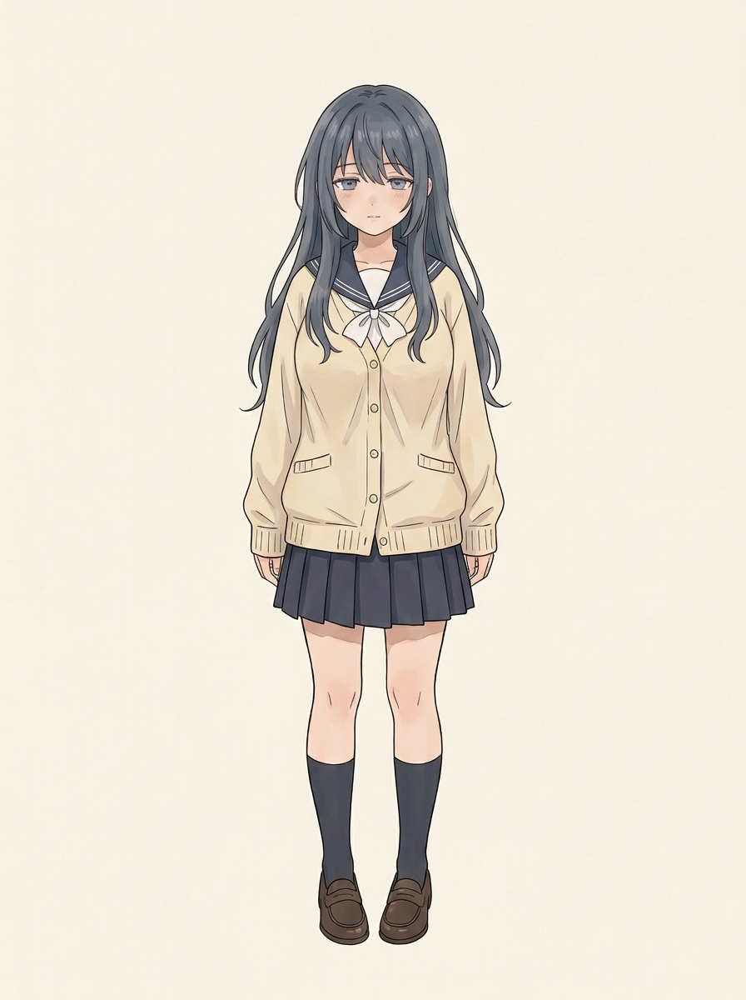
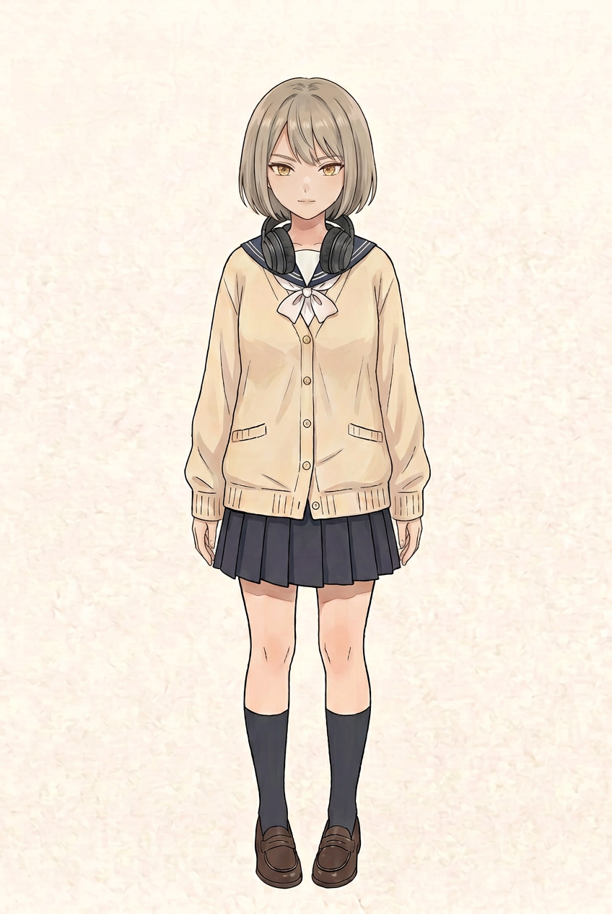
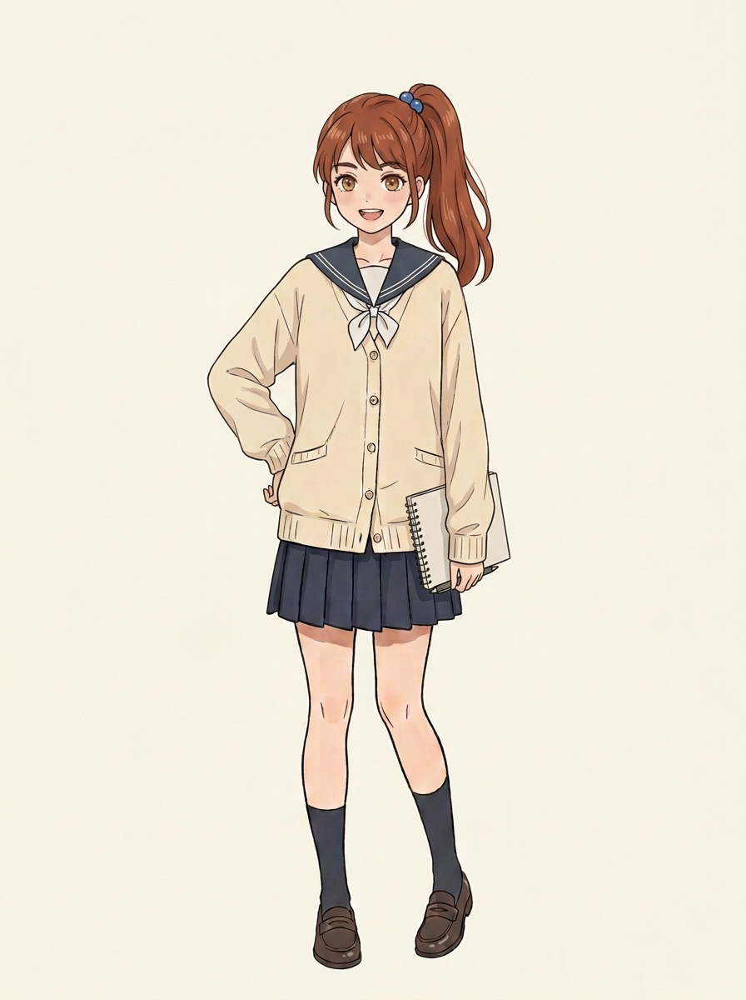

# 好友与学生会成员｜名字及人设候选

这三个人名和本轮新绘的立绘均请你确认；尚不是正式定稿。已认可的好友原参考保留不变，角色背景、年级、生日和家庭经历没有擅自补写。学生会四人是辰希、好友、会长和委员；不是新加三名成员。

## 好友｜候选名：顾清禾

- 辰希的同校好友，学生会四人之一；蓝黑长发，眉眼温柔略显疲倦，娇小、自然丰满，同款校服。
- 性格方向：安静、细腻，有一点病弱猫系的气质，但不是猫娘；会认真思考，也有自己的想法。
- [你已认可的好友体型参考](../妹妹好友_参考与候选/新同学_体型优化试案.png)仍是基准。此图是新绘候选，不取代原图；正面身高比例与立绘表情请一起看。

## 会长｜候选名：沈知遥

- 学生会会长，灰金短发，金棕眼，颈挂深色耳机，与好友的脸、神情和发色区分。
- 性格方向：沉稳、有主见；组织讨论时先听大家的意见。听音乐等更具体的爱好及背景尚待确认。
- [上一版会长候选](../学生会新成员_试案v1/耳机会长_v2.png)保留；本张是进一步尝试，仍请你确认。

## 委员｜候选名：夏予晴

- 学生会委员，栗红高马尾、蓝色发绳，神情明朗，同款校服。
- 性格方向：活泼、热心，乐于与人沟通；本话中主动负责通知社团。其他背景待确认。
- [上一版委员候选](../学生会新成员_试案v1/活泼委员.png)保留。新图生成了随身本子，**该本子仅本张试画的道具，不作为固定饰物**，手部与姿势请你一起确认。

上述名字只用于这份候选说明，正文气泡不加姓名。是否采用、修改，或由你另取名字，均由你决定；会长与委员的具体经历、未来相识情节也未定。
