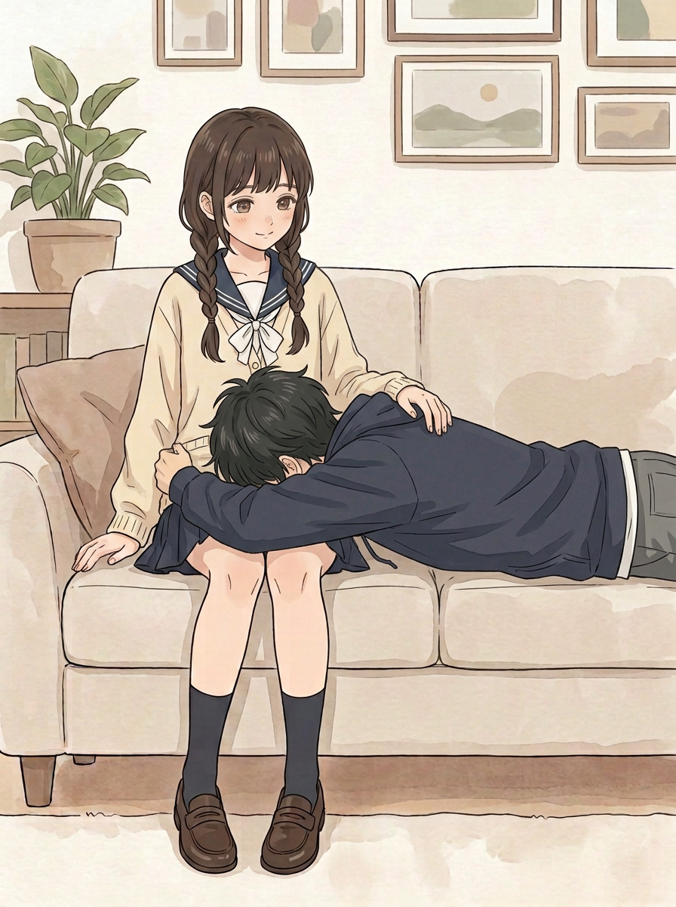
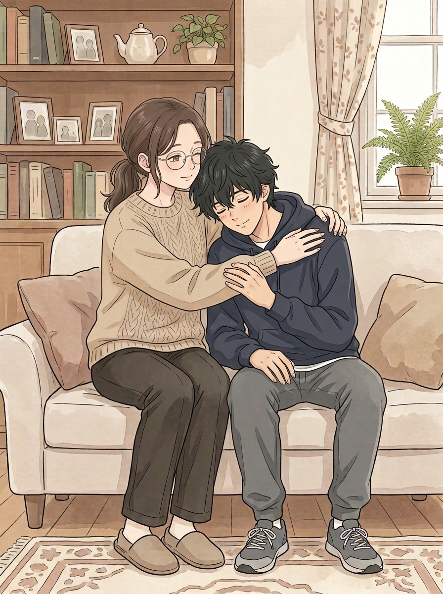
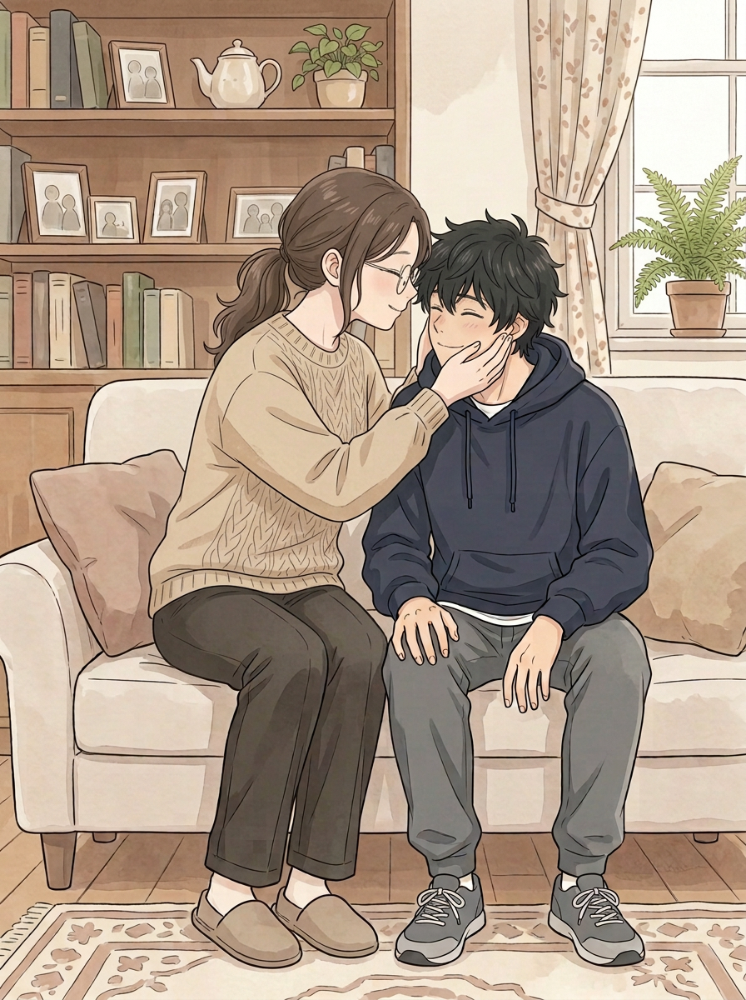
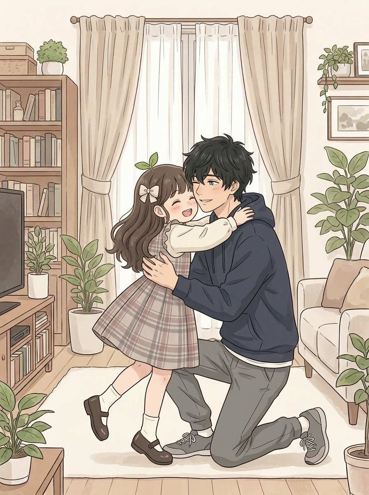
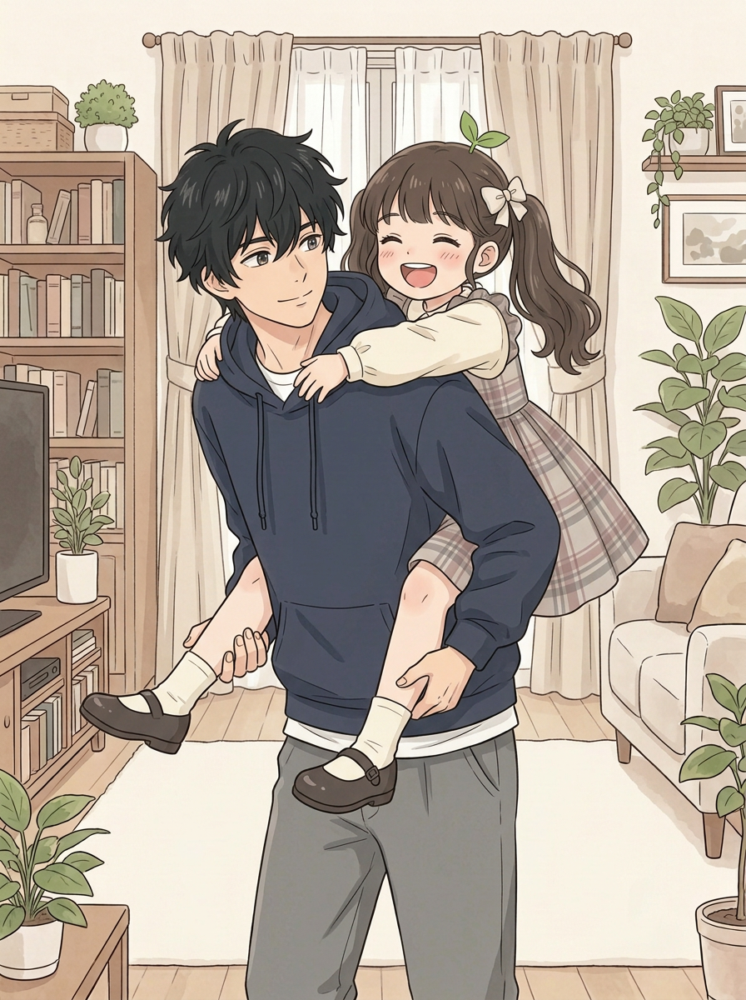
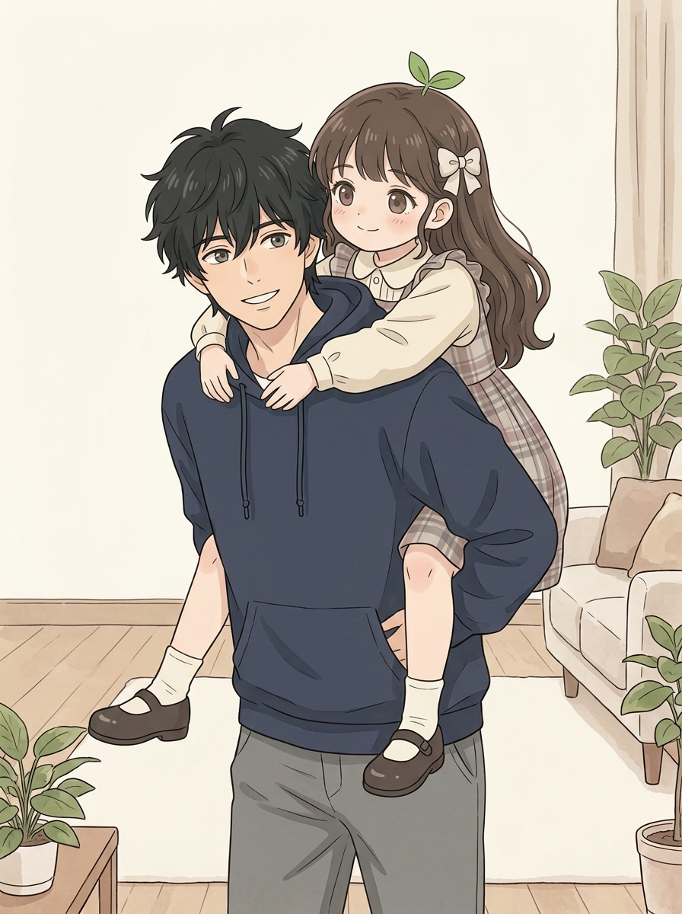

# 第五话｜新增互动候选

这些是**独立原画草稿，供选择动作，不是已经插入正文的成品**。原检查版及姐姐亲吻页均未覆盖。选定动作后，还需核对连续性、修正候选中的问题，再决定插入位置和台词。

## A｜妹妹：抱腿，脸朝下

二弟脸朝下趴在妹妹腿上，手臂横过膝前；妹妹手放在他背上。二弟另一条手臂及下肢被遮或在画外；是否达到你想要的抱腿方式请你判断。

## B｜姐姐：搂肩靠着

姐姐搂住二弟，他靠着她，手搭在她的袖子上。姐姐绕过身后的手臂被人物遮挡，连接无法完整追踪。

## C｜姐姐：捧脸靠近

姐姐捧他的脸靠近，另一只手在头后部分遮挡；额头是否实际接触看不清。该页是亲吻以外的额外候选，不替换原亲吻页。

## D｜小满：开心地抱住小叔

小满两只鞋可见，一脚抬起；双方各有一只手臂在拥抱中遮挡。此画面与原跳抱有些相似，是否需要额外加入由你决定。

## E｜小满：小叔背着她

小满两只鞋可见，二弟的脚画外；左侧托腿的袖口被腿遮挡，手部连接不完整。她的发型变成了侧扎，与现有散发不同，若选此动作需处理连续性。

### E 的另一个草稿

恢复散发，但二弟两只手多数被遮住，不能确认托腿姿势；上方墙面较空。仅供比较动作，尚不宜直接插入。

## 制作记录
本轮新生成10张候选，其中展示上述6张，其余保留在 `art/chapter-05-home-options/` 备查。妹妹抱腿最初版本脸朝侧面，另一版衣服与现有造型不符，故改用 A；最初小满拥抱缺鞋、姐姐捧脸初稿二弟鞋变为拖鞋，均未作为推荐稿。

AI 已查看完整图片并放大手臂区域，不能代替你验收。画布预筛针对10张原画报6项线条疑点，均在沙发底缘附近；其中展示的 A、B、C 的对应线看起来是沙发／地面交界，尚未逐坐标建立例外台账。风格统计对 B、C 和 E 另稿有目录差异提示，不等于画风必然出错。候选无台词和页码，尚未完成整话衔接与成品级审校。
