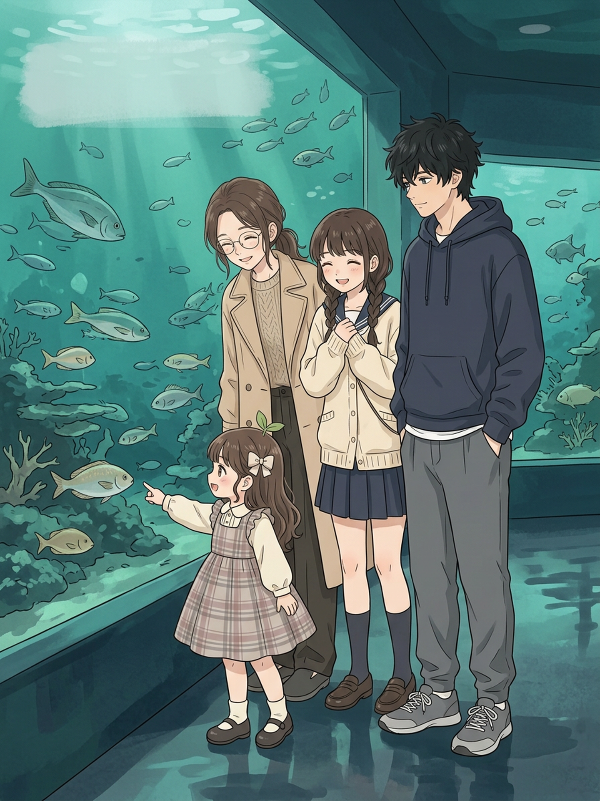
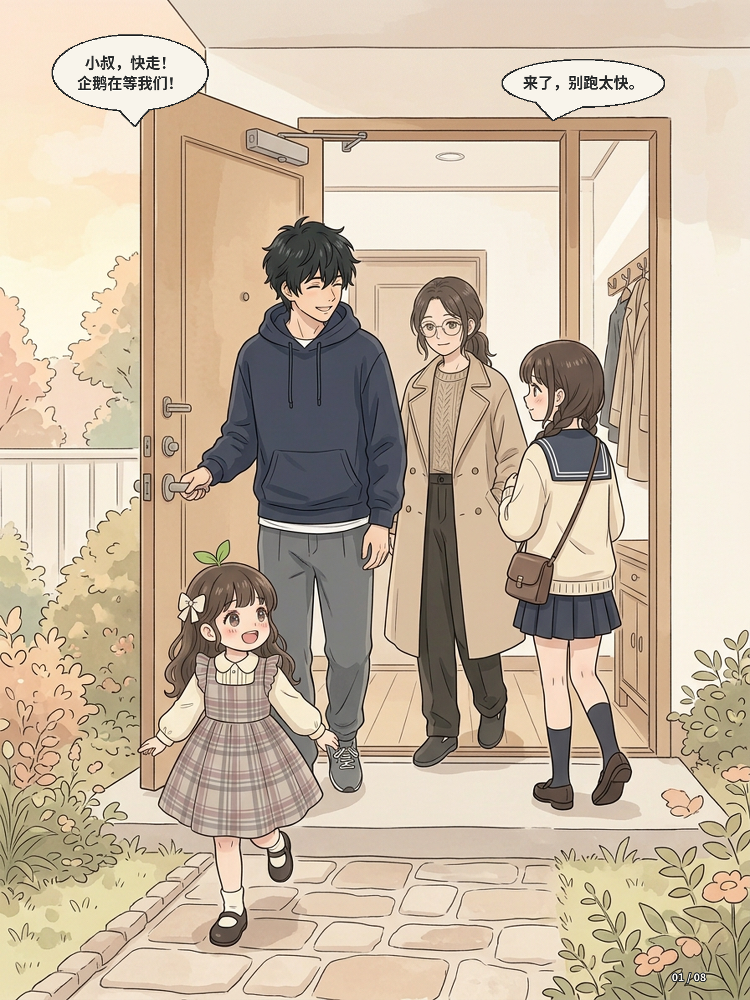
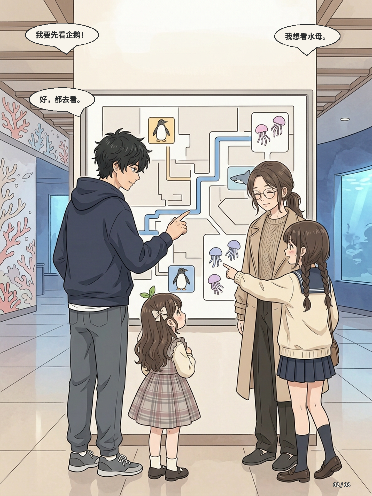
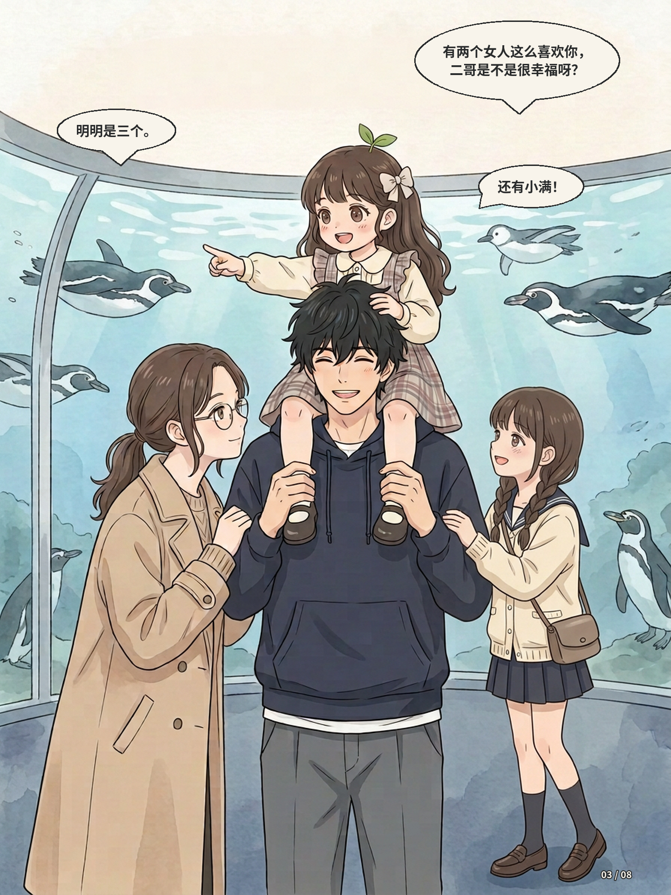
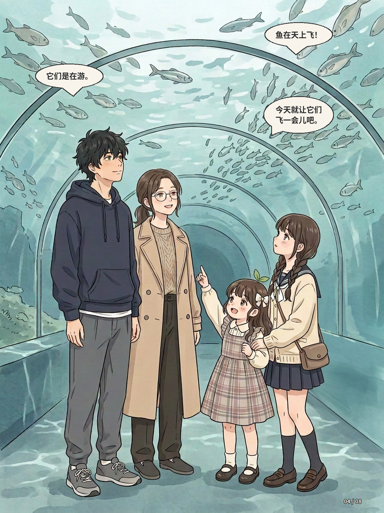
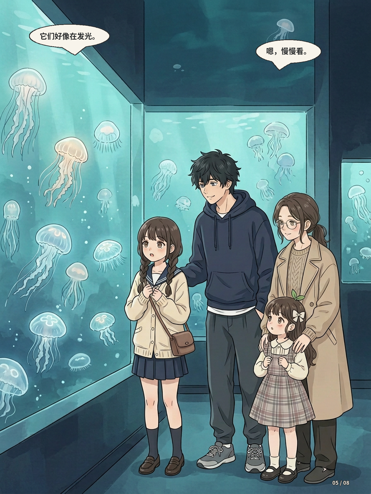
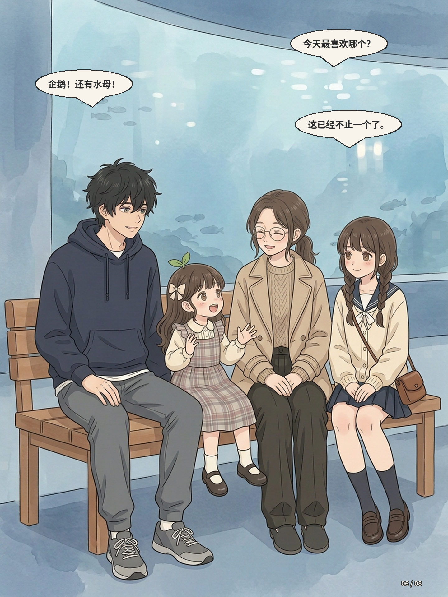
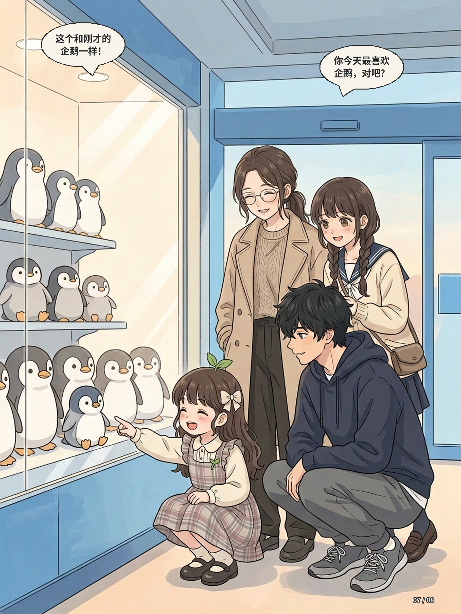
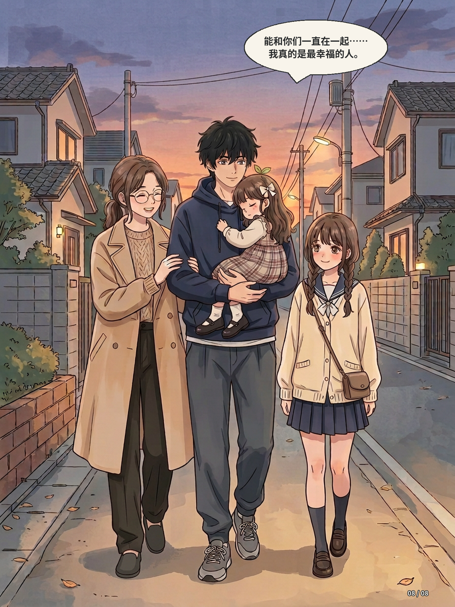

# 第五话｜水族馆 · 第二轮检查草稿

已重新生成缺失妹妹挎包的页面，并重画出发和回家页；**这是带台词试排的工作草稿，尚非成品或用户验收版**。封面标题仍待用户决定；对白除末页用户指定原句外均可调整，部分气泡与说话者距离较远，归属仍需调整。

## 封面（无标题）

## 01 出发

## 02 路线

## 03 企鹅和肩上骑

## 04 海底隧道

## 05 水母

## 06 休息

## 07 企鹅玩偶

## 08 回家

