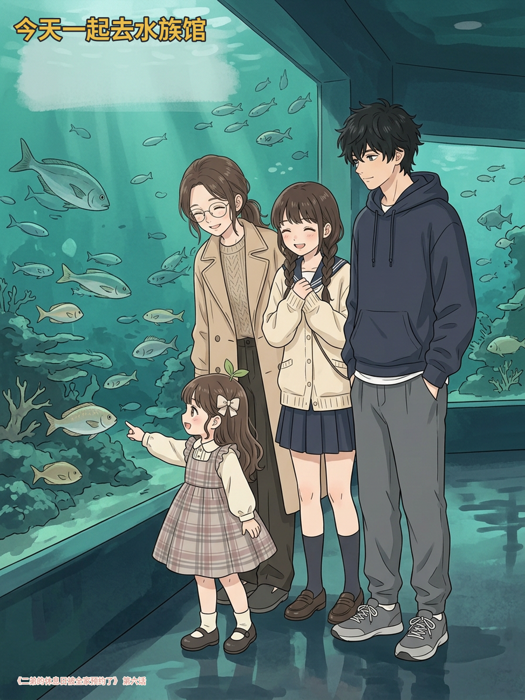
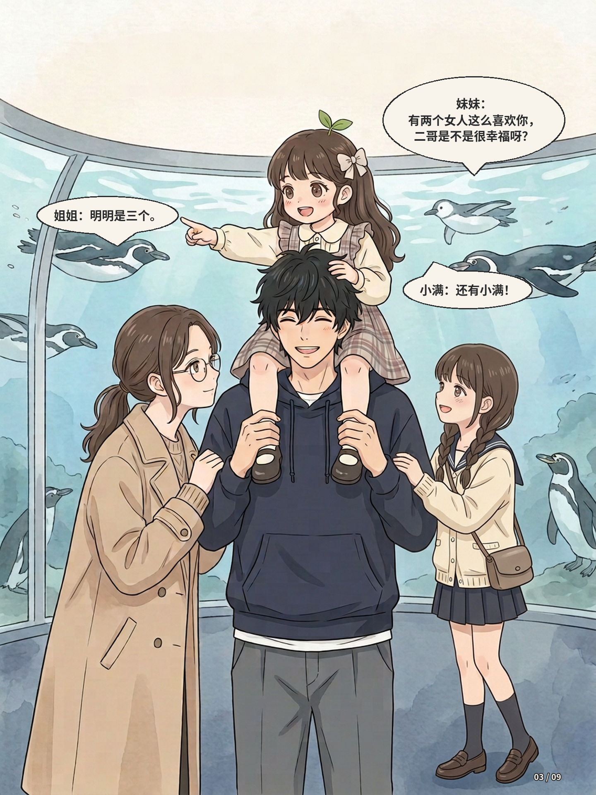
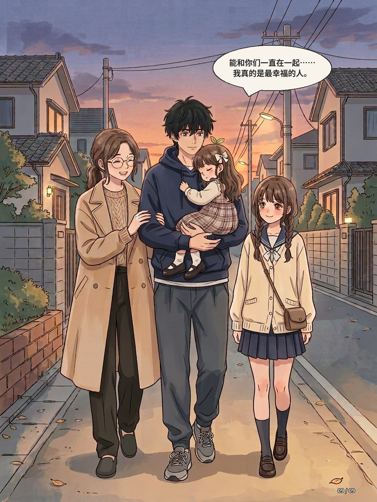

# 第六话｜今天一起去水族馆 · 对白归属调整版

> 保留第六话封面及剧情；仅重排第03页气泡并标注说话人，原对白不变。请用户确认排版。
> PNG为 1440×1920 排版图（原画896×1200）；轻量PDF供预览。

## 封面

## 出发

## 商量路线

## 企鹅和肩上骑

## 海底隧道

## 四人合影

## 水母

## 休息

## 企鹅玩偶

## 回家

