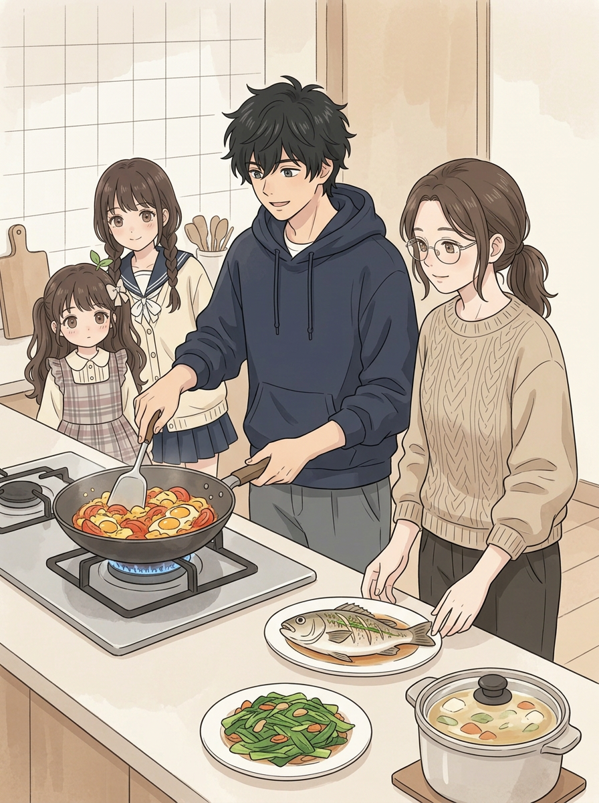
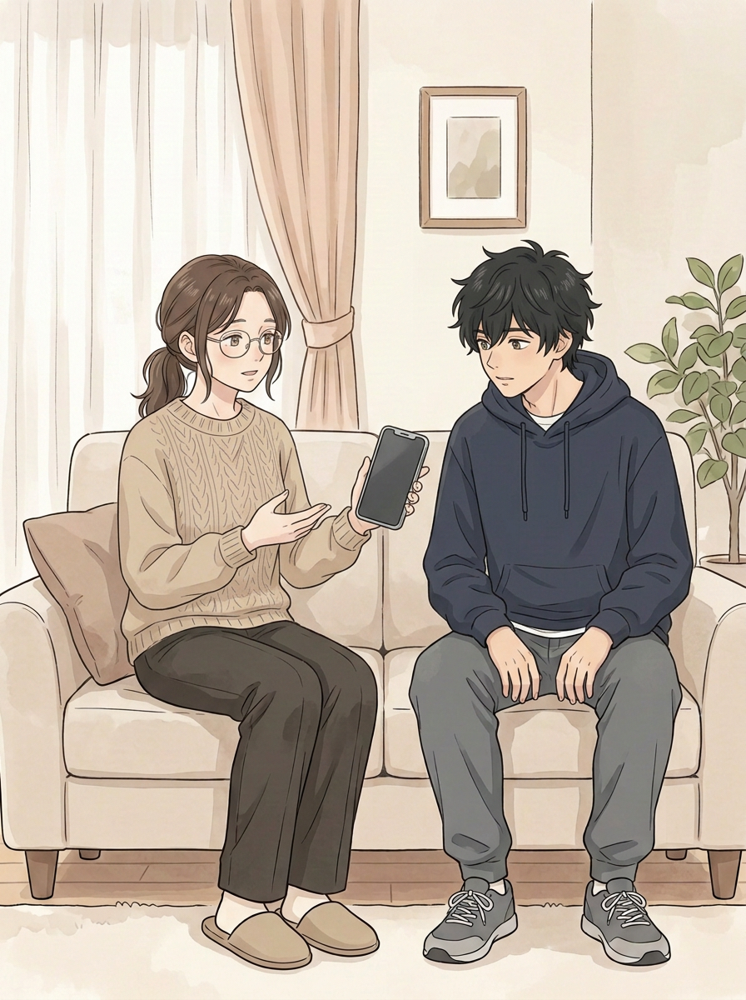
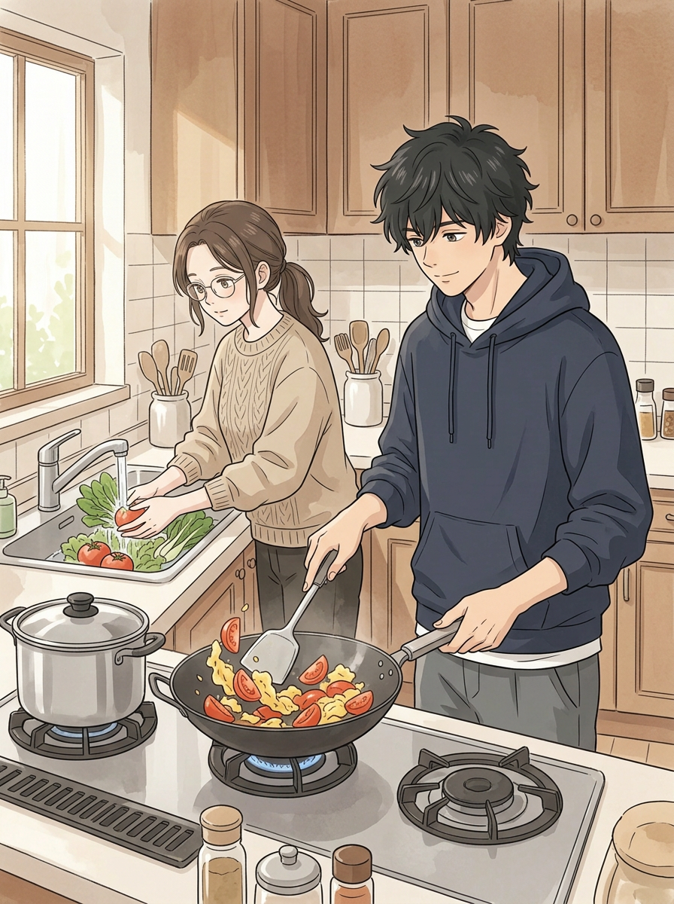
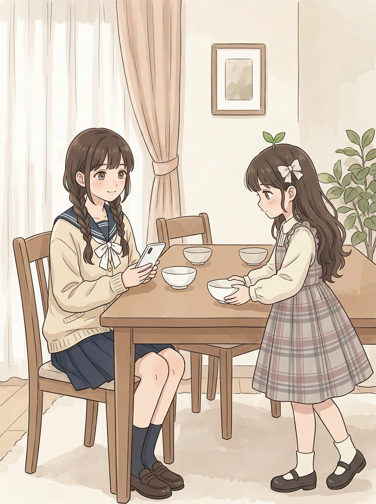
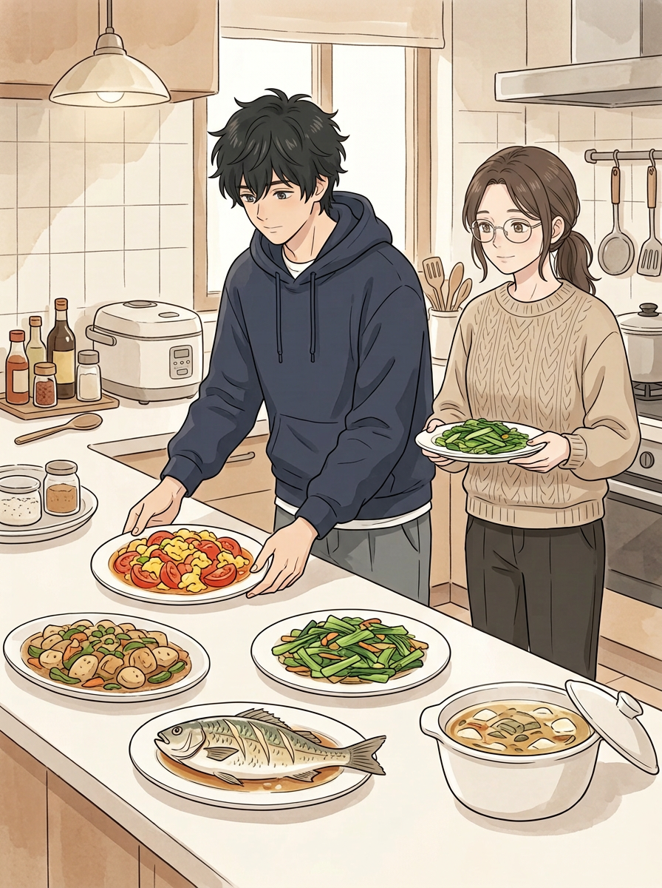
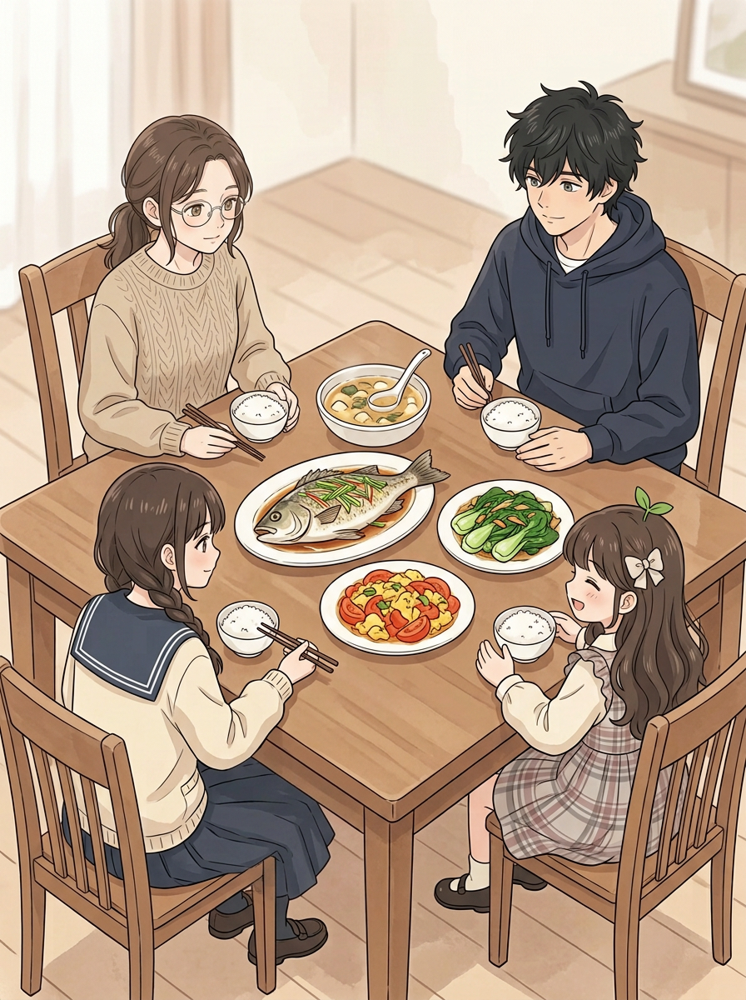
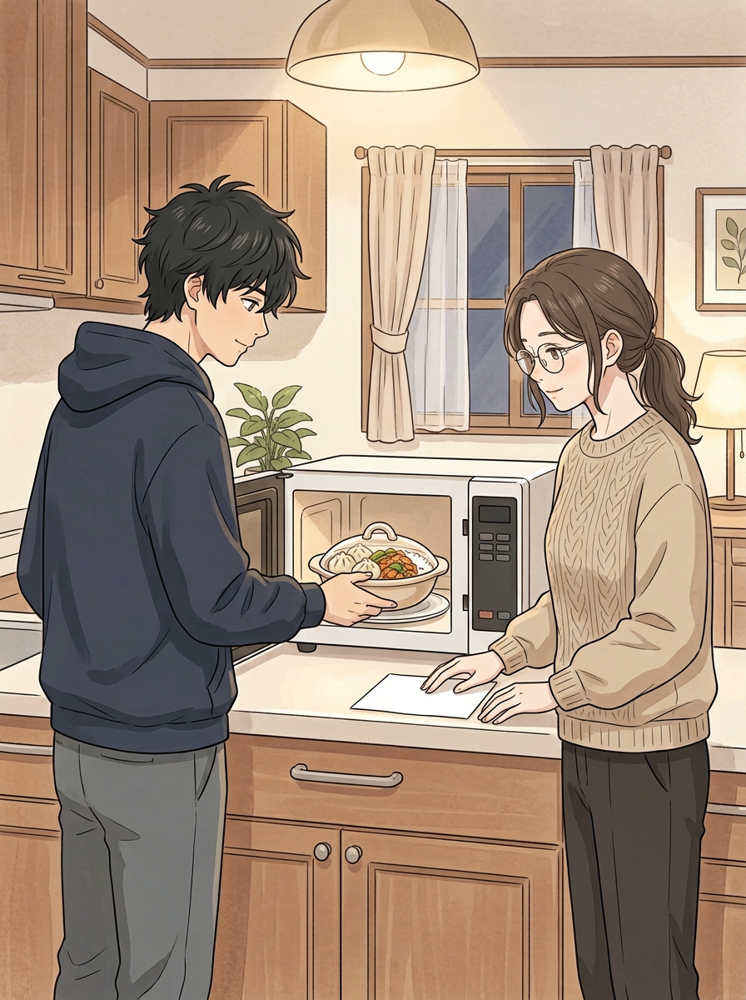
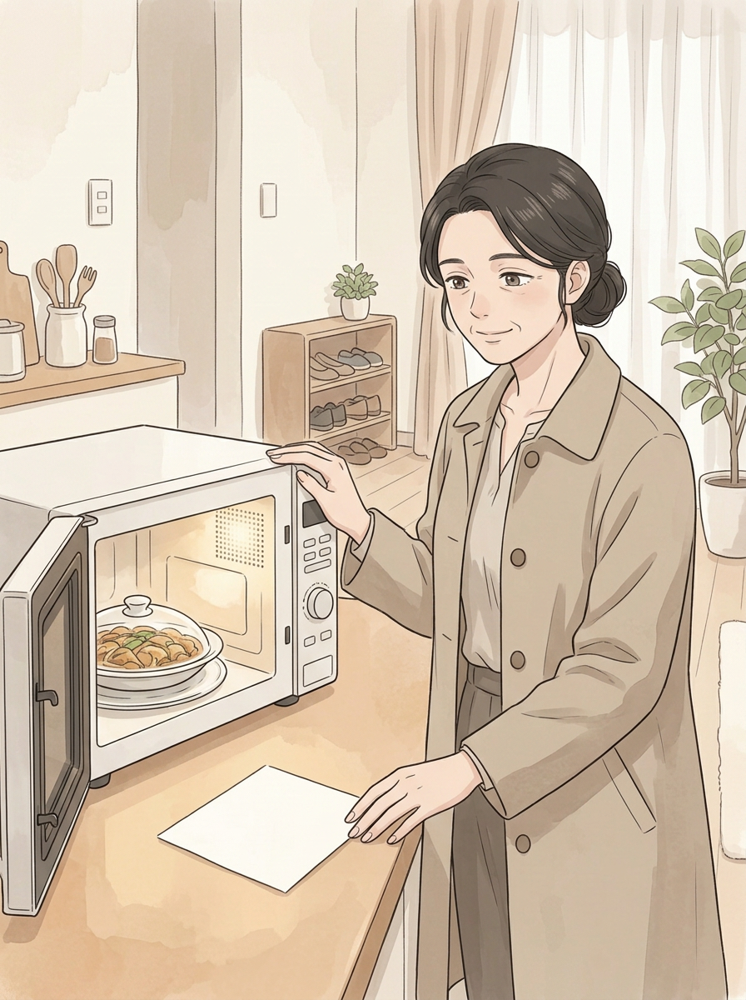

# 第七话｜丰盛的中餐 · 原画制作中

> 这是新一轮原画草稿，不是成品：封面及02–07本轮重生，01沿用上轮；对白、纸条、页码和封面标题尚未排入。具体剧情和对白候选见 [分镜草案](../../docs/第七话_做饭_剧情分镜草案.md)。旧版保留。

## 封面｜一起准备晚饭

## 01｜妈妈有事，二弟接下晚饭

## 02｜姐弟一起准备

二弟用锅铲炒番茄鸡蛋，旁边是独立的汤锅；姐姐洗菜。

## 03｜妹妹看手机，小满摆碗

## 04｜中餐出菜

有鱼、番茄鸡蛋、青菜、汤和另一道菜；同时有两盘青菜，与下一页菜盘数量需再核对。

## 05｜大餐桌上的晚饭

大餐桌有鱼、番茄鸡蛋、青菜、汤和米饭；04多出来的菜盘在此页看不见，连续性待处理。

## 06｜留饭和纸条

补画二弟和姐姐为妈妈留饭的过程。纸条暂时空白；留饭里出现包子和其他配菜，与前页及下一页食物不完全一致，需要返修。

## 07｜妈妈回家

妈妈不再穿围裙，看到微波炉里的晚饭和空白纸条。与06的餐具、食物和微波炉按键外观不一致，需统一；纸条待精确排字。
