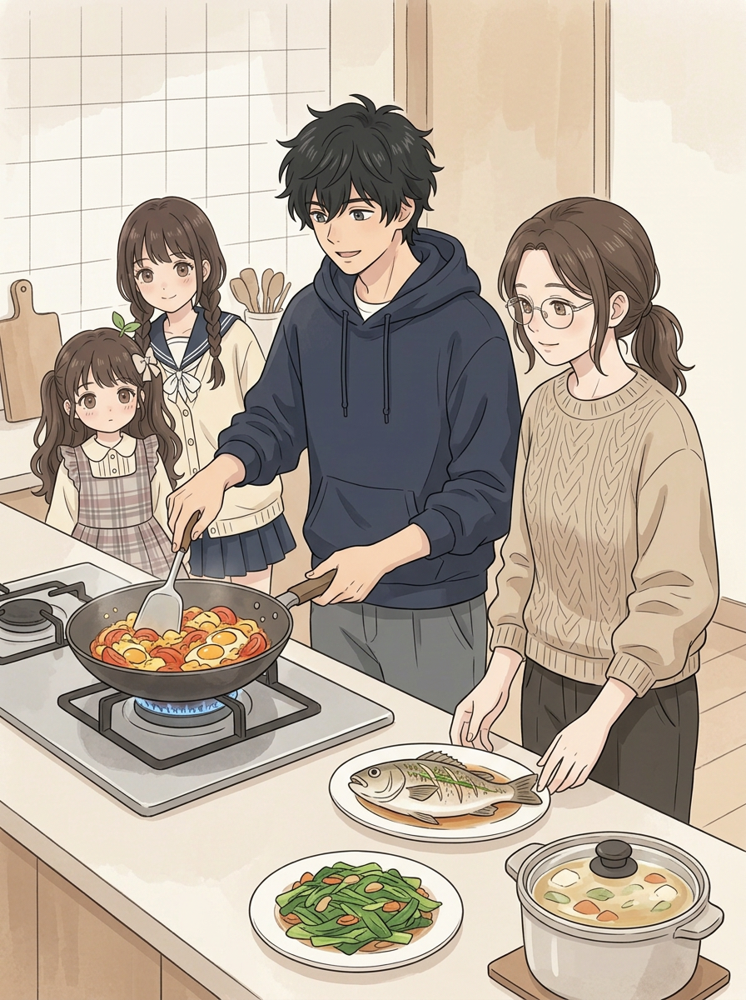
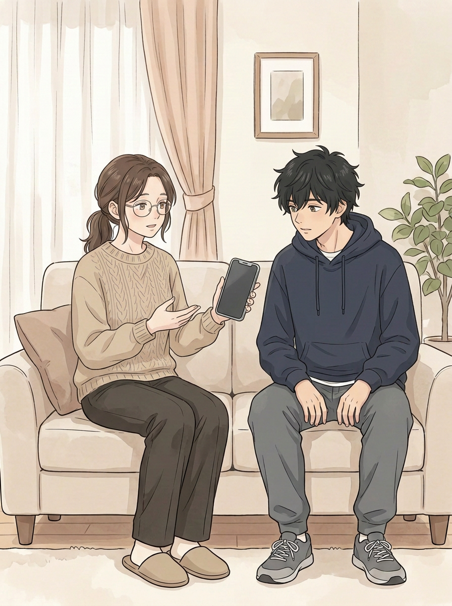
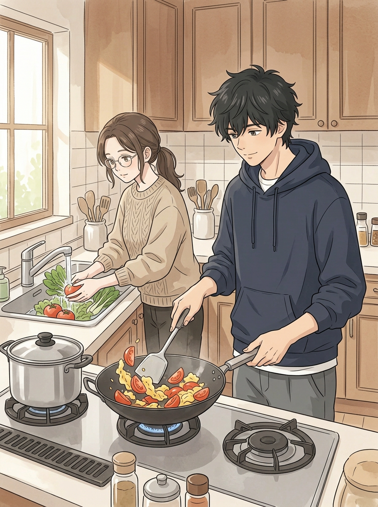
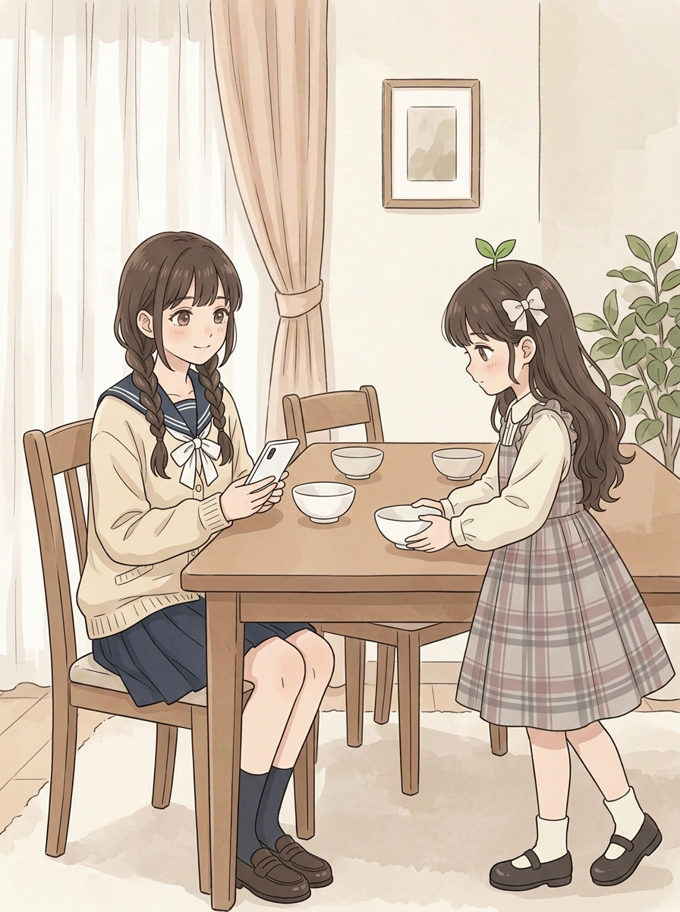
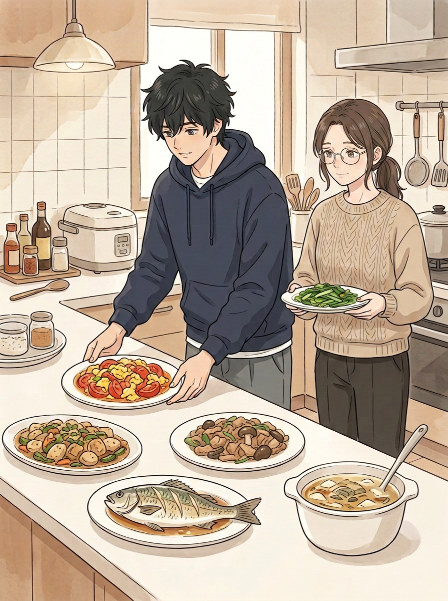
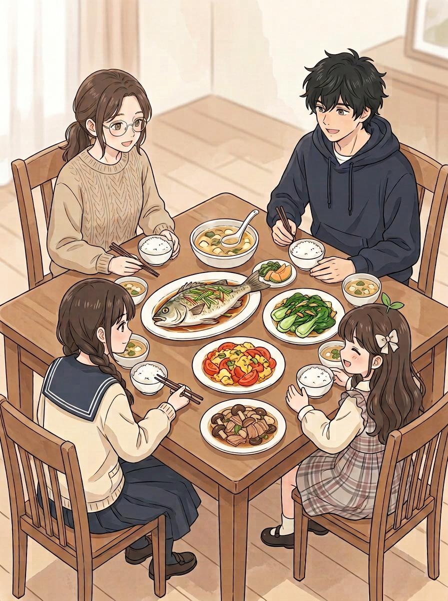
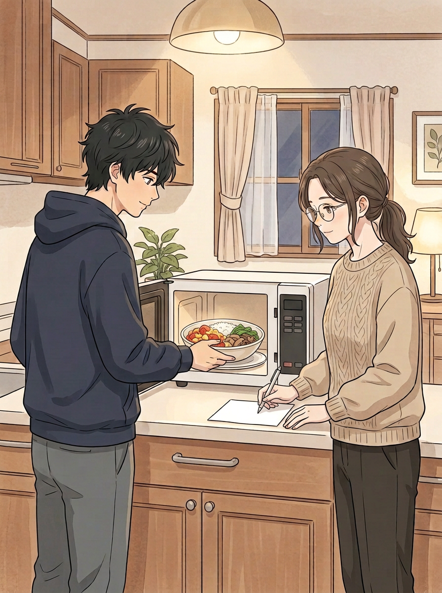
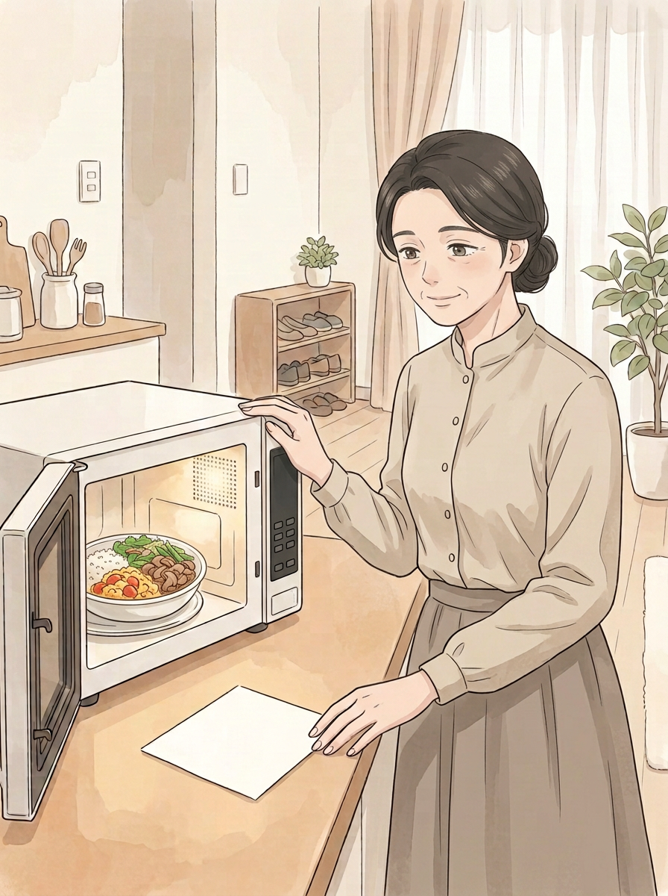

# 第七话｜继续制作检查稿（未完成）

> 无对白、纸条文字、页码和标题。封面及01–03沿用前稿；04、05、06、07为本轮新生候选。未覆盖旧版。此稿仍需修整，非成品或验收结论。

## 封面（沿用v2，发型待复核）

## 01｜妈妈有事（沿用v1）

## 02｜炒菜和备菜（沿用v2）

## 03｜摆餐具（沿用v2）

## 04｜出菜（新候选）

二弟表情略有笑意，姐姐也有微笑；原图并不是完全不能用，但新候选更轻松一点。此图多出现两盘相似肉菜，下一页只有一盘，跨页需统一。

## 05｜四人晚饭（新候选）

四人和主要菜式都在，鱼、蛋、青菜、肉菜、汤分开，但长桌比例仍不够明确，不符合用户强调的明显长桌，还需重画。另一个[尝试](../../art/chapter-07-cooking-v3/shot-05.png)误生了两个小满，不能使用；[05-b](../../art/chapter-07-cooking-v3/shot-05-b.png)桌形与菜式也未达到要求。

## 06｜留饭和写纸条（新候选）

留饭改成米饭、番茄蛋、青菜、肉和蘑菇，纸条仍为空白，后期需准确排字。饭菜不宜长时间放置在未开启的微波炉里，时间安排可在剧情中明确。

## 07｜妈妈回来（新候选）

服装改得更接近妈妈人设的立领上衣与长裙，去掉围裙、外套；06/07的饭菜更接近，但碗和控制面板细节仍不完全相同，需统一。纸条空白、尚未排对白。
