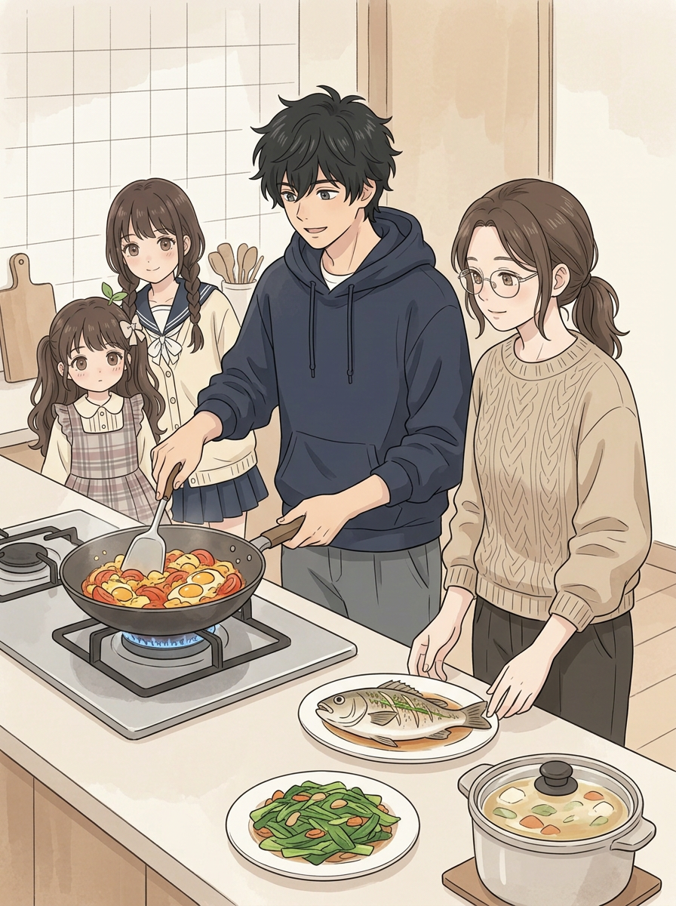
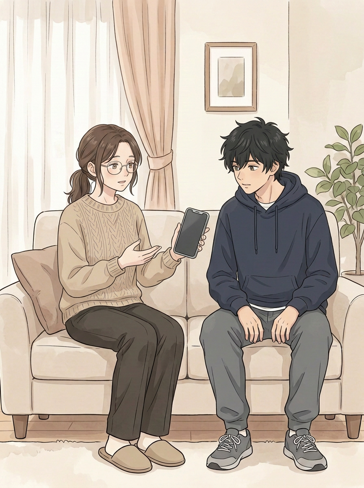
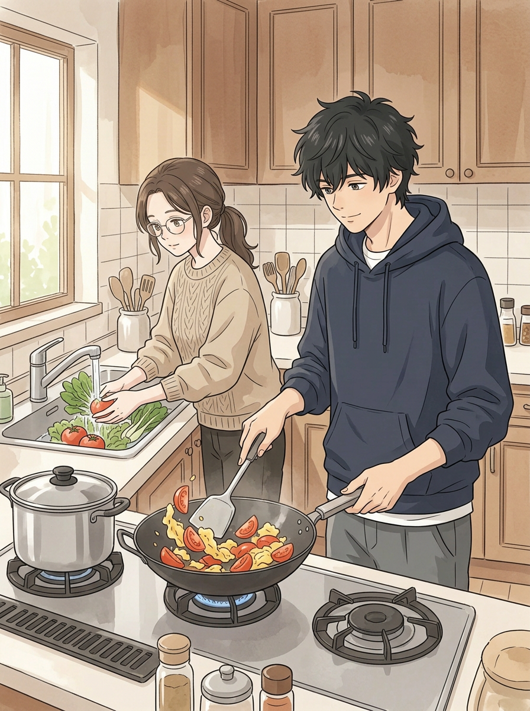
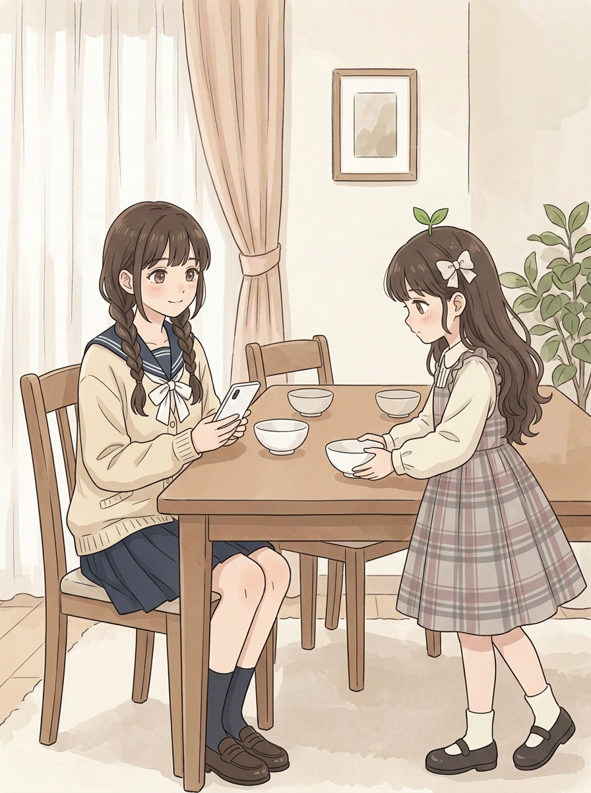
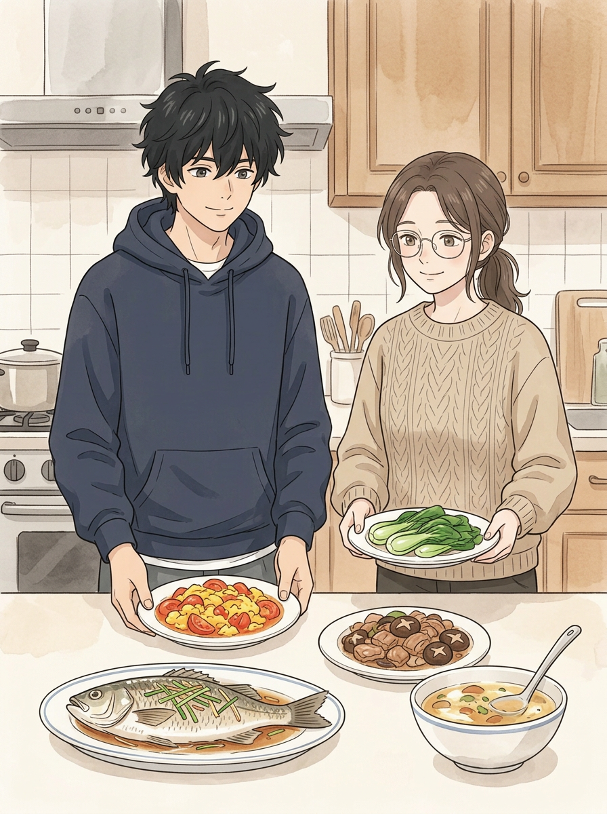
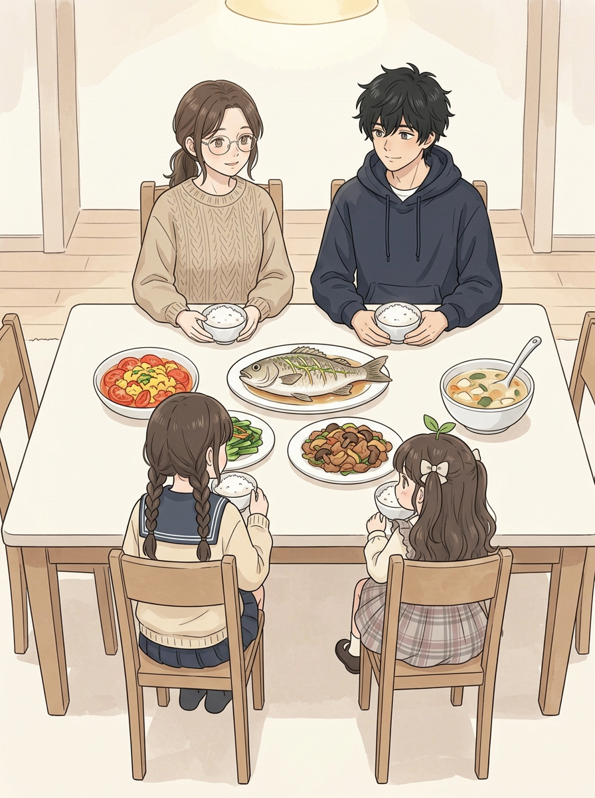
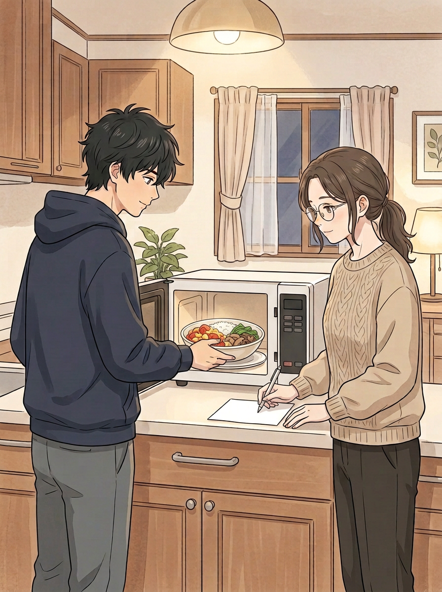
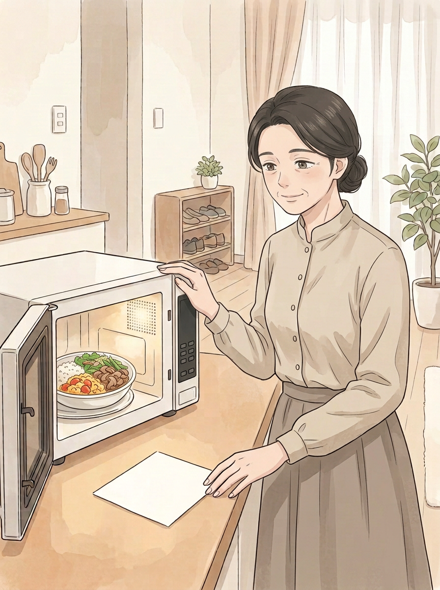

# 第七话｜长桌与出菜修画进行中（不可验收）

> 用户要求四人，两人坐一边、两人坐对面。04和05为本轮新生候选，其他图沿用已记录的前稿；只是制作进度，不是最终稿，也没有对白、纸条、页码与封面标题。原图和此前候选均保留。

## 封面（v2）

## 01｜妈妈有事（v1）

## 02｜掌勺与帮厨（v2）

## 03｜摆餐具（v2）

此页桌子为木色，05候选桌面是白色，材质和颜色尚未接上。

## 04｜出菜（v4-v2，新候选）

四道菜及汤分开，人物各有两只持盘手，汤有汤勺。相对v4-v1不再出现画外额外手，也去掉重复肉菜。

## 05｜四人长桌（v4-v2，新候选）

画面里仅四人：姐姐、二弟坐同一长边，妹妹、小满坐对面长边。五道餐食可见，无重复小满；人物手和腿部分被身体、碗、座椅遮挡，不能据遮挡断言结构全对。与03桌面颜色、06/07器具仍须统一；背景线和风格需继续比较。

## 06｜留饭（v3）

## 07｜妈妈回家（v3）

纸条为空白；微波炉控制面板、餐碗样式与06尚不完全一致，待修。
