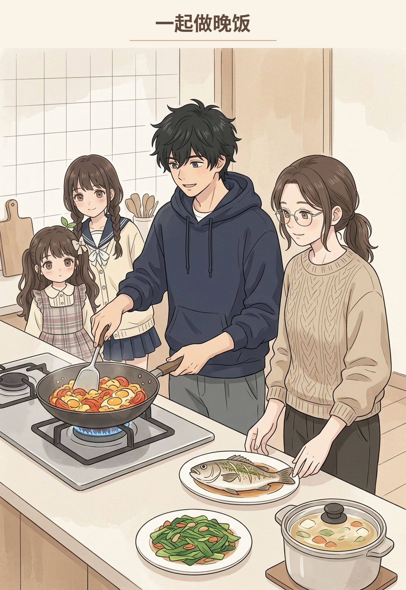
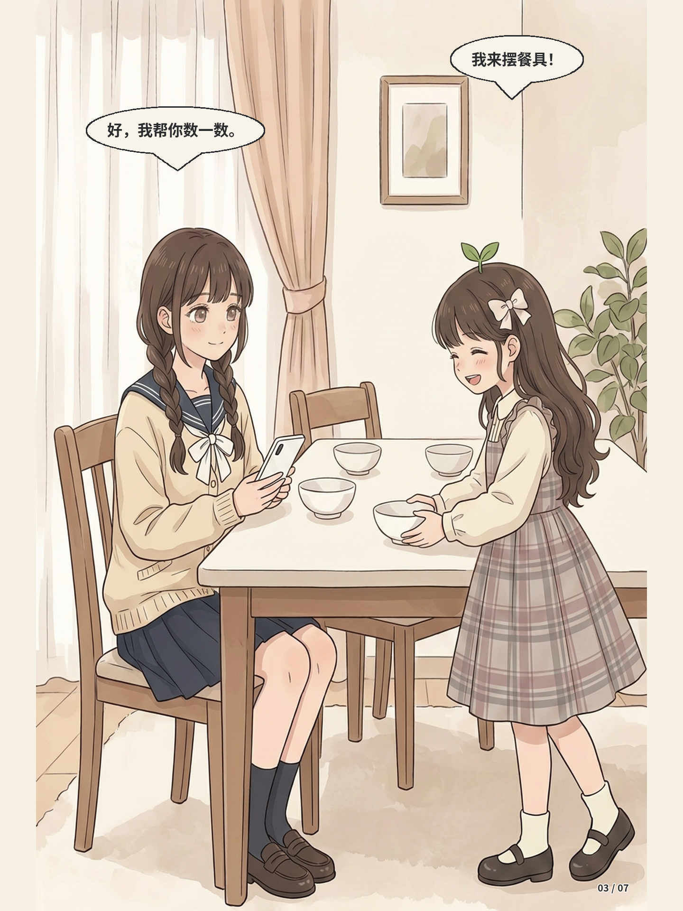
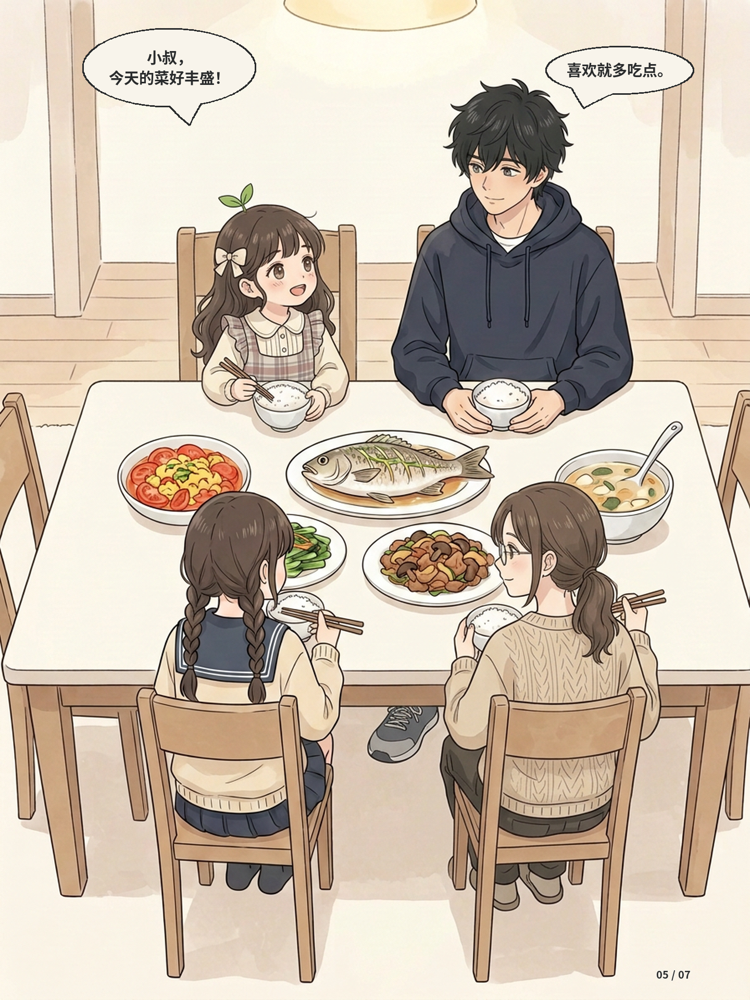
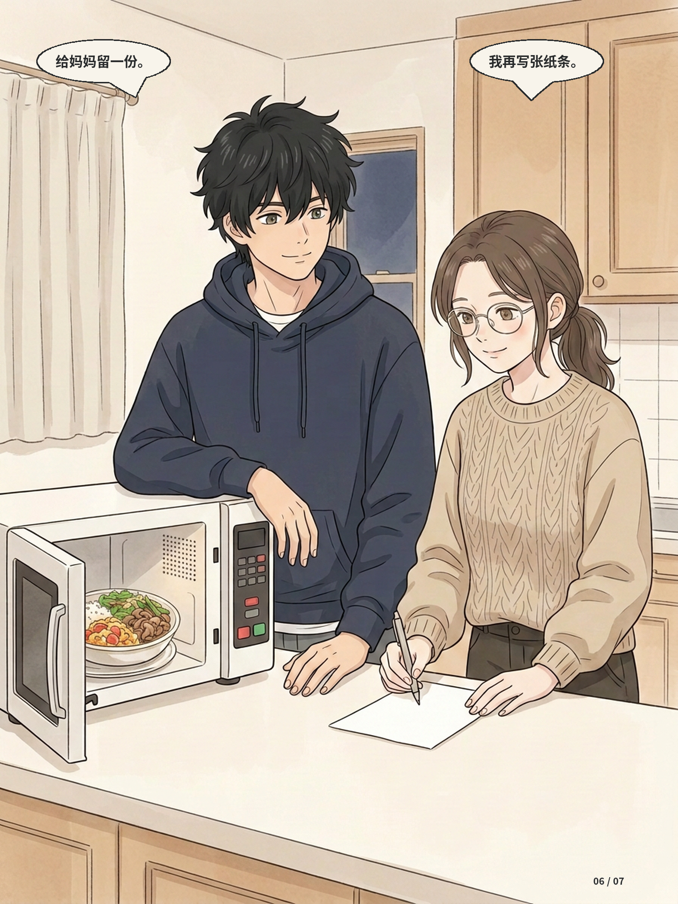
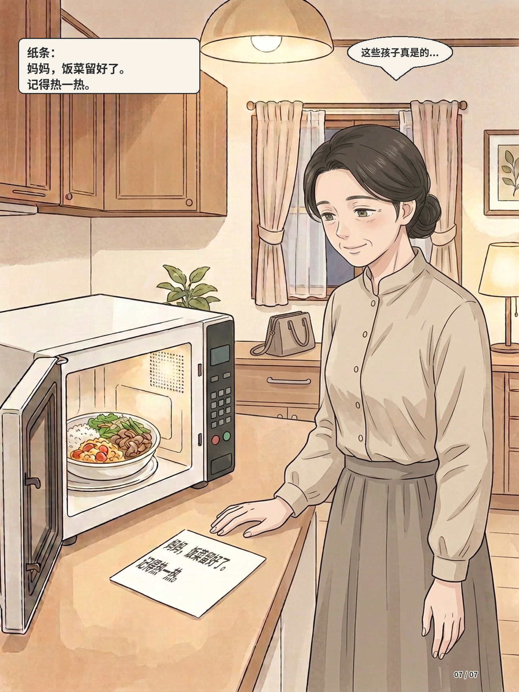

# 第七话｜v7 用户确认版

> 用户在审阅本版与邻居姐妹身高对照后回复“好了，可以定型了”，按本轮交付整体确认记录：第七话以本 v7 图文为准，封面标题《一起做晚饭》，第03页微笑及摆碗姿态采用本版。01、02、04—07页直接沿用v6图源。PDF文件名和内部元数据保留原样。

## 封面

## 第01页

## 第02页

## 第03页

## 第04页

## 第05页

## 第06页

## 第07页

