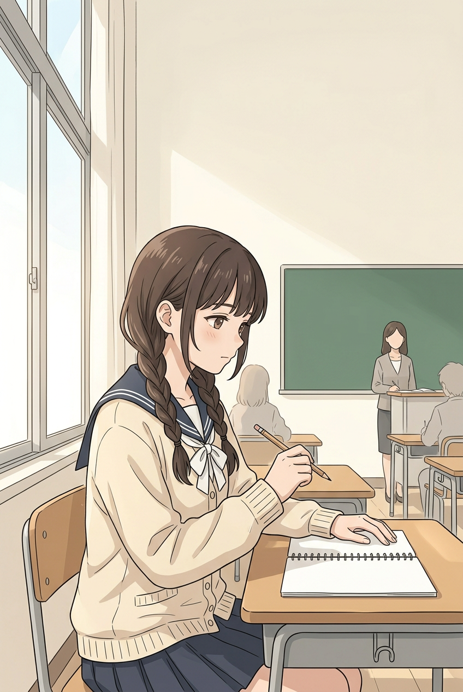
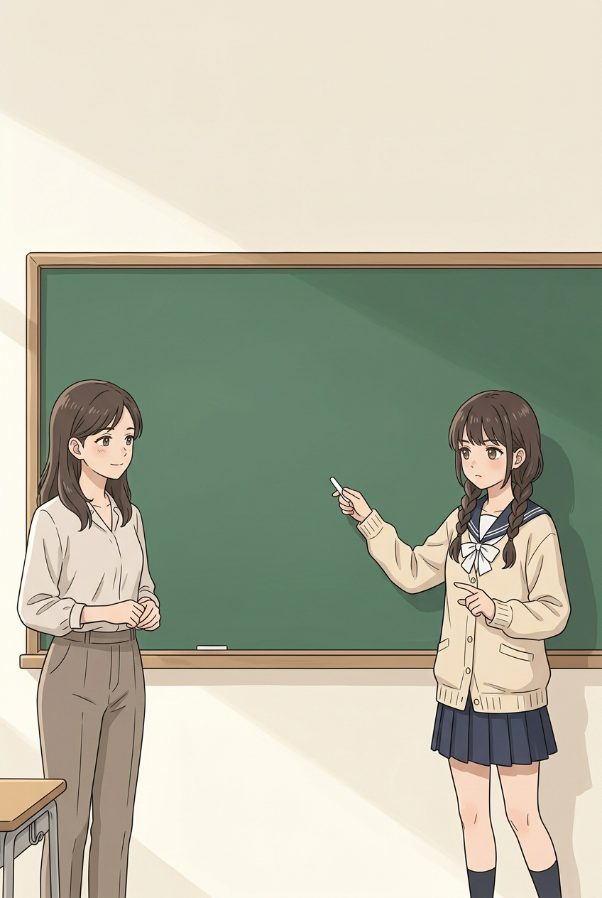
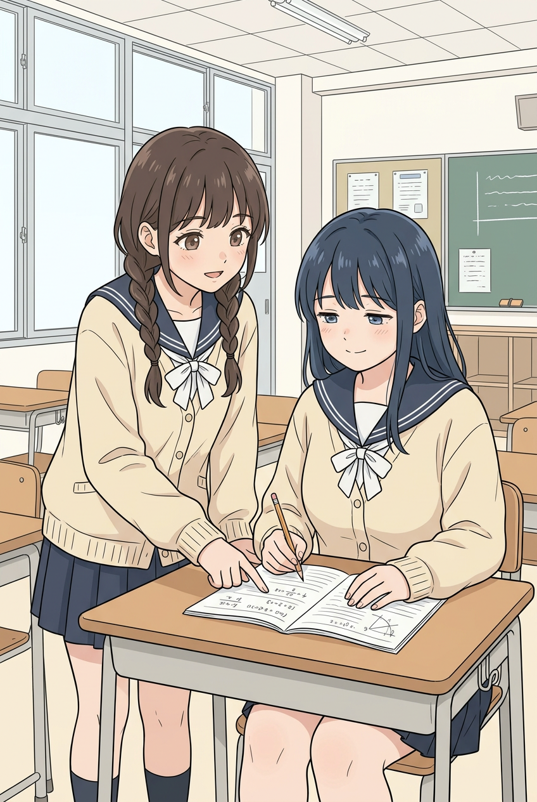
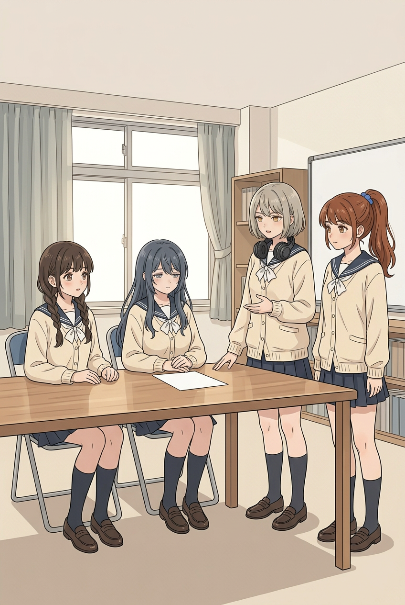
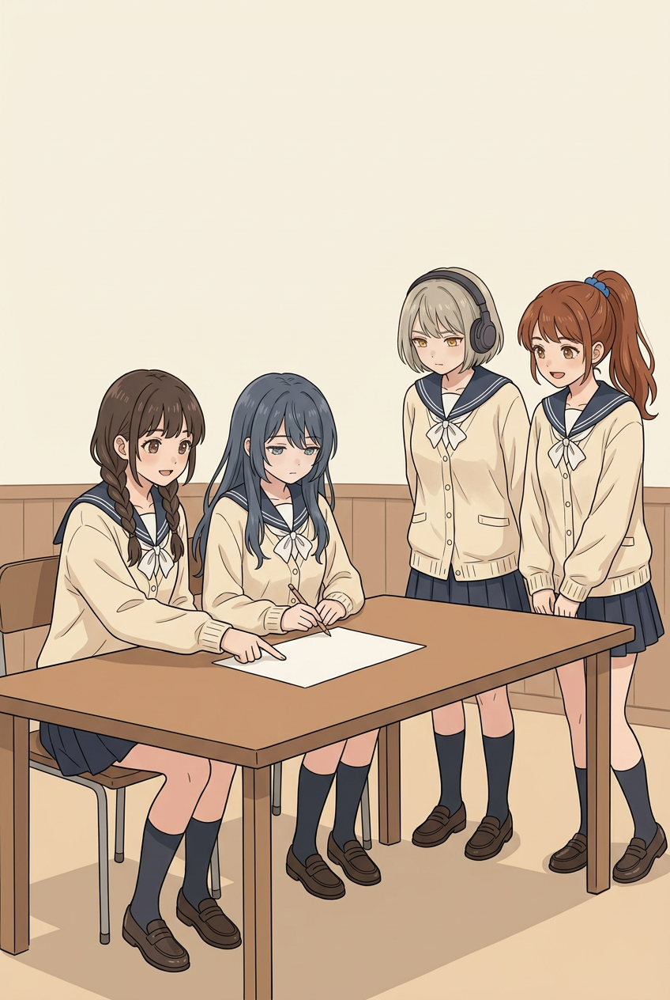
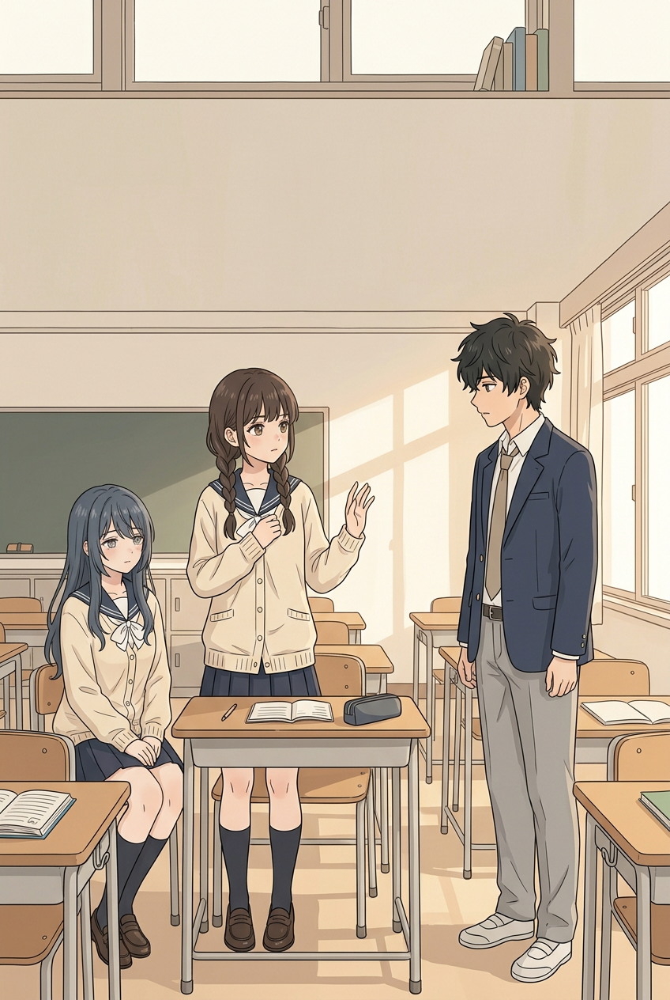
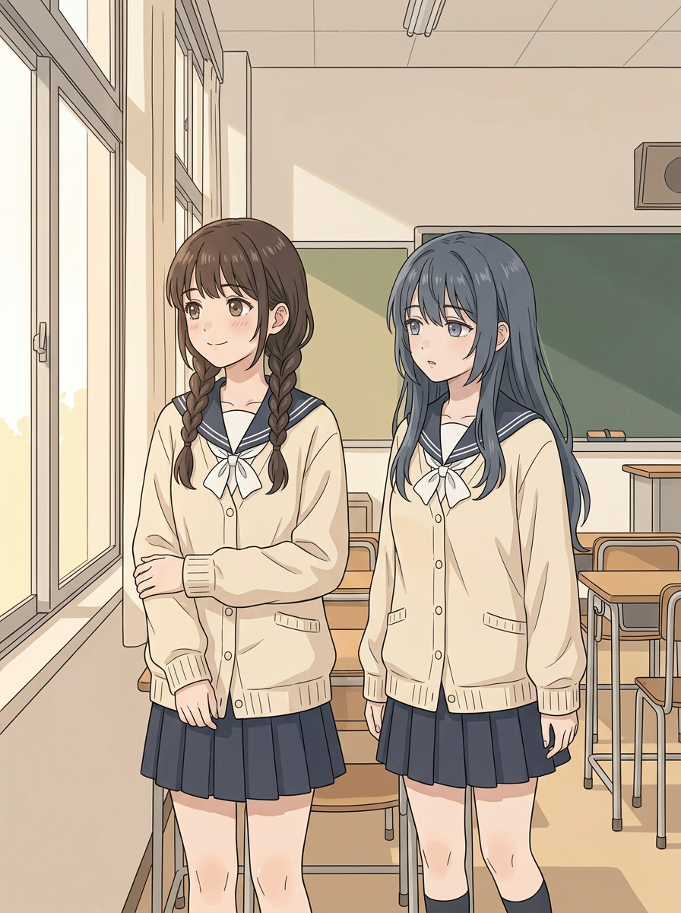
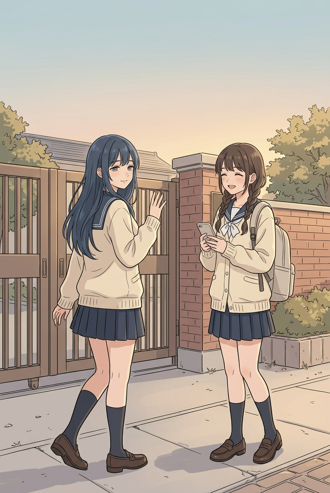
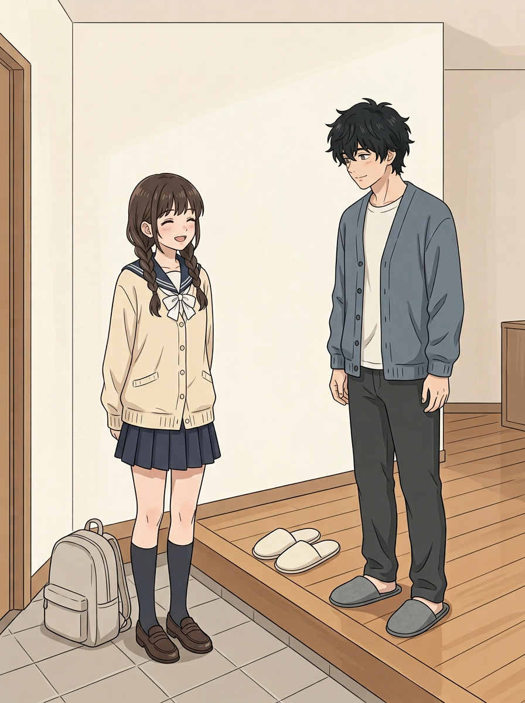
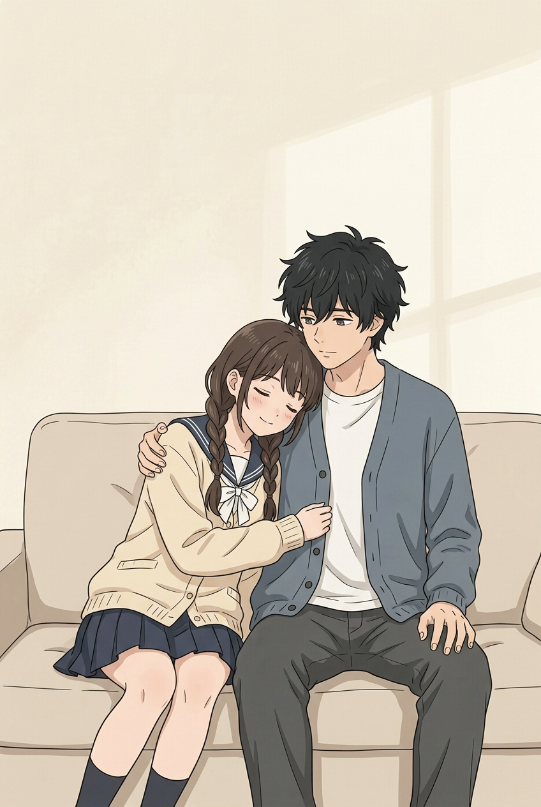

# 第八话｜整话重置工作稿

> **工作稿，未完成，非正式排版漫画。** 用户要求优先完整优化第八话，并明确原01画风仍不对、要完整重置。本轮01从已认可漫画画风图和妹妹原人设出发重新构图，**没有使用此前01原画或01候选作底图**；能否达到用户想要的画风仍由用户判断。封面与以下14页是完整剧情方案，不是已经全部画好、排好字的14页。新人物名字与背景、标题、对白均未被用户最终确认。10张新图为无字草图，不覆盖v2或已确认内容。

## 全话锁定条件

- 同校四位女生穿同款奶油开衫、深蓝水手领、白结、深蓝裙；好友蓝黑长发、困倦眼神、娇小自然丰满，以[用户认可立绘](../../art/角色形象区/妹妹好友_参考与候选/新同学_体型优化试案.png)为基准。会长灰金短发戴耳机、委员栗红高马尾蓝发绳是候选，学生会固定四名女生。
- 画风对照用户认可漫画，人物脸、黑发双辫和体态跨场景稳定；二哥穿蓝灰居家开衫时仍应有其穿衣显瘦、自然健身的体态。下页的候选存在问题，不能以生成成功当作验收。
- 校园能力与朋友共同解决问题 → 妹妹对男同学冷淡而对哥哥温柔的反差 → 放学道别 → 换鞋回家拥抱 → 趴靠哥哥胸前轻轻吸气并分享；都是正常家庭亲情。书包、鞋袜及沙发位置需连贯。
- 正式字、公式和气泡后期排；画内生成的乱码不是正确题目。封面标题《妹妹的学校日常》仍为候选。

## 封面｜一起走向学校

[走路封面候选](../../art/chapter-08-v4/cover-walking-candidate.png)：两人脚一前一后，比原图更像走路，但步态仍同步、妹妹领口被书遮挡，画风和好友身材需用户判断；未经确认，暂不作为成品。

## 01｜课堂：先想一想

老师出题，辰希坐在窗边思考，先用自己的草稿整理思路。老师先说、妹妹思考，不要让画面阅读顺序颠倒。

**老师**：“这道题，谁有思路？”

**黑板题目（后期准确排版）**：已知 x＋y＋z＝6、xy＋yz＋zx＝11，求 x³＋y³＋z³－3xyz。

**实看状态**：独立重新构图；背景老师脸部没有五官，不能作为正式页；黑板与草稿空白，题目和对白还未排。笔附近两手可见，腿脚在画外。妹妹侧脸及线条是否符合认可画风需用户判断；不能声称已修好。

## 02｜讲出关键思路

辰希走到黑板前说明解法，老师听完回应，展现她的聪明和从容，而不是只写出答案。

**辰希**：“先用恒等式变形，再代入已知条件，答案是十八。”

**老师**：“思路很清楚，大家记一下这个变形。”

**板书（后期准确排版）**：x³＋y³＋z³－3xyz＝(x＋y＋z)[(x＋y＋z)²－3(xy＋yz＋zx)]＝6×(36－33)＝18。

**实看状态**：黑板留白可后期排公式，但老师外貌、服装与01远景不一致，需统一；妹妹鞋脚未入画，不能确认全身。

## 03｜好友问思路

下课后好友打开本子，辰希放慢速度讲解，好友自己动笔。

**好友**：“这里我没跟上，你怎么想到这样拆？”

**辰希**：“先看式子的结构，试试这个恒等式。”

**实看状态**：制服相同、好友上身轮廓可见，但与认可立绘体型是否一致待用户判断；本子有生成的数字与图案，数学内容不可直接使用。放大手部：各自手袖大体可追踪，妹妹另一只手与好友手臂靠近有遮挡；双腿与鞋被裁切或遮住，不能判断完整比例。

## 04｜好友自己完成

好友独立做一道同类题，辰希肯定她的解题方法；随后两人收拾笔记，准备去学生会。

**好友**：“这道我自己做出来了。”

**辰希**：“对了，你整理得也很清楚。”

**数学备选**：若 x＋y＋z＝3、xy＋yz＋zx＝2，同式的值为 3×(9－6)＝9；可只在笔记上后期排出简短步骤。

**画面状态：缺图。** 不能将03讲解画面冒充好友独立完成的新画面。

## 05｜午休：学生会讨论

字幕建议：**午休·学生会室**。四位成员都在，会长说明三个社团各用教室十分钟，时段12:10至12:40；委员补充音乐社12:30前结束、绘画社12:20之后才到。

**会长**：“三个社团各用十分钟，从十二点十分开始。”

**委员**：“音乐社要在十二点半前结束，绘画社十二点二十之后才到。”

**实看状态**：四人可辨、制服一致，会长耳机在颈部；好友坐姿与桌面影响体型判断。桌边的手和腿可见部分需与局部遮挡区分，不能据此断定全部肢体合格。

## 06｜四人一起解决

辰希提出音乐、手工、绘画的顺序；好友把表整理清楚，会长核对，委员准备通知各社团。

**辰希**：“音乐先、手工第二，绘画最后，时间就不冲突。”

**好友**：“我把时间和标记整理清楚。”

**具体可行安排**：音乐12:10—12:20；手工12:20—12:30；绘画12:30—12:40。满足绘画社“12:20之后才到”的限制，不将12:20边界混成“之后”。

**实看状态**：好友自然轮廓和四人分工需要进一步核对；放大图可见妹妹指纸、好友持笔及另一只手，局部靠近但不将遮挡自动视为错误。**明确连续性差异**：与05相比房间、桌椅变了，会长耳机从颈部变为戴在头上；需统一后再用。

## 07｜安排收尾

会长确认结果，委员主动去通知，辰希和好友收拾桌面准备回教室。四人各有贡献，不只让别人称赞辰希。

**会长**：“好，就按这个安排。”

**委员**：“我去通知三个社团！”

**画面状态：缺图。** 与05、06使用同一间学生会室、同一张安排表、同一套服饰及耳机位置。

## 08｜下午：冷淡拒绝

男同学向辰希发出邀请，她态度冷淡而明确。好友在旁，气氛不夸张。

**男同学**：“放学后一起去买饮料吗？”

**辰希**：“不了，我要回家。”

**实看状态**：妹妹和好友同款校服。男同学的黑发和脸与二哥较接近，有混淆风险，需改为可辨的不同人物；好友坐姿与衣服遮挡，体型仍待对照立绘。

## 09｜想念哥哥

转入课间，两人谈话，妹妹对哥哥的想念与刚才的冷淡形成反差。

**好友**：“你这么急着回去，是想见二哥了？”

**辰希**：“嗯，今天特别想他。”

**实看状态**：表情有变化，同款校服；两人站在近似位置时头顶高度相近，好友较矮的特征不明确，脚在画外；好友身形轮廓偏直，须重做或调整。

## 10｜放学：发消息、道别

字幕建议：**放学后**。妹妹给二哥发消息，得知他在家后与好友告别。好友继续自己的归途，这一话不与哥哥见面。

**辰希发消息**：“二哥，你今天在家吗？”

**哥哥回复**：“在家。路上慢点，等你回来。”

**好友**：“明天见，路上小心。”　**辰希**：“嗯，明天见！”

**实看状态：不采用为正式页。** 好友在画面中看起来比妹妹高，不能表现用户要求的娇小身高；背影遮住好友正面体型。妹妹的米灰书包需与回家页同一个款式；手机信息要后期准确排字。

## 11｜到家：先换鞋

妹妹在玄关放下书包，哥哥在室内迎接。她先脱室外鞋、换室内拖鞋，再进屋；鞋履与下一页衔接。

**哥哥**：“回来了？”　**辰希**：“二哥！”

**实看状态**：两只棕鞋在妹妹脚上，哥哥脚上两只灰拖，地上另一双浅色拖鞋；目前仍是准备换鞋，不是已经换完。书包外形与10页仍需统一；此页的画风与人物脸由用户判断。

## 12｜拥抱，进屋坐下

穿好拖鞋、放稳书包后，妹妹在客厅抱住哥哥，哥哥自然接住她，再一起坐到沙发上。

**辰希**：“今天在学校就一直想你，好想快点回来抱抱你。”

**哥哥**：“那就多抱一会儿。先坐下吧。”

**画面状态：缺少适配新玄关及新沙发的最终画面。** 可参考[此前站着拥抱的无字图](../../art/chapter-08-v2/scene-09.png)，但其衣领、沙发与新图不完全相同，不能直接宣布衔接正确。必要时补一小格换鞋或坐下，不把中间动作误说成已画出来。

## 13｜靠着二哥

妹妹坐在沙发上，脸颊贴着二哥上胸，轻轻吸气撒娇；哥哥自然回应。

**辰希**：“（轻轻吸气）二哥，让我再靠一会儿。”

**哥哥**：“好。”

**实看状态：动作未达要求。** 放大后看妹妹主要靠在哥哥肩头、脸颊贴上胸不明确；吸气也需要依靠后期文字或明确动作表达。另一只手被身体遮挡，不能断定对错；沙发与12页需一致。不能当作已完成的胸口动作。

## 14｜分享学校的一天

坐好后，妹妹向哥哥说起解题、好友的进步和学生会四个人的分工，哥哥认真听她讲。具体剧情不把学生会新成员与哥哥的初次见面提前发生。

**辰希**：“今天我解出一道题，朋友也自己做出来了。学生会的事，我们四个人一起安排好了。”

**哥哥**：“听起来很充实，慢慢讲给我听。”

**辰希**：“好，不过先让我再靠一会儿。”

**画面状态：缺图。** 需延续13同一沙发、同一服饰及表情动作，不能仅凭文字宣布画面已完成。

## 下一步：仍只处理第八话

1. 先修掉01无脸老师，并继续对照已认可画风；01与02统一老师、教室和精确板书，达到可验收程度再请用户判断。旧01及上轮01候选不再作为底图。
2. 以认可好友立绘重做09、10的身高与自然身形，并补04好友独立解题；校服四人一致、人物各有特征。
3. 统一05—07学生会室、桌椅及耳机位置；补会议收尾。男同学不画成二哥同脸。
4. 统一10—14背包、鞋履、沙发，补换鞋/站立拥抱/坐下的衔接；重做13明确脸颊贴上胸，再补14分享。
5. 仅在图像逐张实看且合适后做气泡与正确公式排版、整话相邻页检查，再生成阅读版和PDF。当前10张新图的尺寸不同，不能直接按旧脚本强裁；须做不损失主体的排版适配并人工复核。

本轮图片生成达到10张上限；04、07、12、14缺画，新候选也仍有上述问题。全话优化尚未完成，不能将此工作稿当成正式交付或用户验收通过。
