# 第八话｜整话分镜工作预览

> **未完成、未经用户验收**。此预览将现有候选按故事顺序串起来，除01、02外对白写在图片下方，**并非已排好的正式漫画**；标题、对白、新成员设定和画风仍待裁定。新增抱起的分镜后暂为封面＋16页。所有图都保留原图；考拉抱及脸颊贴胸的要求尚未画清楚，均不算完成。

[本轮检查和待办](本轮检查与下一步.md) · [完整剧情方案](../review-chapter-08-reset-v1/第八话_整话重置工作稿.md)

## 封面｜一起上学

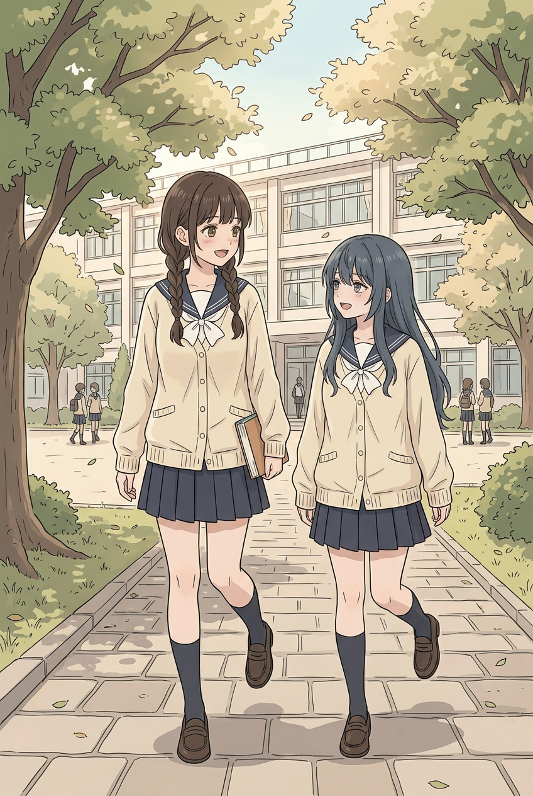

候选标题《妹妹的学校日常》。两人同款校服、领结可见，朋友个子较矮；两人抬脚姿态过于相似，是否像自然走路、好友身形和画风仍需判断。

## 01｜老师提出问题

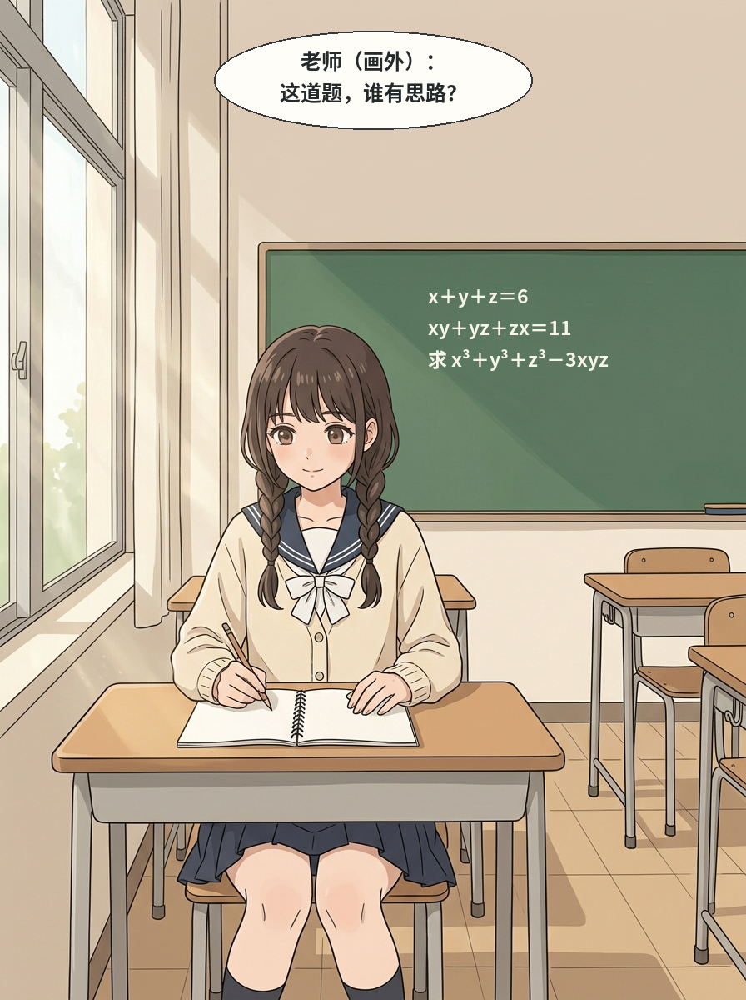

老师在画外；数学题和对白为后期排字。画风尚未经用户确认；空教室氛围需判断。

## 02｜辰希解题

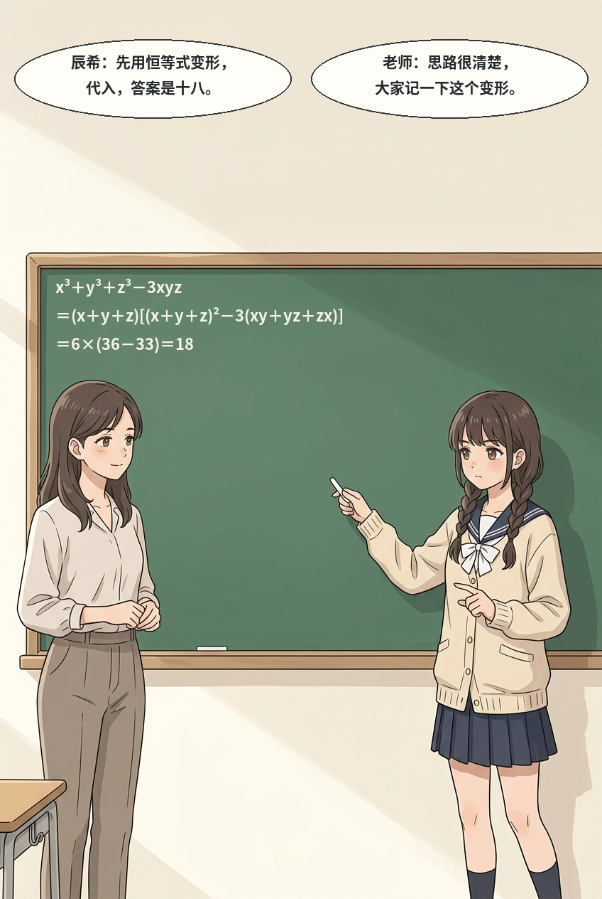

恒等式和答案18已核对。气泡未画尾，靠人名辨认，画面使用与01不同的原始画幅，尚未统一排版。

## 03｜好友请教

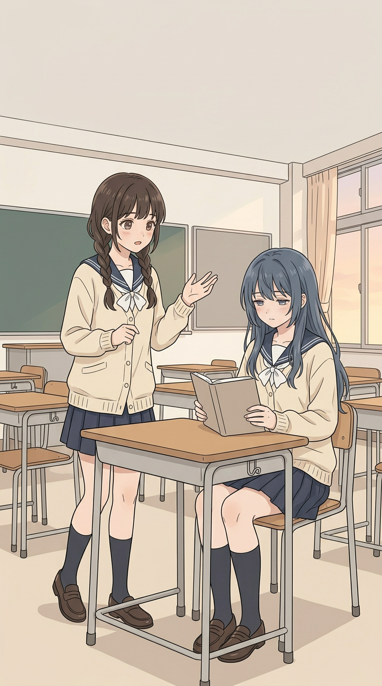

**好友**：这里我没跟上，你怎么想到这样拆？ 
**辰希**：先看式子的结构，试试这个恒等式。

好友拿开放书本，页内没有明显乱码；她部分身体被书与桌面遮挡，不能据此确认完整体型；窗外偏暖的光线与下一页需结合时间核对。

## 04｜好友自己完成

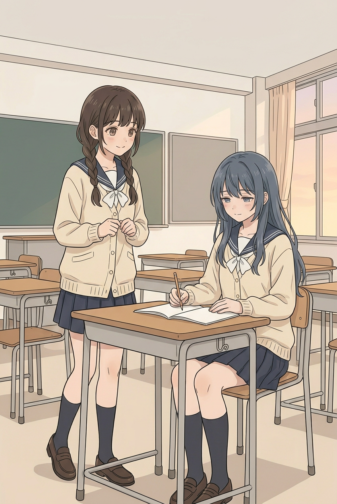

**好友**：我试着自己做这道。 
**辰希**：好，你慢慢来。

好友自己执笔，笔尖贴纸、纸面留白供后期写准确题目；此刻正在解题而非已经完成。两人坐站不同不用于判断身高；鞋子靠近画面底缘，正式适配不可裁切。是否达到认可体型须由用户判断。

## 05｜午休：学生会讨论

**会长**：三个社团各用十分钟，从十二点十分开始。 
**委员**：音乐社要在十二点半前结束，绘画社十二点二十之后才到。

四位都是女生，会长和委员形象仍是待确认候选。

## 06｜一起安排

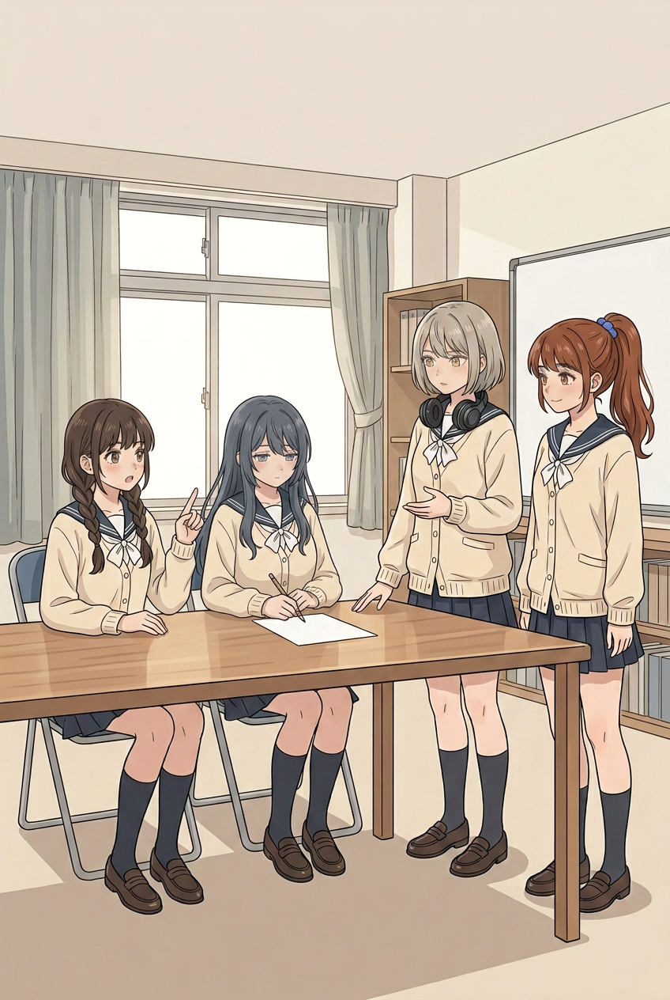

**辰希**：音乐先、手工第二，绘画最后，时间就不冲突。 
**好友**：我把时间和标记整理清楚。

安排为音乐12:10—12:20、手工12:20—12:30、绘画12:30—12:40，避免“12:20之后”边界歧义。纸上仍无正式排字。

## 07｜会议收尾

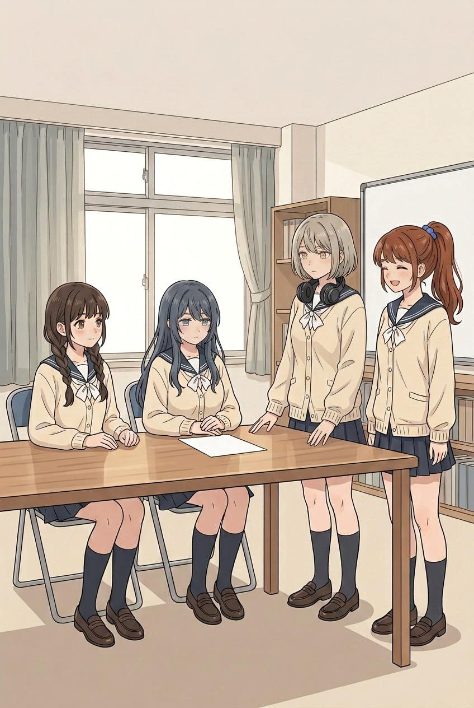

**会长**：好，就按这个安排。 
**委员**：我去通知三个社团！

本页只有桌上一张纸，委员说准备去通知，不再暗示手上拿着同一张纸；耳机在颈部。05—07构图相近，动作表现仍需检查是否太重复。

## 08｜下午：婉拒邀请

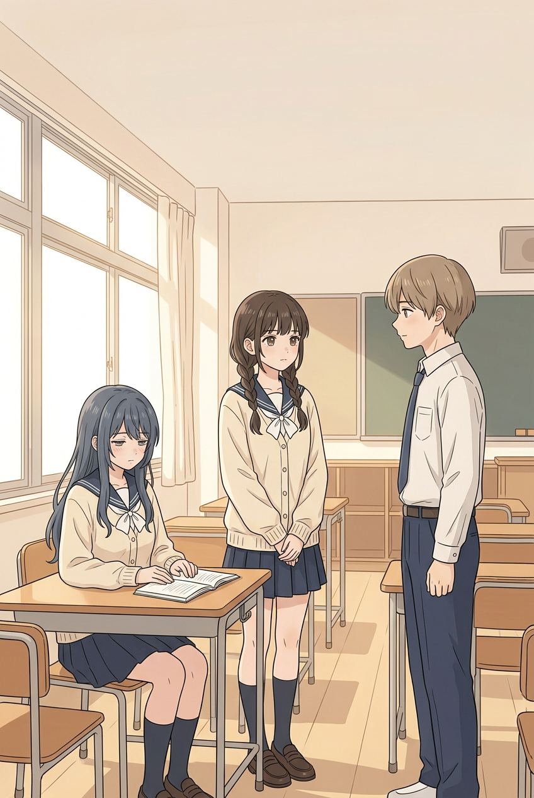

**男同学**：放学后一起去买饮料吗？ 
**辰希**：不了，我要回家。

男同学的浅棕发与二哥有区分；好友坐姿影响体型和身高判断。

## 09｜想念二哥

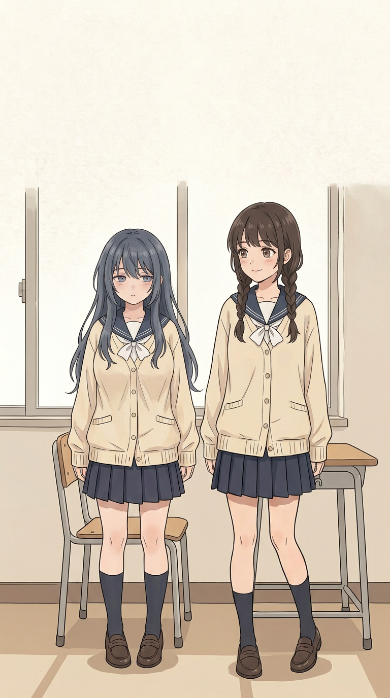

**好友**：你这么急着回去，是想见二哥了？ 
**辰希**：嗯，今天特别想他。

两人全身同地面，好友明显较矮且穿同款校服；好友朝向前方、两人互动视线不够明确，且好友体型是否达到认可立绘仍需判断。

## 10｜放学道别

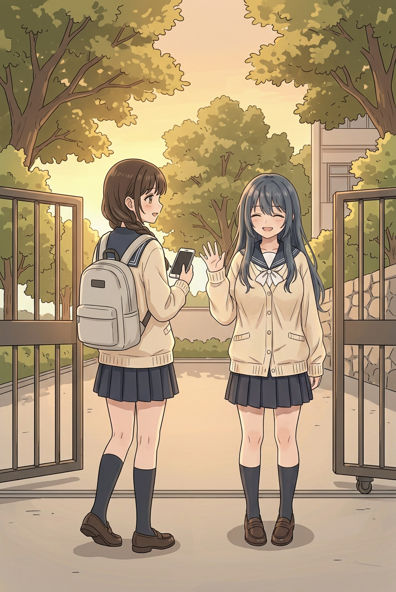

**辰希发消息**：二哥，你今天在家吗？ 
**哥哥回复**：在家。路上慢点，等你回来。 
**好友**：明天见，路上小心。 
**辰希**：嗯，明天见！

两人站位仍有前后差，好友看起来略矮，但不能据此确定身高比例；妹妹的灰书包正面口袋可见，需与玄关图对照。画外好友的书包是否携带仍待明确。

## 11｜回到家

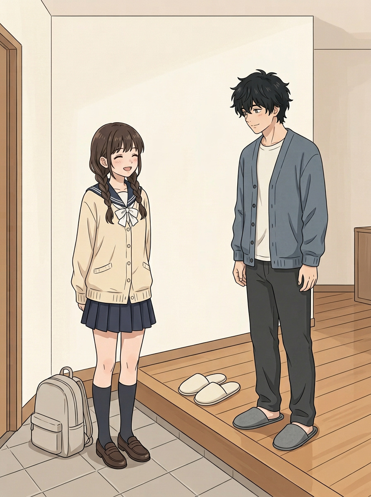

**哥哥**：回来了？ 
**辰希**：二哥！

妹妹穿室外鞋站在玄关，二哥穿灰拖；浅色拖鞋待换。

## 12｜脱鞋换拖鞋

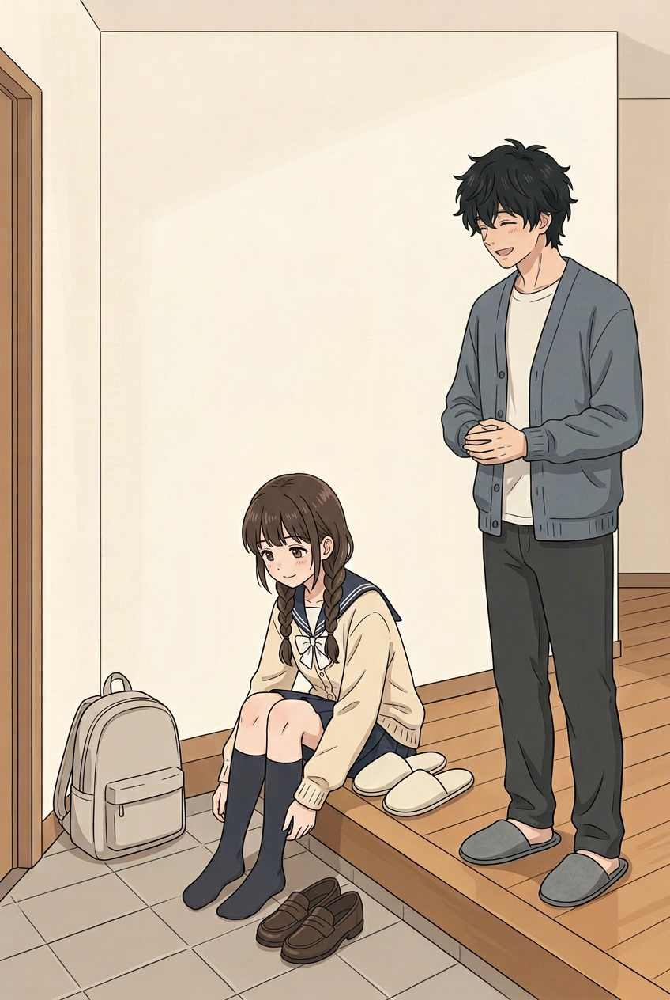

妹妹坐在玄关边，已脱下两只棕鞋，两只脚穿深色袜；一双浅色室内拖鞋放旁边，哥哥仍穿灰拖。这个画面补足11和13之间的换鞋过程；需核对相邻页空间、包和室内环境。

## 13｜想了一天的拥抱

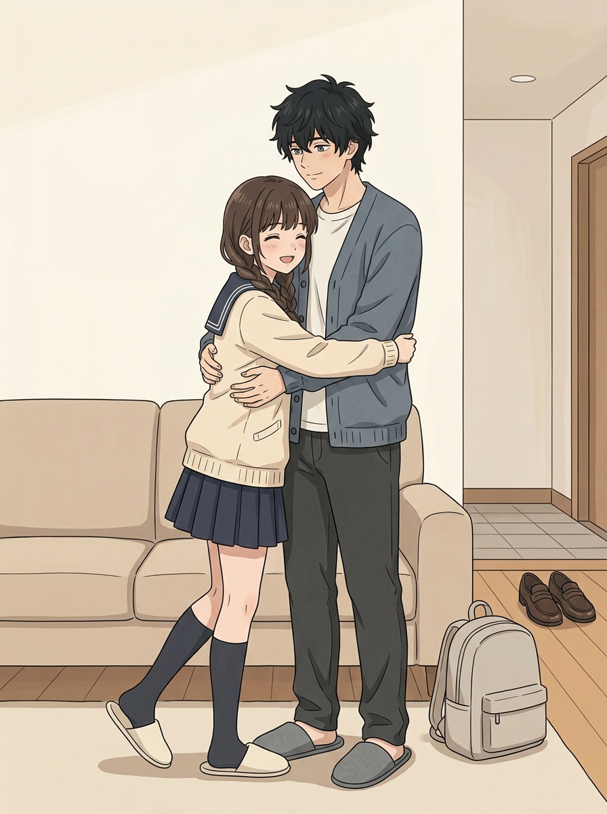

**辰希**：今天在学校就一直想你，好想快点回来抱抱你。 
**哥哥**：那就多抱一会儿。

妹妹换成浅拖、二哥仍穿灰拖；书包和鞋的位置与玄关图有变化，移动发生在画外；两人手臂部分遮挡，需要结合整图判断。

## 14｜考拉抱（动作待补）

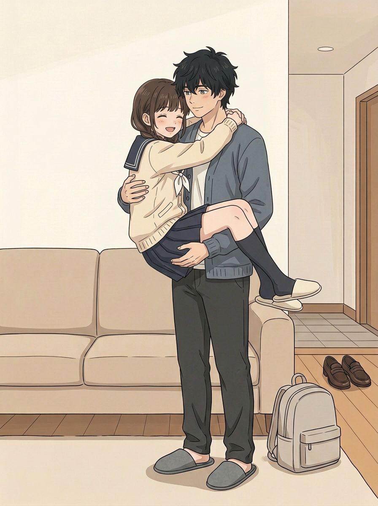

新要求：妹妹双臂抱住哥哥，双腿环在两侧，哥哥托住她，形成考拉抱，之后两人再到沙发上坐下。图中哥哥一手托住、一手护背，妹妹双腿朝同一侧，更接近横抱，**不是所需考拉抱**，仅作动作探索，不能定稿。其余试画及明确的多腿错误见本轮检查；抱起→放下坐好需要补清晰过渡。

## 15｜靠在二哥胸前

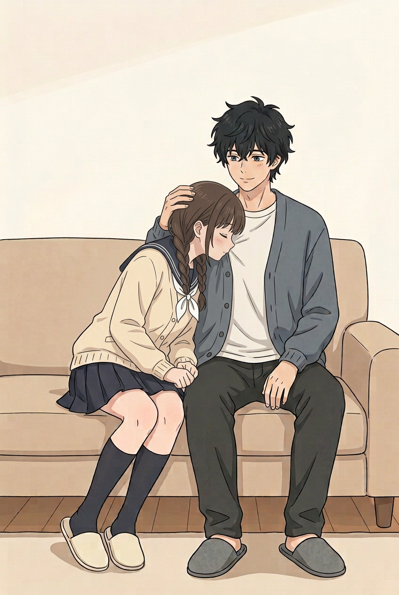

**辰希**：（轻轻吸气）二哥，让我再靠一会儿。 
**哥哥**：好。

**尚未达到明确要求**：放大后脸正面、鼻尖接近衣服，但脸颊贴上胸的接触点仍不清楚；表情与吸气需靠后期对白或进一步表现。白色领结已恢复，此图不能作为动作已修好的证据。

## 16｜分享校园日常

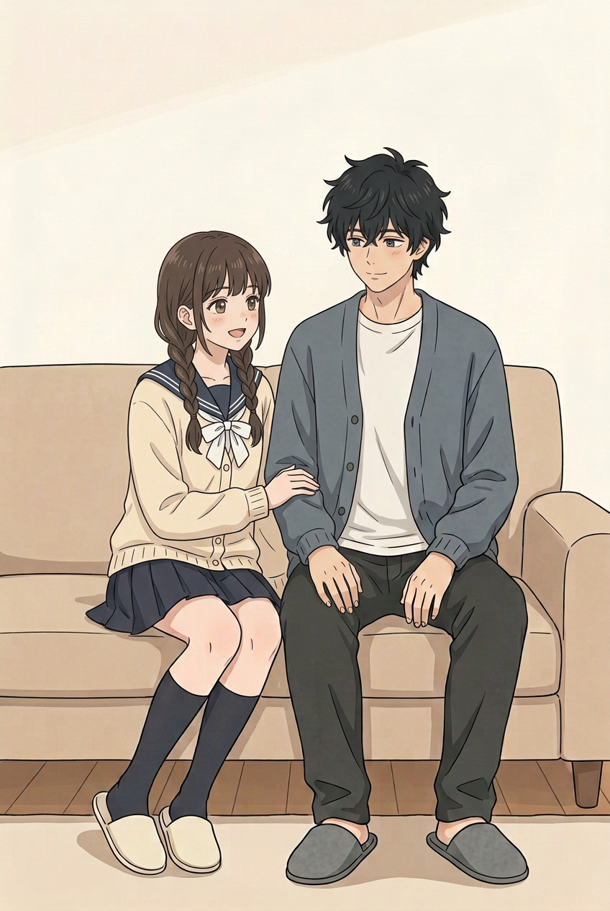

**辰希**：今天我解出一道题，朋友也自己做出来了。学生会的事，我们四个人一起安排好了。 
**哥哥**：听起来很充实，慢慢讲给我听。 
**辰希**：好，不过先让我再靠一会儿。

沙发、衣服与15的样式接近；两个不同时间的动作及转场仍需核对。之后仍需处理对话量、气泡布局及清晰读序。
