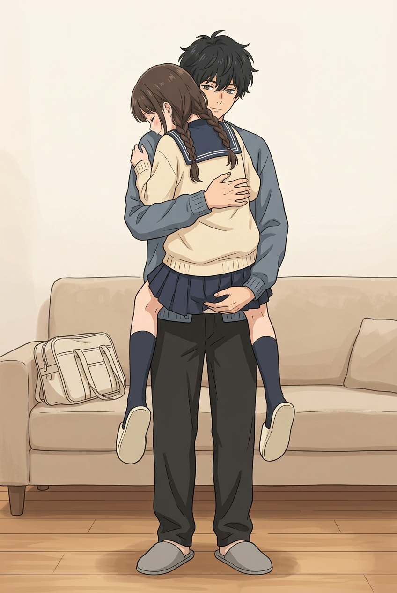
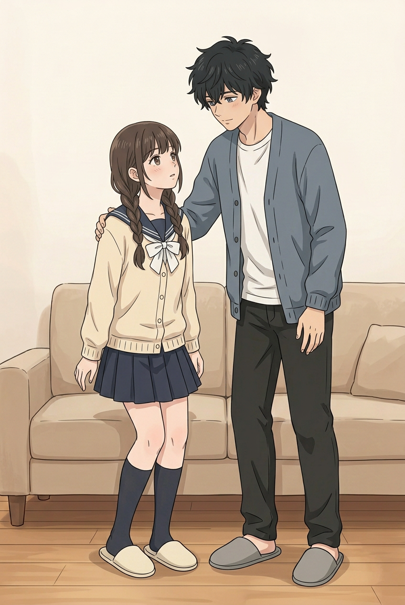
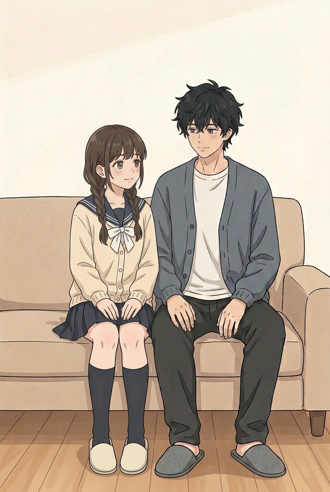

# 第八话｜保留考拉抱动作与衔接试画

**用户确认：保留下面这张的考拉抱动作，并在此基础上优化。** 我赞同：妹妹两脚离地、腿分在两侧，二哥一手护背、一手托住她，整体自然、温暖。用户认可的是这个动作，不扩大为整话或其他页面已验收；原图保持不变，不再为了动作另换姿势。以下新图为未验收的衔接试画，不替换原图。

## 用户认可的动作

原图 SHA-256：`3bd3b22b2644a5ddabc6e72bda8e90e21956c5a5894012d682530d3c08eed54b`。妹妹的脸靠在哥哥肩侧：用户已看图并认可这个动作，不再把它作为拒用理由；此前希望靠近胸口的细节如要突出，可以在**后续另一镜头**处理，不改变已认可姿势。图中沙发上的浅色包与玄关书包样式、位置不一致，仍需在整个回家段统筹，不擅自修改原图。

## 新试画一｜放下后站稳

两人站在沙发前，妹妹两脚着地，哥哥手搭在她肩上，承接抱起后的状态；妹妹左、哥哥右，与后续分享页方向一致。**这张表现的是已经站稳，不是放下的中间动作**；从抱起到落地仍有画外动作，能否充分交代放下要继续判断。原图的包在沙发上，这张画外没有交代移走，不能宣称道具连续已解决。两人各可见两腿两脚，哥哥两只手、妹妹两只手可见，仍须结合正式画幅仔细复核。

## 新试画二｜坐好后

两人坐在沙发上、妹妹左哥哥右，服饰、袜子和拖鞋与回家段接近；同样是静态结果，不展示实际坐下过程。沙发与分享页接近但仍需核对，包与上一镜相同地不在画内，不能证明移动过程。图中两人各有两只手、两条腿和两只脚可见；小指细节和正式尺寸需再检。

## 剩余工作

- 将认可抱姿按原图保留；统一书包在玄关、沙发及后续画面的款式、去向，必要时补清楚前置动作，不凭空忽略已出现在沙发上的包。
- 审核是否还需要更明确的放下／坐下过渡；后续靠胸及分享镜头继续对照，不以试画代替完成。
- 继续整话画风、人物、校园剧情、台词和正式排字检查。01画风仍须用户判断；整话尚未完成。

[此前整话分镜工作预览](../review-chapter-08-reset-v5/第八话_分镜工作预览.md) · [上轮逐图检查（其对抱姿的结论已被本次用户确认更新）](../review-chapter-08-reset-v5/本轮检查与下一步.md)
