# 第八话｜妹妹的学校日常（试排 v2）

> 试排，非定稿。保留四人女生学生会；新增两位成员的区别形象，并加入回家后的亲情场景。标题、台词、形象与连续性仍待用户审阅。

[本轮复查](../../docs/第八话_v2_学生会与回家场景复查.md) · [新成员设计](../../art/角色形象区/学生会新成员_试案v1/README.md) · [旧版逐页](../review-chapter-08-v1/逐页看图.md)

## 封面｜封面

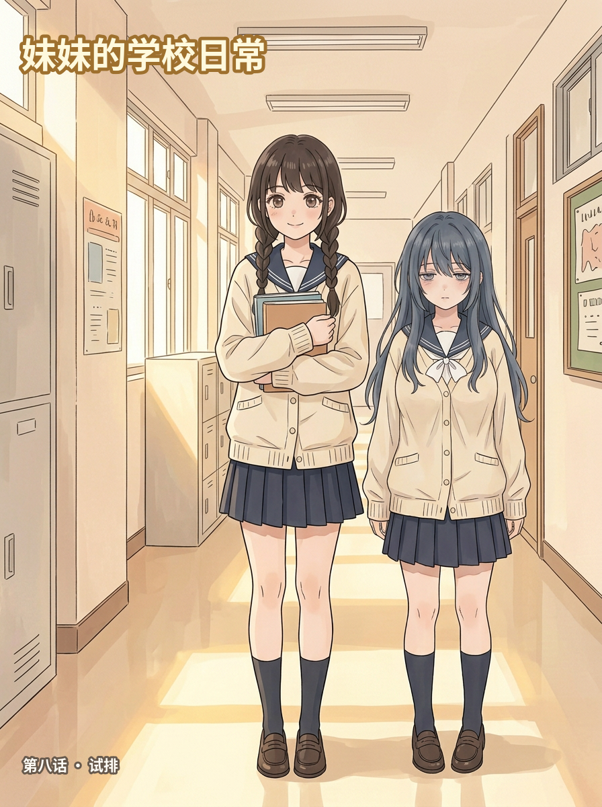

## 第01页｜课堂解题

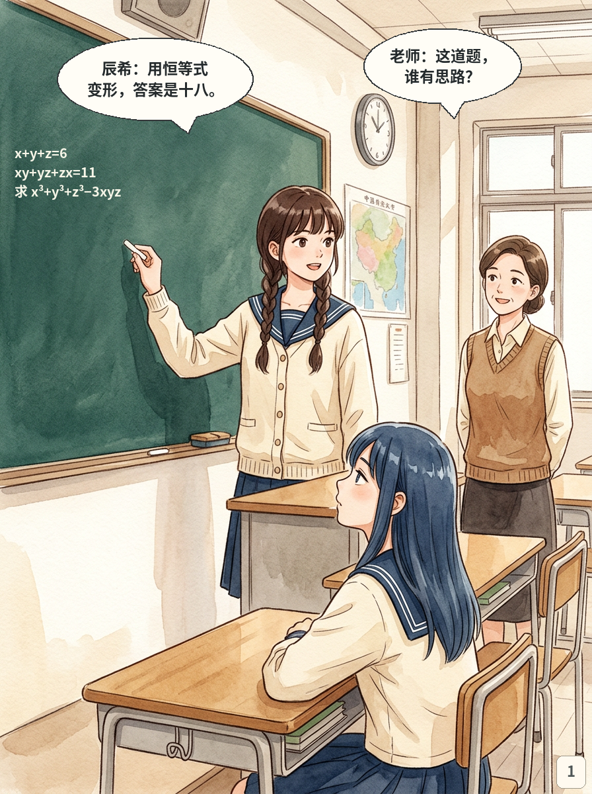

## 第02页｜好友的笔记

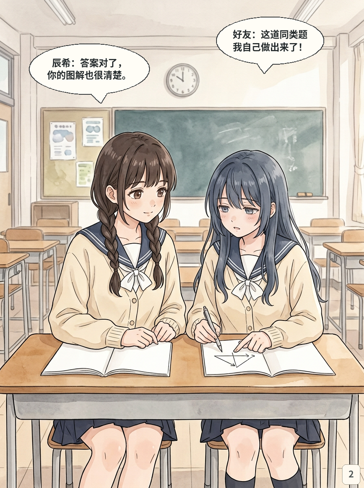

## 第03页｜学生会开会

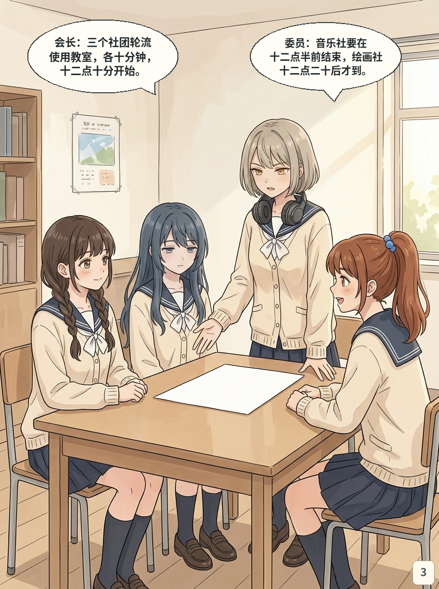

## 第04页｜一起安排

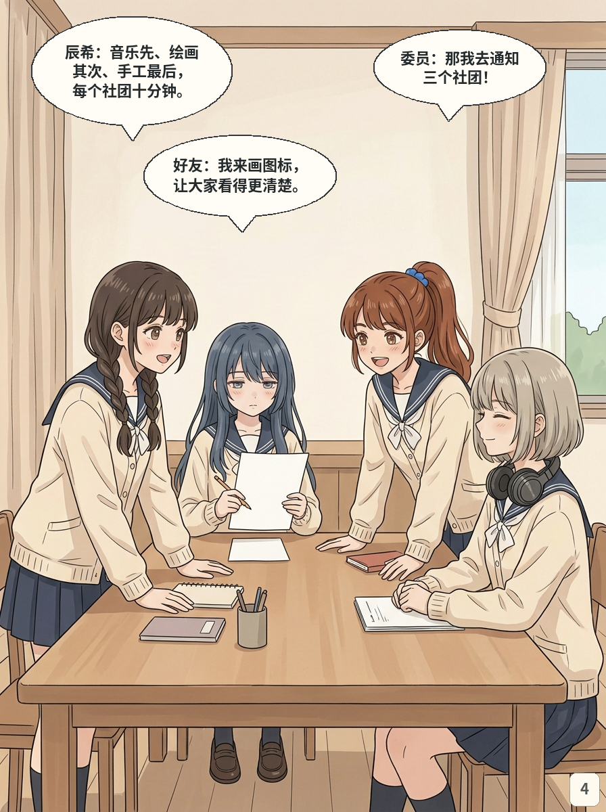

## 第05页｜冷淡拒绝

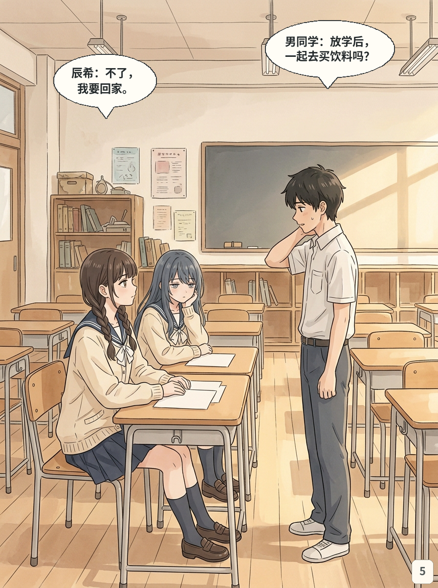

## 第06页｜想念哥哥

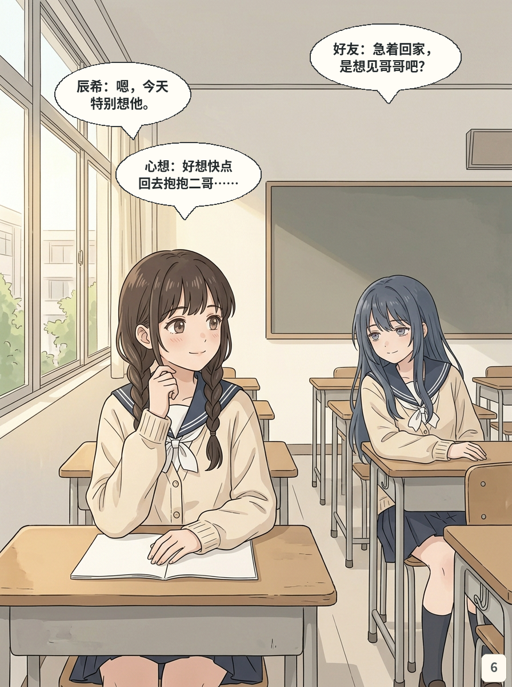

## 第07页｜放学后

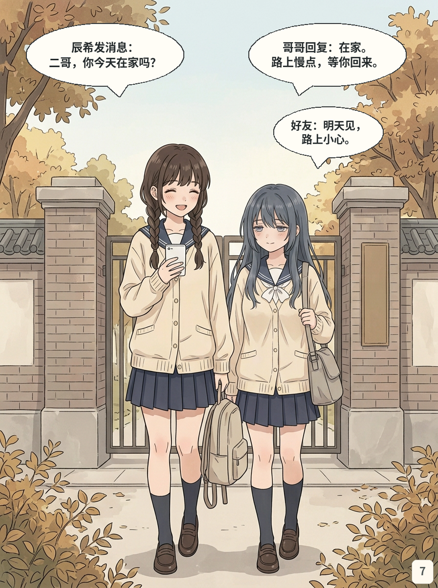

## 第08页｜回到家

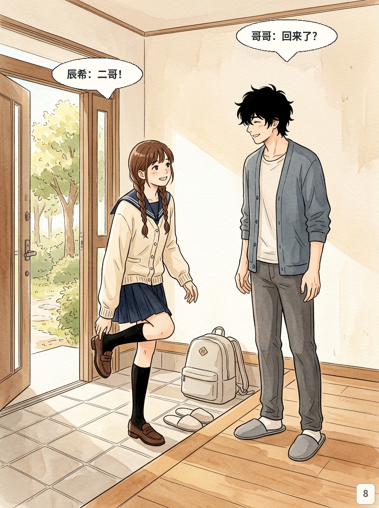

## 第09页｜想了一天的拥抱

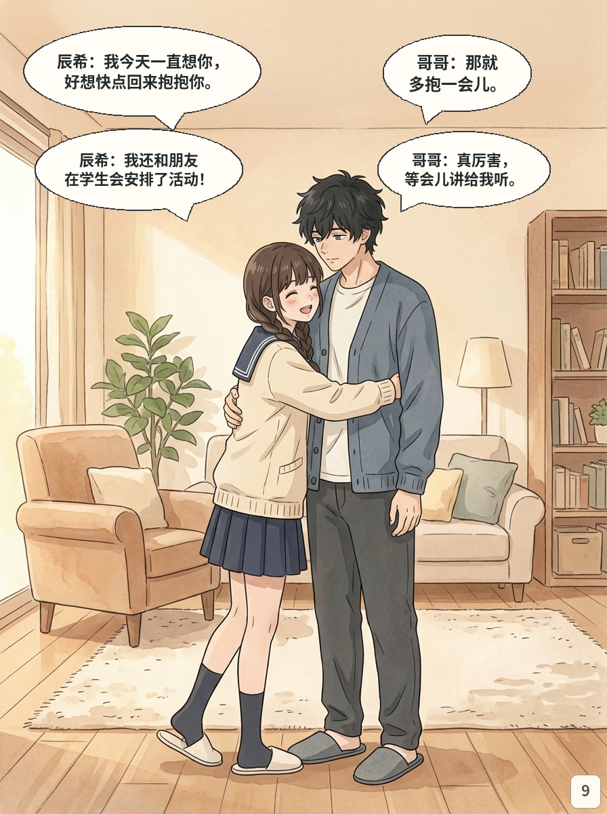

## 第10页｜靠在哥哥胸前

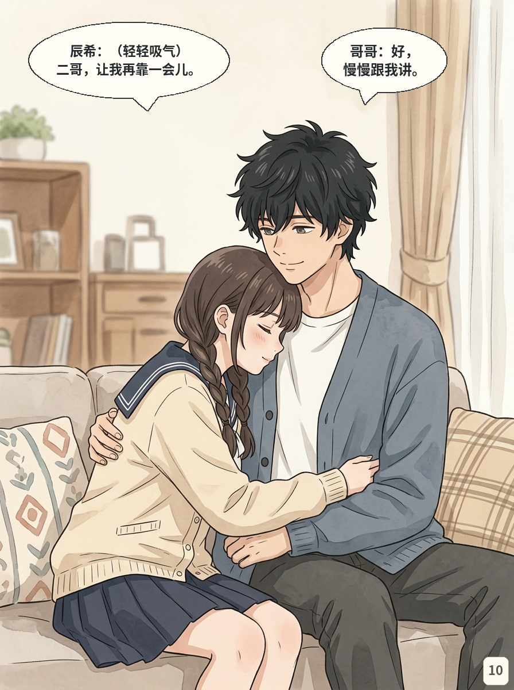
