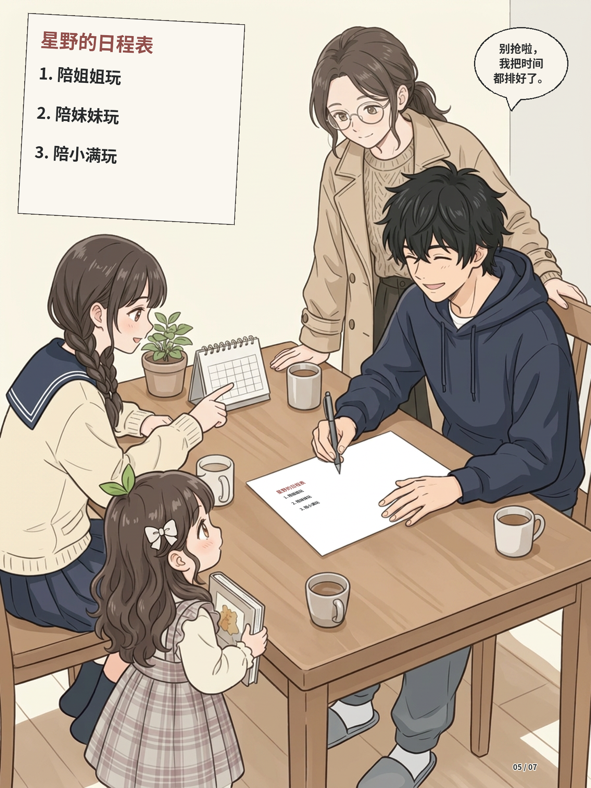

# 第一、二话：逐页检查版

此目录供用户逐页查看；旧正式输出与用户归档均未覆盖。每话封面加七页，PNG 为 1440×1920；PDF 是缩小并 JPEG 压缩的轻量预览，细节和小字以 PNG 为准。

- 第一话：用户已查看并表示没有问题；末页按要求仅将「妈妈转述」改为「妈妈：」。日程表文字朝向由用户自行处理，此处不代修。
- 第二话：这里仍是现有完整阅读页，新的风格并轨尚未完成。用户已指出第1页旧原图崩坏，应舍弃旧构图图源，另行从人物及风格参考独立生成；新图仍为候选，不在此旧版中冒充完成。
- [第一话轻量 PDF](chapter-01-preview.pdf) ｜ [第二话轻量 PDF](chapter-02-preview.pdf)

## 第一话

### 封面

### 01

### 02

### 03

### 04

### 05

### 06

### 07

## 第二话

### 封面

### 01

### 02

### 03

### 04

### 05

### 06

### 07

