# 完整人设与合照 V3｜逐页看图

> 正式文件：`完整人设与合照_V3.pdf`（8 页，无损原图）。若网页 PDF 预览打不开，
> 直接用本页逐张 PNG；也可下载 `完整人设与合照_8页PNG图片版.zip`，
> 或打开 `character-cards-v3-preview.pdf`（720×960 / JPEG q=88 / 明确非定稿）。
> `完整人设与合照_V3_兼容版.pdf` 为补了 Fast Web View 与文件 ID 的兼容重存版。

## 8 页人设卡与合照

### 1 / 8　江怀川｜父亲

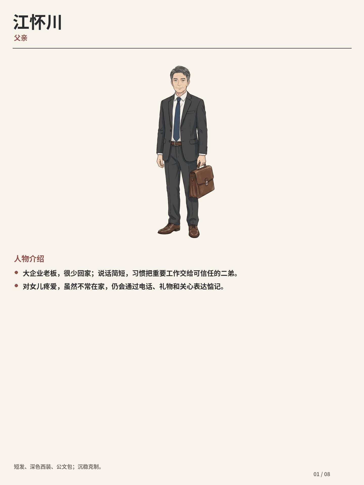

### 2 / 8　沈静宜｜母亲

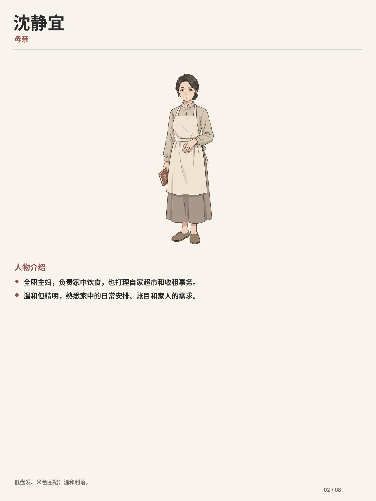

### 3 / 8　江昭远｜大哥

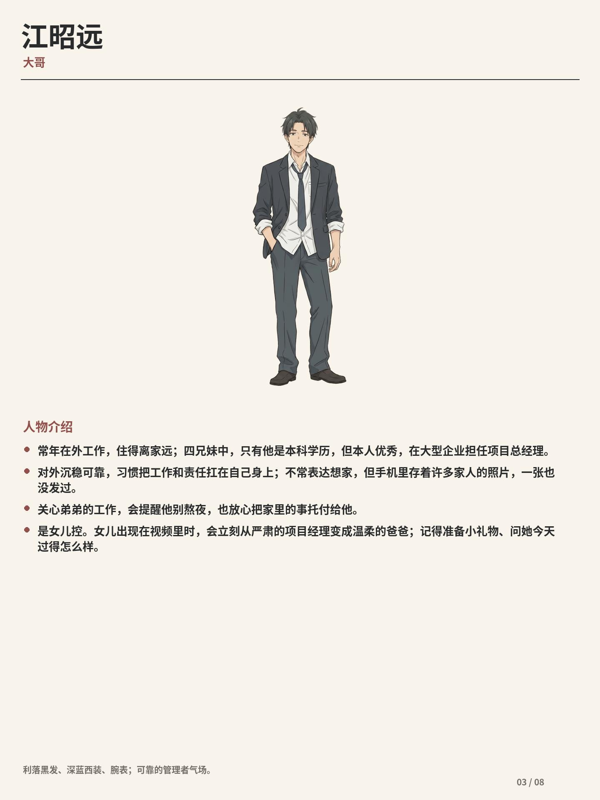

### 4 / 8　江望舒｜姐姐

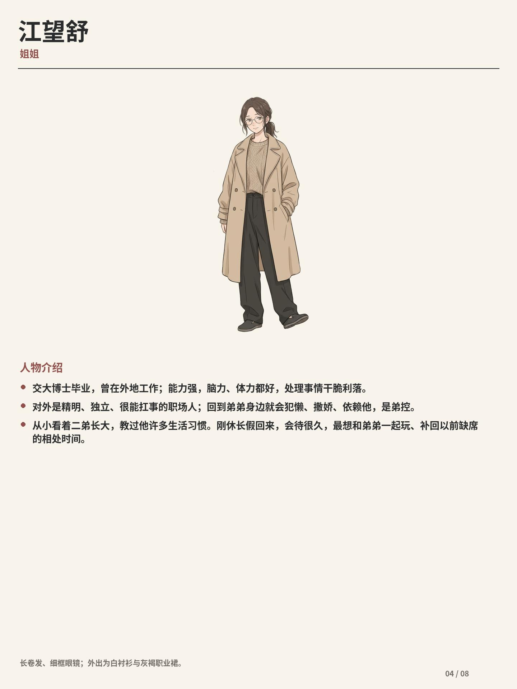

### 5 / 8　江星野｜二弟

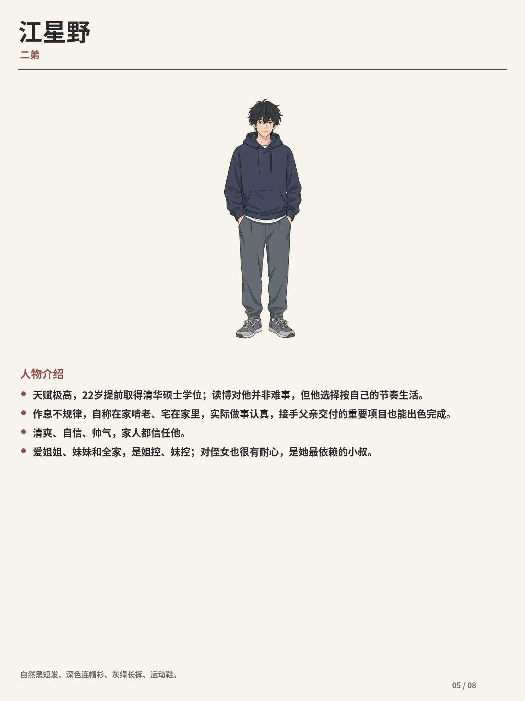

### 6 / 8　江辰希｜妹妹

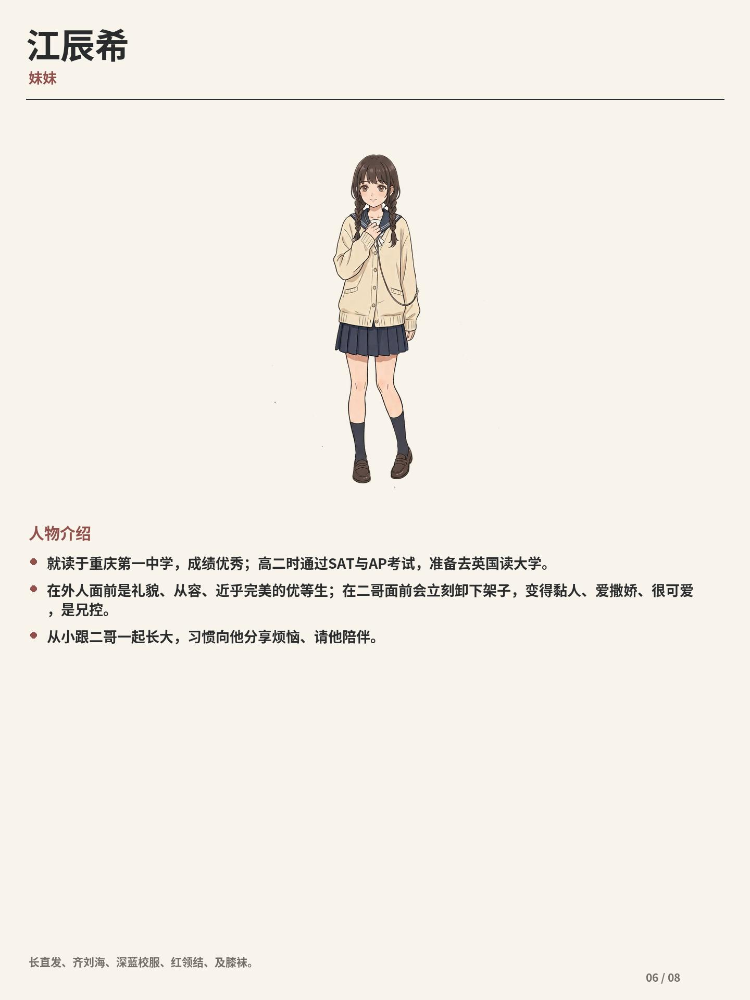

### 7 / 8　小满｜小侄女

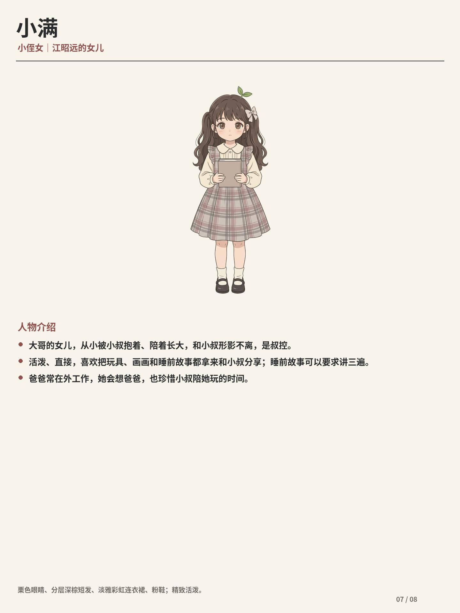

### 8 / 8　七人合照｜家族角色设定资料集

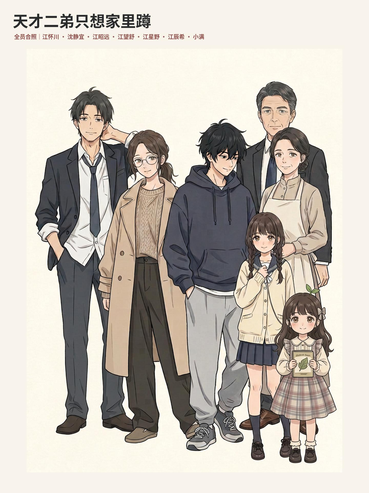

## 单独立绘（画风与人设基准）

以下 7 张为 `art/character-v3/` 的官方单独立绘，`family-character-design-v3.jpg`
是用户确认的最高视觉基准：**暖纸底、低饱和、细腻手绘线、轻薄水彩填色、自然五官、
克制阴影、写实头身比**。生图必须与此并排比对，不得只比脸。

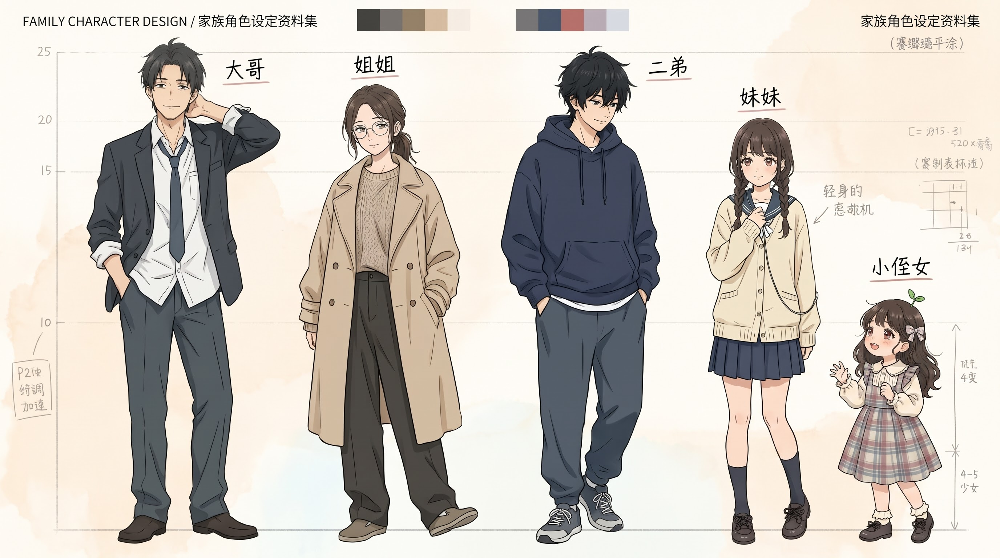

### 江星野｜二弟（男主）

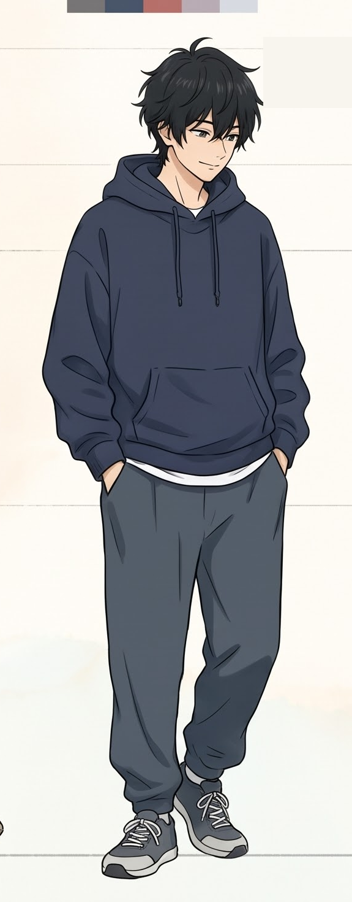

### 江望舒｜姐姐

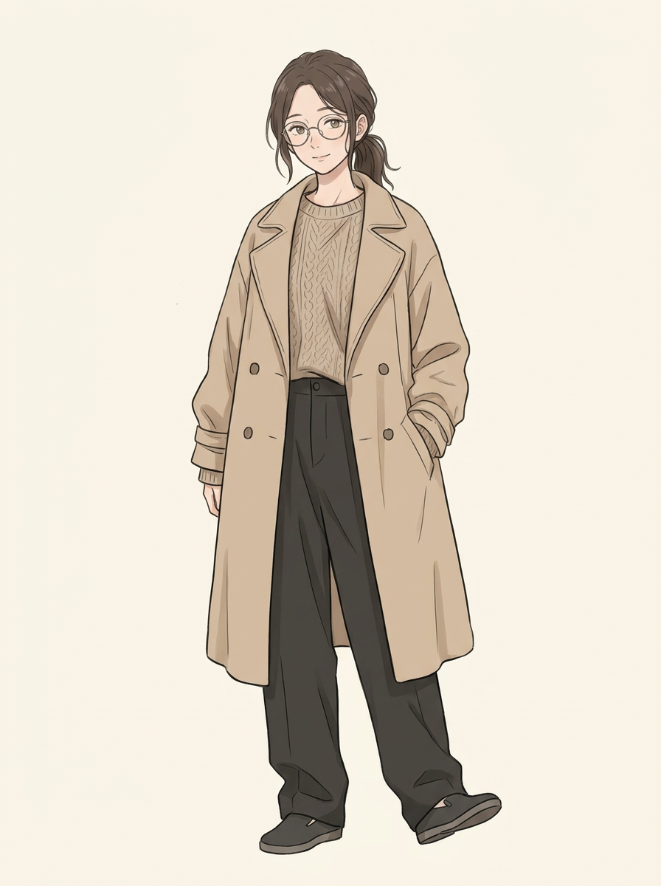

### 江辰希｜妹妹

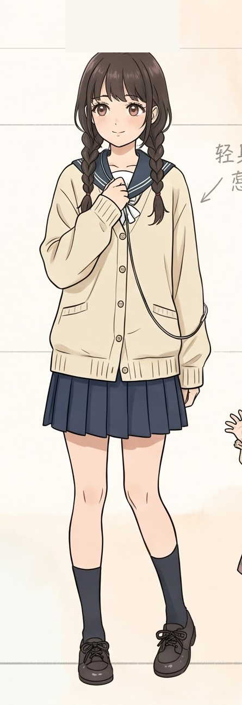

### 小满｜小侄女

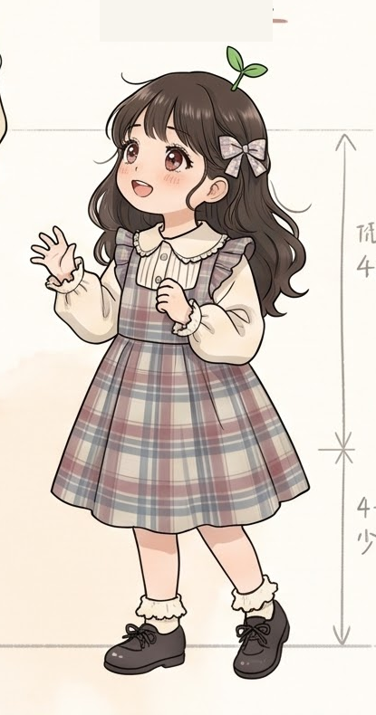

### 江昭远｜大哥

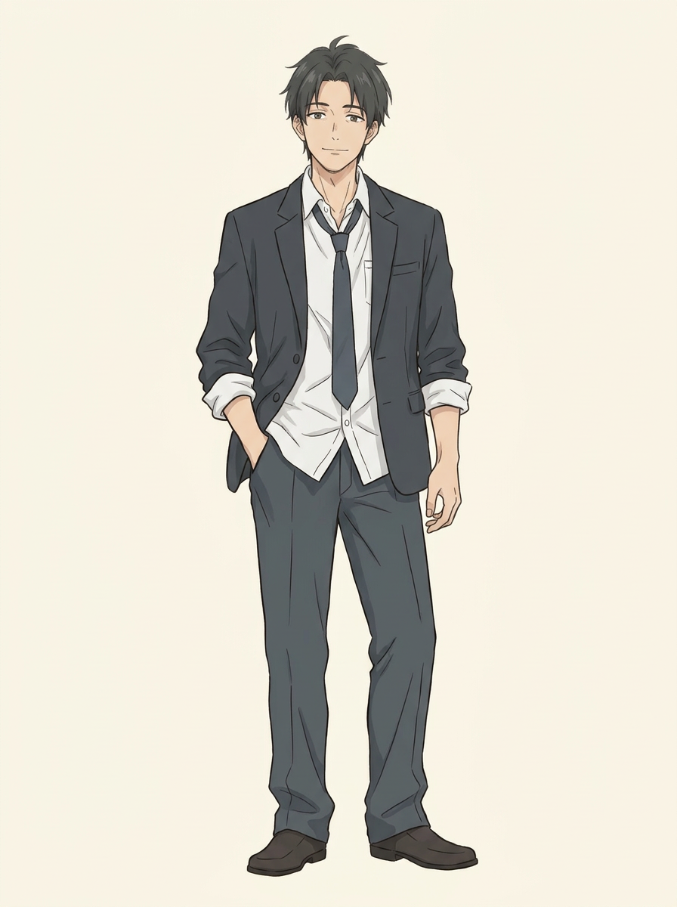

### 江怀川｜父亲

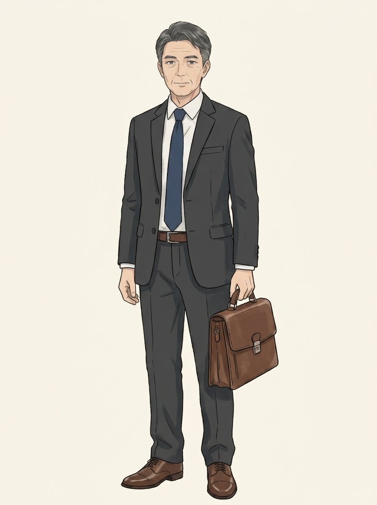

### 沈静宜｜母亲

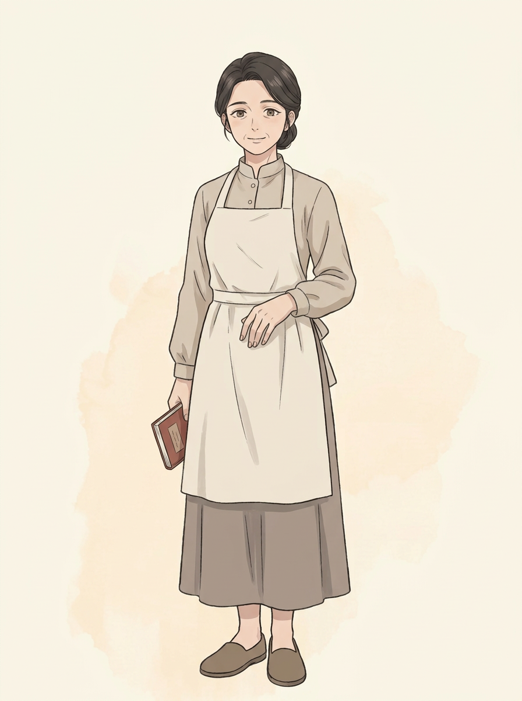

文字设定（身份/经历/性格/外貌）见 `../../../data/characters.json`，
画风锁定条款见 `../../../docs/V3角色与画风锁定.md`。
