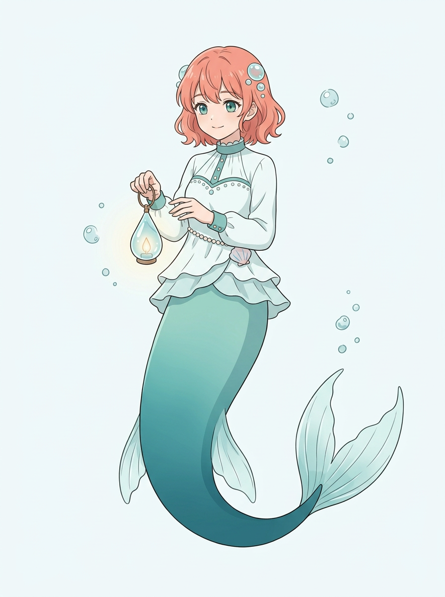
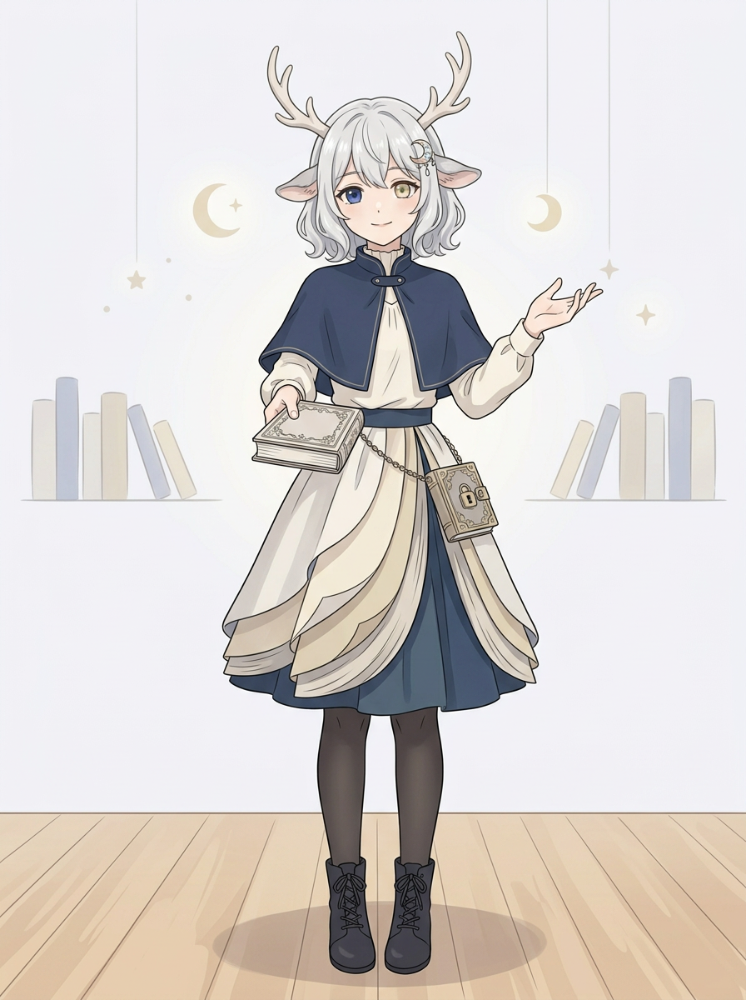

# 邻居姐姐 VTuber｜两版形象候选

根据已讨论的文字方向，按用户要求分别制作两张单人虚拟形象。两版均待用户审阅，尚未选定或投入剧情；它们是姐姐的虚拟角色，不改变现实中的发型、外貌和衣服。原来的星海信使和允许保留的观星绘图者服装也都未覆盖。

## 深海泡泡梦境向导＋人鱼

珊瑚粉短卷发、海绿色眼睛、泡泡发饰、白青上衣和渐变鱼尾，手提水滴灯。整图已实看：单人，鱼尾及尾鳍完整，衣装完整；放大手部后，提灯手与提环相互遮挡，另一手部分手指叠在一起，细节不能完全确认。发色为暖珊瑚粉，虽然发型、眼色及人鱼外观不同，但色相与现实暖橙棕有些接近；若用户希望区分得更彻底，可再讨论调整色彩。

## 月光图书馆守夜人＋鹿娘

银白短卷发、鹿耳与鹿角、蓝金异色眼，配深蓝披肩、书页层次裙、短靴和锁书。整图已实看：单人全身，鹿角、双腿和双鞋可见；放大手部后，持书手指被书遮挡，张开手的部分手指有重叠，不将不清楚的地方算作已通过。画面里的鹿角比文字方案“小巧鹿角”更醒目，可由用户决定是否调整。

两张为静态概念立绘，不是可直接直播的分层模型或动捕成品；最终画风、外观与细节由用户决定。直播内容仍是游戏、聊天及短视频的提案，并非已定剧情或具体成绩。

## 后续意见与优化提案

用户表示这一版先保留，但希望 VTuber 形象有更多记忆点、更漂亮的服装和脸，以及更多装饰。[两版优化文字提案](姐姐VTuber双方案_优化文字提案.md)供讨论；未重画、未覆盖本页两图，新增设计未定稿。
