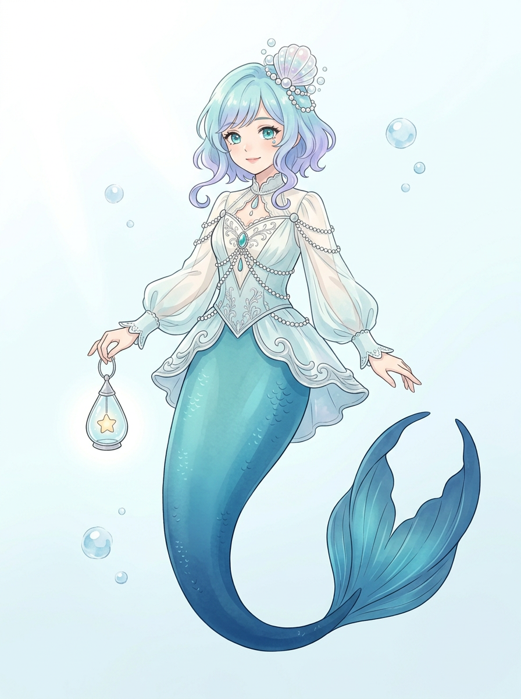
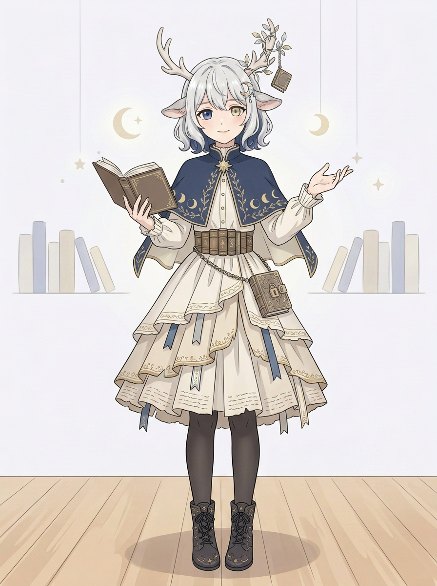

# 姐姐 VTuber｜两版华丽优化候选 v2

用户要求按前述文字方案制作两版。先前人鱼和鹿娘 v1 均原样保留；以下是新生成的静态候选，未确认、不自动入剧情，也不是可直播的拆件模型。发色及鹿角大小采用前述建议方向，不代表用户已选择。

## 人鱼：深海泡泡梦境向导

水蓝至淡紫短卷发、贝壳冠、珍珠链、海蓝层叠服饰、渐变鱼尾与星光水滴灯。实看整图及手部放大：鱼尾完整，提灯手的手指与提环局部重叠，另一手手指也有交叠；不能断言全部正确。衣服更精致，但躯干比例和透明感比第一版成熟、偏华丽插画风，是否符合年龄感与本作品画风仍需用户审阅。

## 鹿娘：月光图书馆守夜人

保留银白短发、异色眼、鹿耳鹿角；加月相与藤叶披肩、星形领针、书脊腰封、书签层叠裙与挂锁书。整图及手部实看：双靴可见；持书手有遮挡，另一手手指部分重叠。头脸与 v1 很接近，主要变化是服装装饰；鹿角仍然醒目，未明显达到小巧化，面部辨识度是否足够也需用户判断。

这两张仅是候选，未覆盖原图，也没有把先前虚拟角色套到现实姐姐身上。用户认可前不称定稿。

用户后续表示两版人设都留下；按要求新增[背景美化版与检查](姐姐VTuber双方案v3_背景版.md)，v2原图未覆盖。背景版仍待用户审阅。
