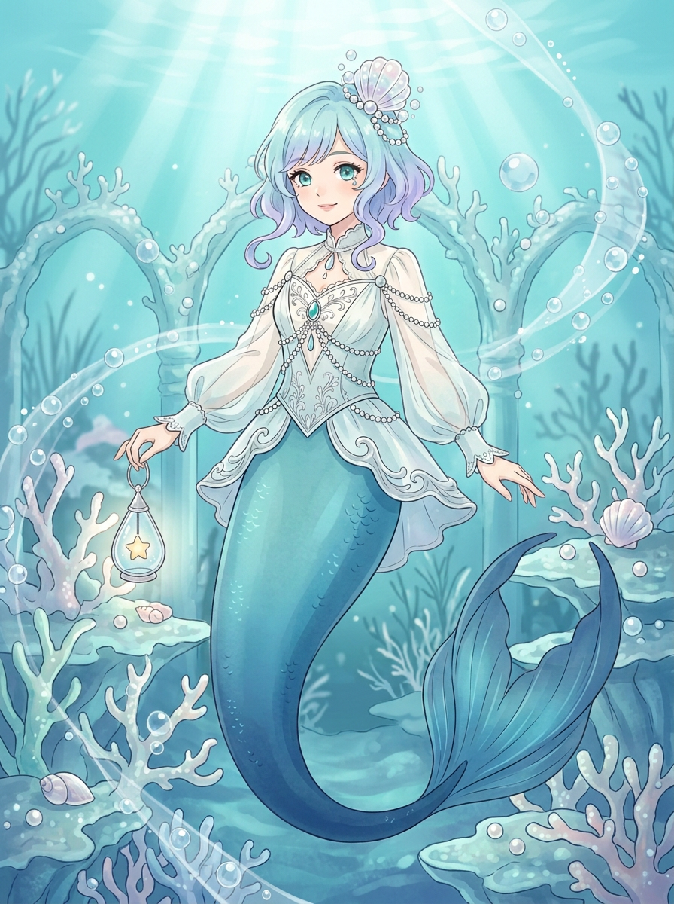
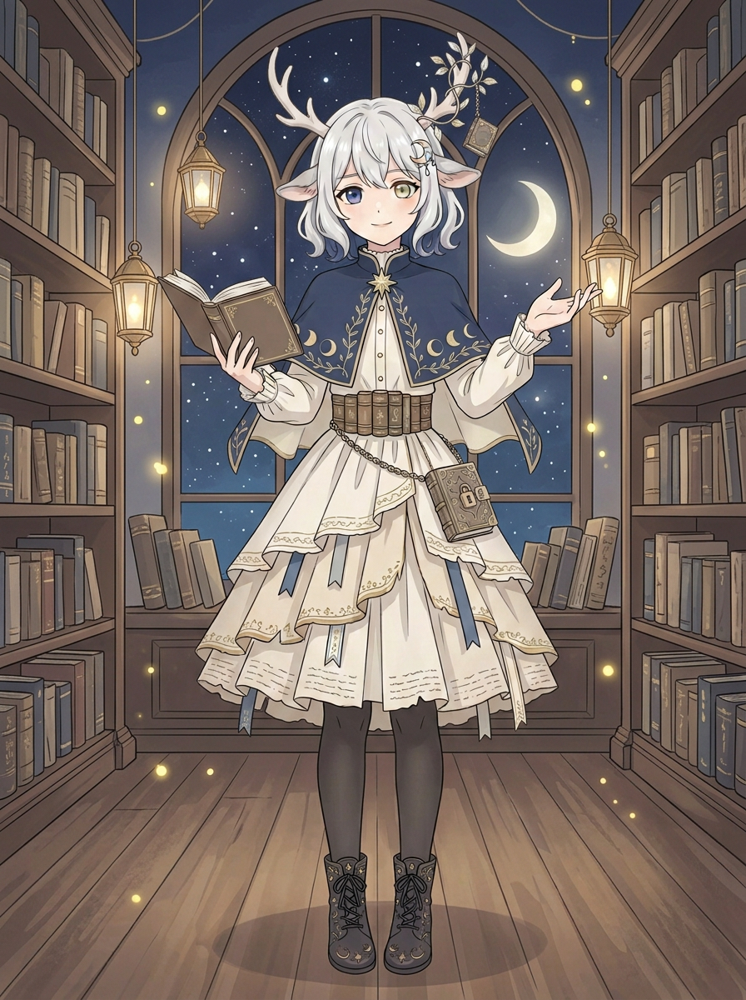

# 姐姐 VTuber｜两版背景美化候选 v3

用户表示人鱼与鹿娘两版人设都留下，并要求把背景精致美化细化；按此分别制作主题背景版，v1、v2原图均保留。以下为静态插画，背景版待用户审阅；不是可直接直播的分层模型，也不自动放入剧情。

## 人鱼｜珊瑚梦境

以v2人鱼为基础，新增海底光束、珊瑚拱门、贝壳与泡泡，原有水蓝淡紫发、珠饰、鱼尾和星光水滴灯保持可辨。实看整图与手部放大：提灯手和另一手的部分手指仍有重叠，不能宣称修好；珊瑚及尾鳍局部颜色相近，背景较丰富但人物完整。图像编辑可能有局部变化，不能声称与原图逐像素一致。

## 鹿娘｜月夜图书馆

以v2鹿娘为基础，新增月夜拱窗、书架、灯笼与微光，银发异色眼、鹿角藤饰、月相披肩、书页裙与小锁书仍可辨。实看整图及手部放大：持书手、张开手的部分手指仍有重叠，右侧灯笼与手靠得很近；背景书脊有少量装饰性纹样，未作为可读文字。人物完整，背景版仍待用户看图确认，不夸称是逐像素不变的原画。
