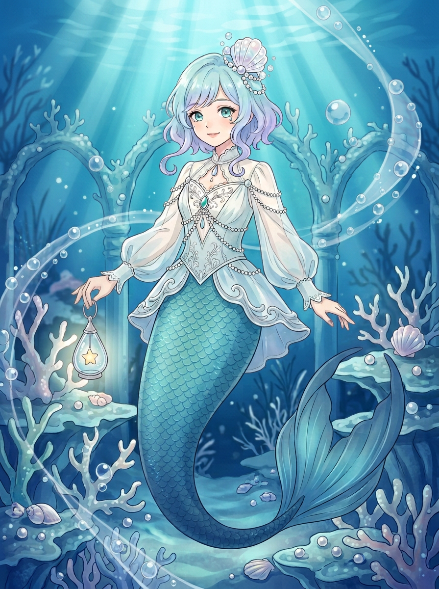
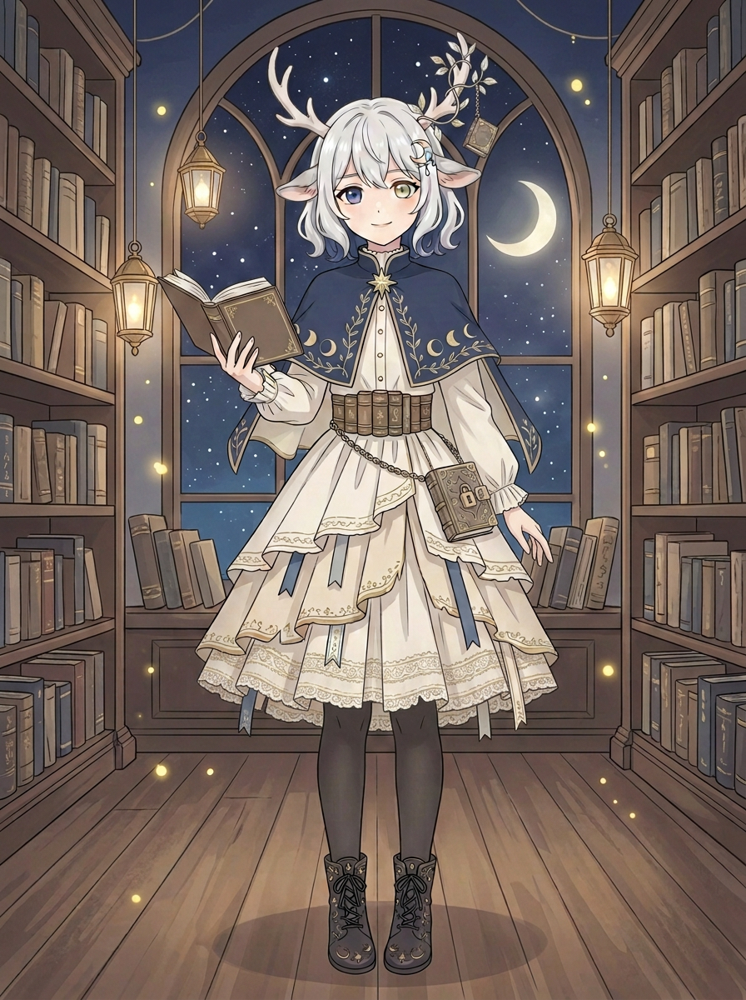

# 姐姐 VTuber 双方案｜人物与背景精修 v4

两版人设都留下，v1、v2、v3原图未覆盖。应用户要求继续精修人物与背景，以下是新生成的静态插画候选；不是分层直播模型，也尚未获得用户验收。

## 深海人鱼

水蓝淡紫短发、贝壳冠、白蓝衣装、珍珠链、水滴星灯和鱼尾保留可辨；相比v3海底色调更深、光束对比更明显，尾巴鳞片纹理更密，细节更突出。整体构图非常接近v3，并非全新背景设计；人物可能产生细微变化，不应说是原画像素不变。实看全图及手部局部，提灯手指与环相叠、另一手手指细节不清，未能验收手部。

## 月夜鹿娘

银发、异色瞳、鹿角藤饰、月相披肩、书页裙和锁书保留可辨；较v3增加裙摆花边细节，灯光和书架纹理更精细，抬起的手变成垂放姿势。构图与v3很接近，人物姿势有变化，不是仅换背景；实看全图与手部，持书手指被书遮挡、垂放手手指细节重叠，尚不能算手部通过。书脊纹样是装饰，不作可读文字使用。

两图分别保留供审阅：[v3背景版与检查](姐姐VTuber双方案v3_背景版.md)、[v2原版与检查](姐姐VTuber双方案v2_华丽版与检查.md)。如果用户认可整体设计，仍需按用途处理遮挡细节；真正用于直播还需另做分层、建模与测试。
