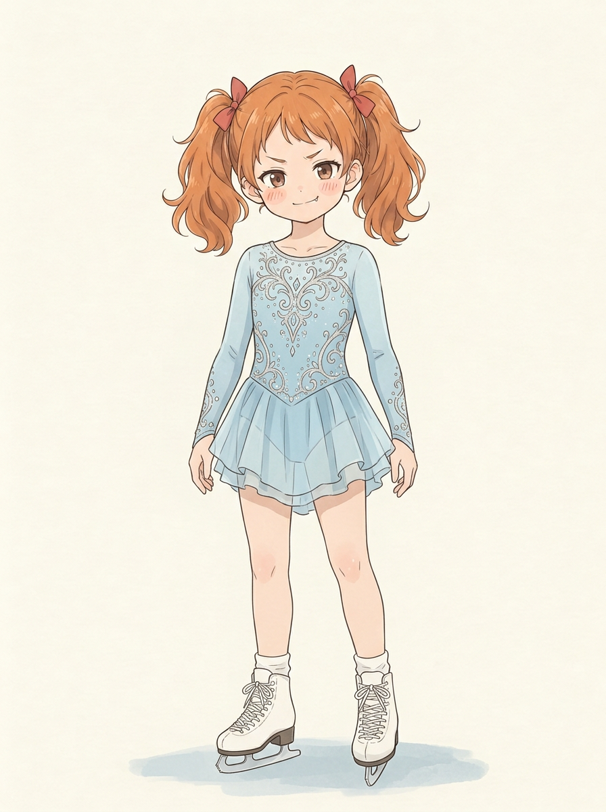
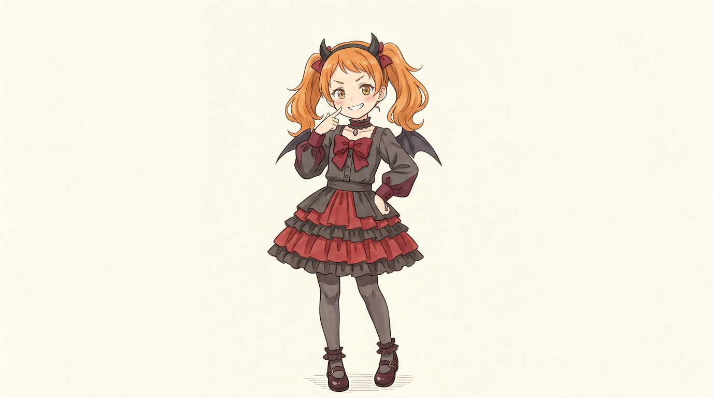
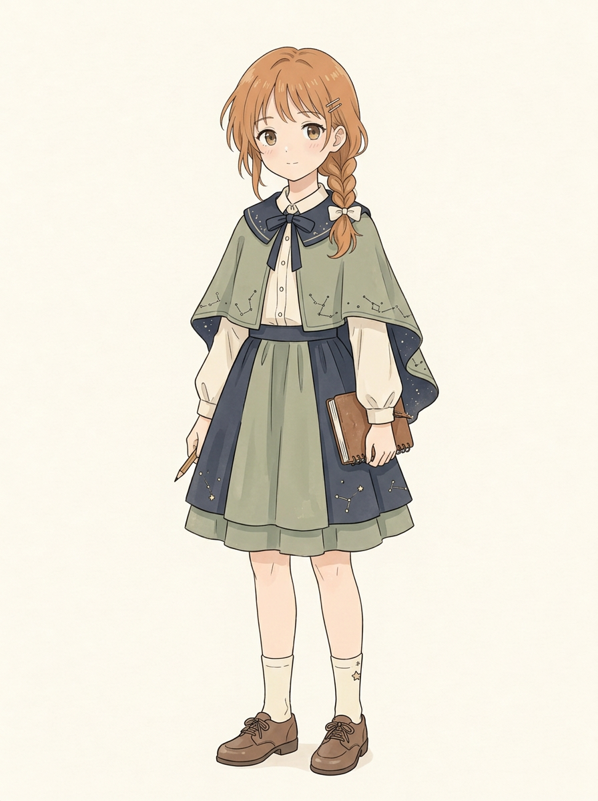
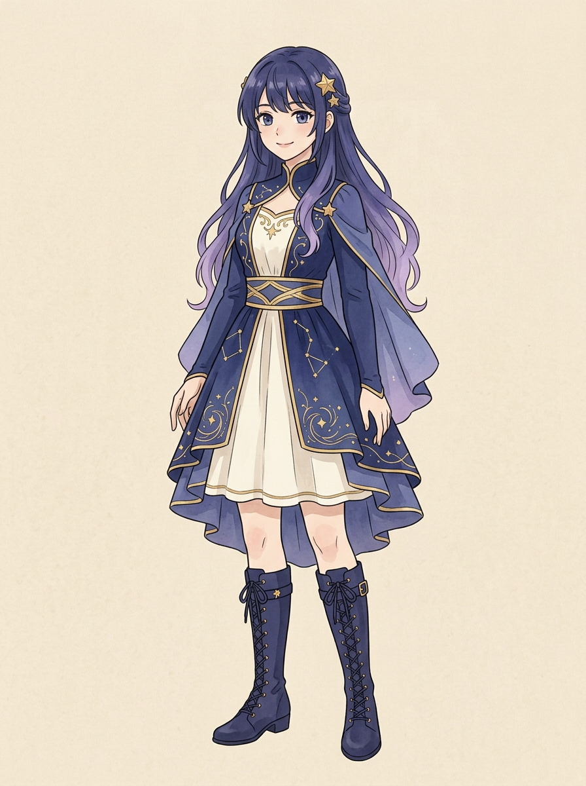

# 邻居姐妹｜三套新造型候选

整理交付区后按用户要求开始生图。妹妹两套和新 VTuber 形象均为候选，尚待用户审阅；姐姐的观星绘图者服装用户表示可以保留。没有覆盖用户原设、原画或已确认章节，也不将造型自动写入剧情。

## 1. 妹妹｜华丽花滑短裙

- 冰蓝银色长袖表演服、花纹与多层短裙，配白色花滑鞋；保留暖橙棕双马尾和红发结。她十岁能完成 **3F（后内点冰三周跳）**，不据此补定比赛成绩。
- 实看：单人全身、两条腿和两只鞋均可见；手指部分有相互重叠，前向鞋的刀刃正面透视较窄，不把遮挡部位算作完全无误。
- 初次生成的[花滑服试图](../../../art/角色形象区/邻居姐妹_新造型候选v1/妹妹_华丽花滑服.png)出现三个重复形象，与单人展示不符，保留记录但不作为本页主候选。

## 2. 妹妹｜完整小恶魔 Cos

- 本次自行采用**原创小恶魔**主题，参考用户原设的深红黑哥特风，包含角、翅膀、蝴蝶结、上衣、层叠裙、袜和鞋，而非只画蝴蝶结；是主题提案，不代表用户已确认。
- 实看：一个角色、完整身体轮廓和双鞋可见；一手指向脸，一手叉腰，叉腰手的指尖有遮挡，小细节不宜断言完全清楚。画幅较宽、人物占比偏小，适合先看整套；如需更清楚的立绘可后续另做，不覆盖此图。

## 3. 姐姐｜观星绘图者服装（用户表示可以保留）

- 鼠尾草绿与深蓝的星座纹短斗篷、衬衫、裙子及画本；保留暖橙棕侧辫与小发夹。用户表示这套服装可以保留，但指出它不够像完全不同的 VTuber 形象。**因此只作为姐姐的一套可保留服装，不再当作她的 VTuber 虚拟形象**；使用场景未指定。文件名沿用历史名称，没有覆盖原图。
- 实看：单人全身，双腿双鞋可见；一手执笔、一手握画本，手指与笔、本的接触有部分遮挡，不能把遮挡细节当作已通过。

## 4. 姐姐｜全新 VTuber 虚拟形象候选

- 按用户“VTuber 应该完全不一样”的要求，试做**原创星海信使**：深靛蓝至淡紫长发、星星发饰、深蓝与象牙白星纹幻想服、长靴；没有沿用现实中的橙棕发、侧辫或日常服。它是姐姐操作的虚拟角色，不是她现实外观改变；名称与造型均为候选，尚待用户审阅。
- 实看：单人全身，两条腿、双靴和两只手均有呈现；双手部分手指与裙边重叠，不能认定遮挡处完全无误。色彩较漫画参考更浓、脸部略偏动画感，风格和年龄感仍请用户看图判断。
- [后续画风调整试图](../../../art/角色形象区/邻居姐姐_VTuber虚拟形象v2/星海信使_作品画风.png)与首图外观几乎相同，没有明显达到画风调整目标；保留作记录，不冒充已改善。

原设、可保留服装和既有画面均保留不动。
