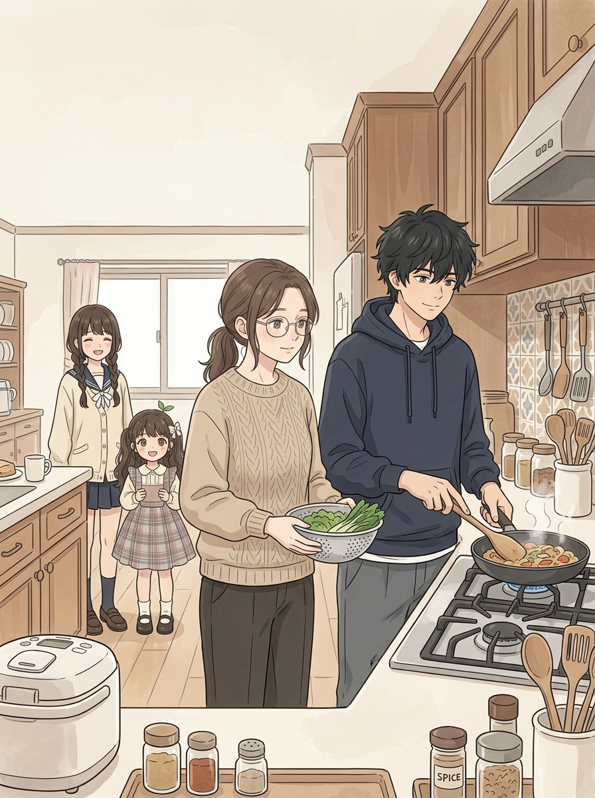
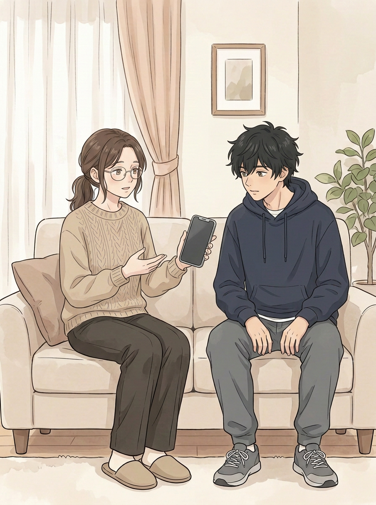
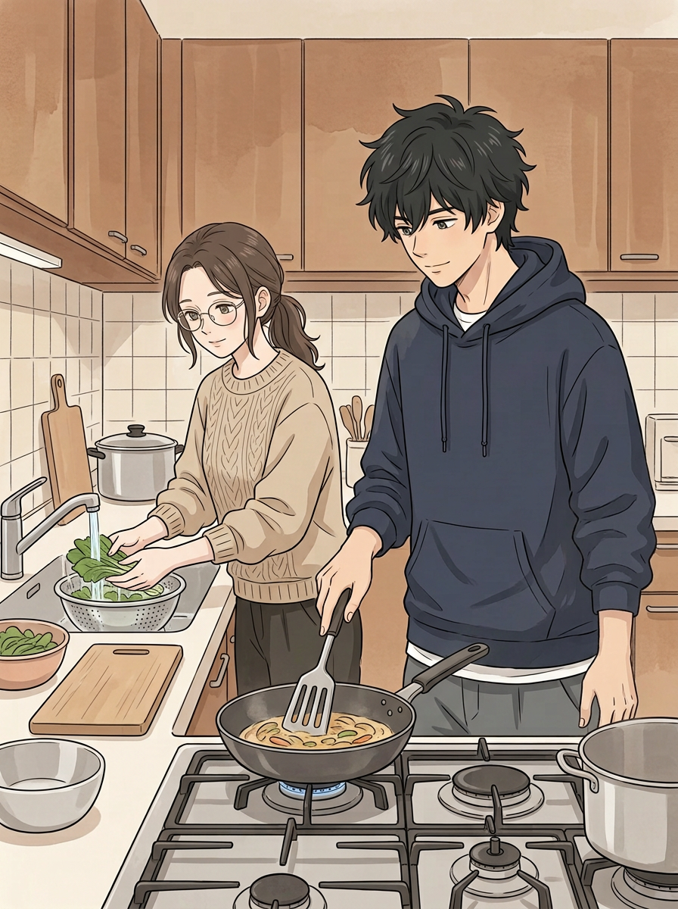
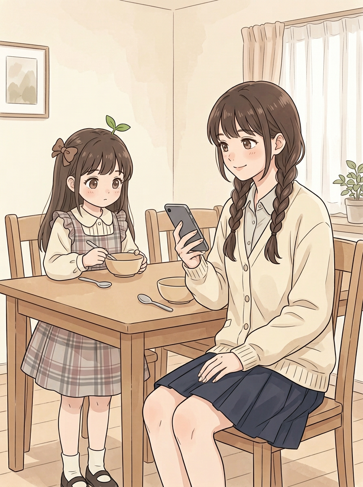
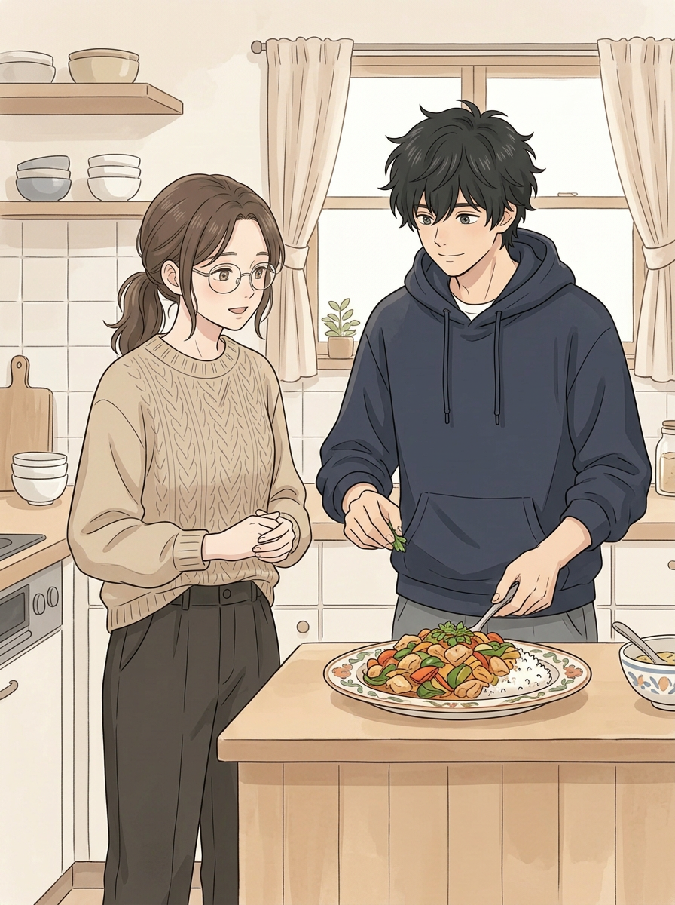
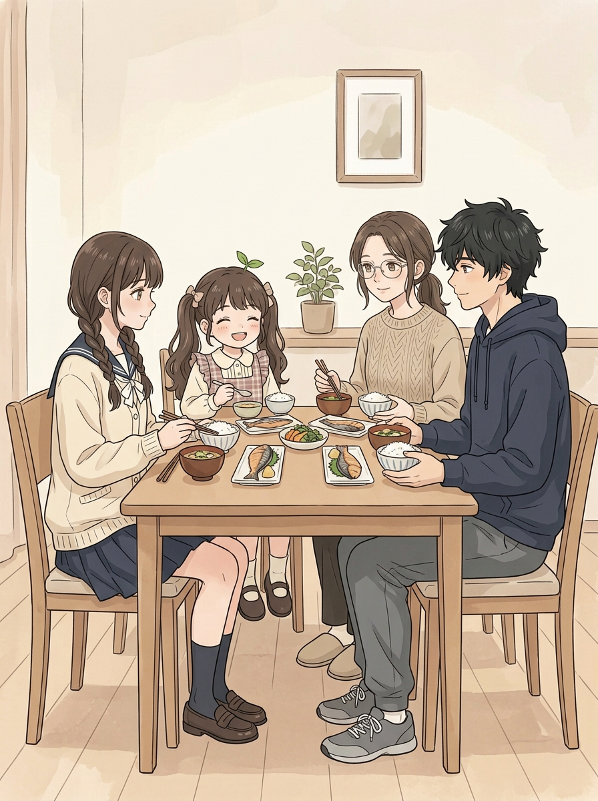
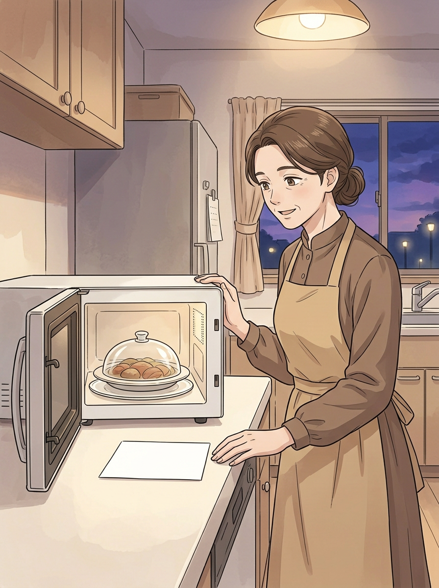

# 第七话｜做饭 · 原画制作中

> 封面＋6页为本轮实际新生成的原画，**不是成品或用户验收版**；尚未排对白、页码或妈妈的纸条，正式标题也未确定。分镜见 [剧情分镜草案](../../../../docs/第七话_做饭_剧情分镜草案.md)。已有需要返修的跨页问题写在各页下方，不能当作已解决。

## 封面｜一起准备晚餐

画面主体为二弟掌勺、姐姐端菜，妹妹和小满在旁；调料瓶出现英文「SPICE」，与不生成文字的要求不一致，需处理，标题待定。

## 01｜妈妈有事，二弟接下晚饭

姐姐展示手机、二弟听她说话；手机画面为空白，情节需要后续对白交代。

## 02｜姐弟一起准备

二弟掌勺，姐姐洗菜；后续仍需排对白和细看锅铲及手指连接。

## 03｜妹妹看手机，小满在餐桌旁

小满正在拿碗和勺，但摆餐具动作不够明确；妹妹内搭领型与其他页不一致，小满发饰及头发也需与下一页统一。

## 04｜菜做好了

二弟正在装盘，姐姐在旁；菜式与05餐桌上的鱼菜不明显对应，需统一或补交代；姐姐此刻没有按原分镜端盘，是否改变动作需复核。

## 05｜一家人吃饭

小满在本页变成双侧扎发，与前页的披发不连贯，需要重画；餐具细节还需复核，不能称已完成。

## 06｜妈妈回家看到留饭

微波炉内有餐盘，纸条留白待精确排字。妈妈穿着围裙，容易让人误以为她刚做过饭，需判断或调整；晚间色调也比前页深，须和整话锚点比较。
