# 第三话｜风格返修试排（未完成）

> 只重绘08和09；其他10页沿用原成品，旧成品未被覆盖。08新图有两把勺和一杯甜品，但妹妹针织背心的麻花纹消失，和07/09服装不连续，仍需返修；09为候选，需对照人物脸型。绝非完成版。

## 封面

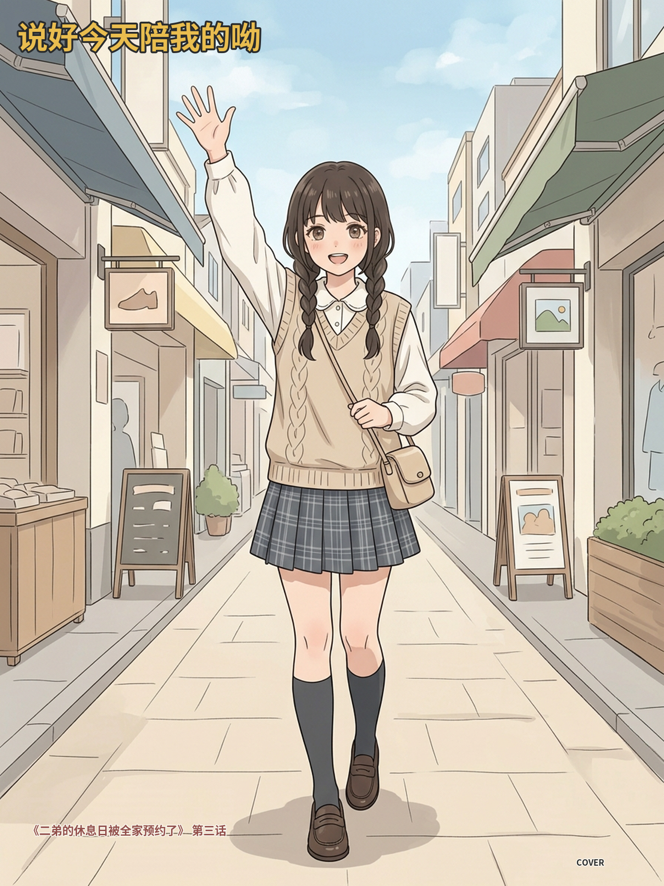

## 第01页

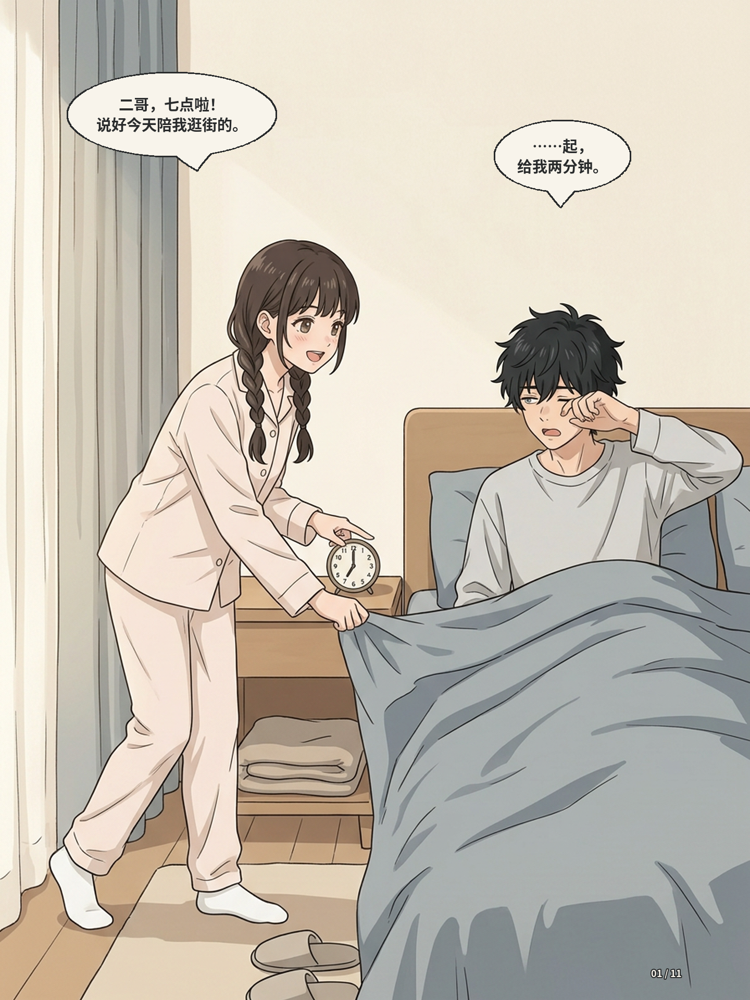

## 第02页

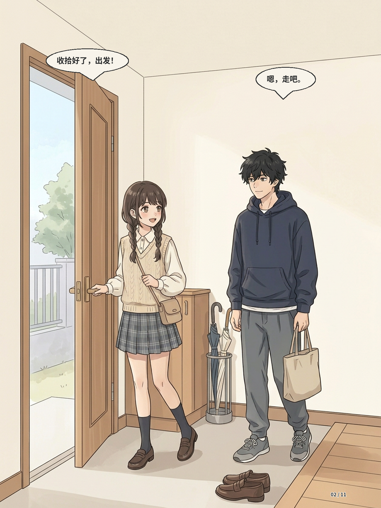

## 第03页

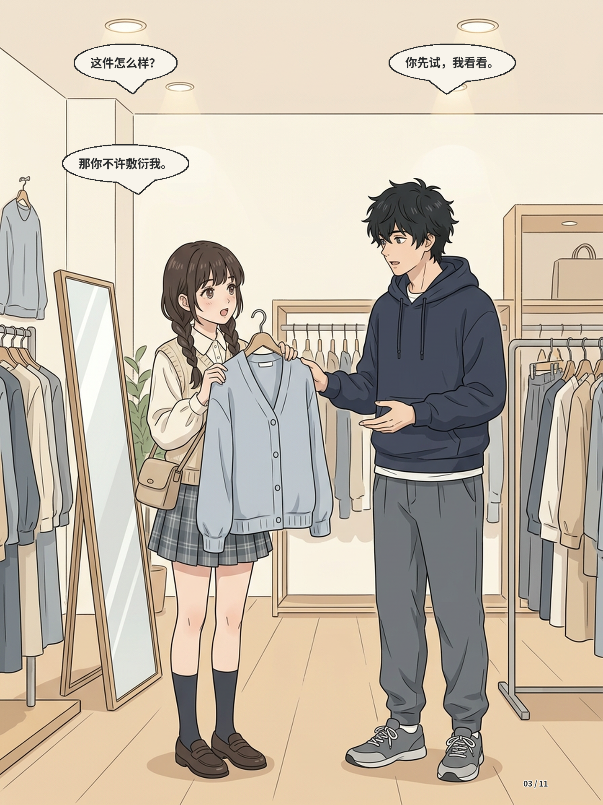

## 第04页

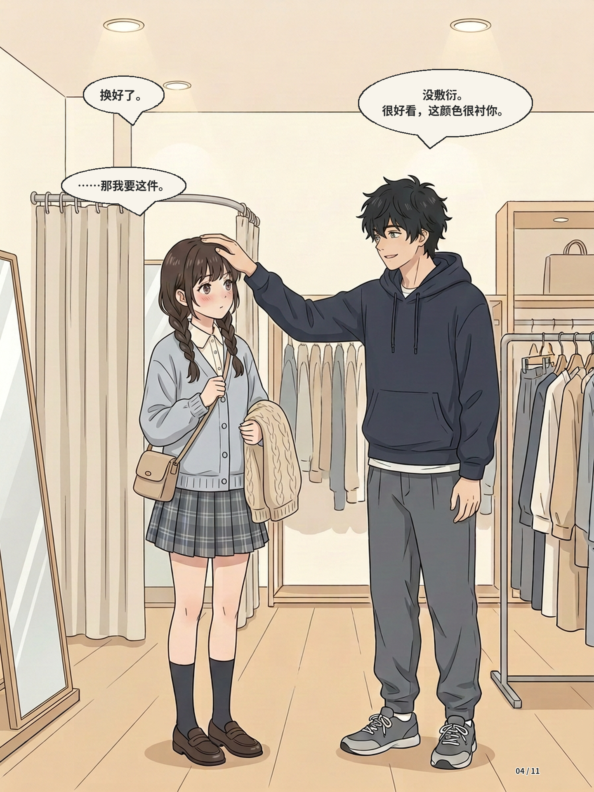

## 第05页

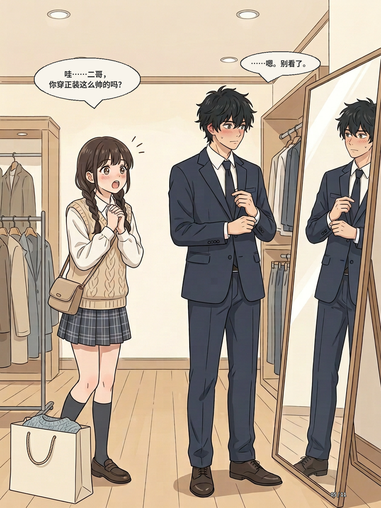

## 第06页

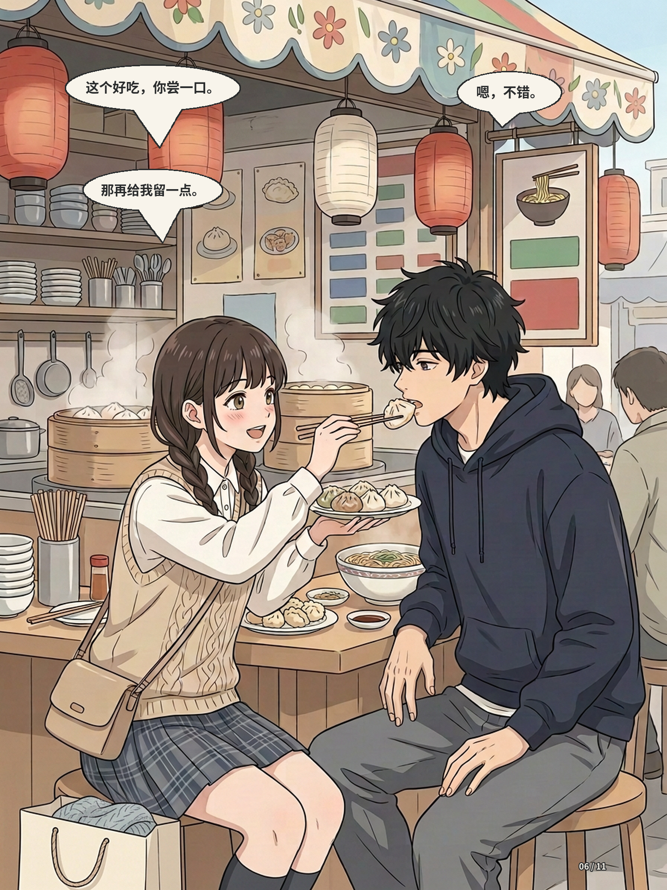

## 第07页

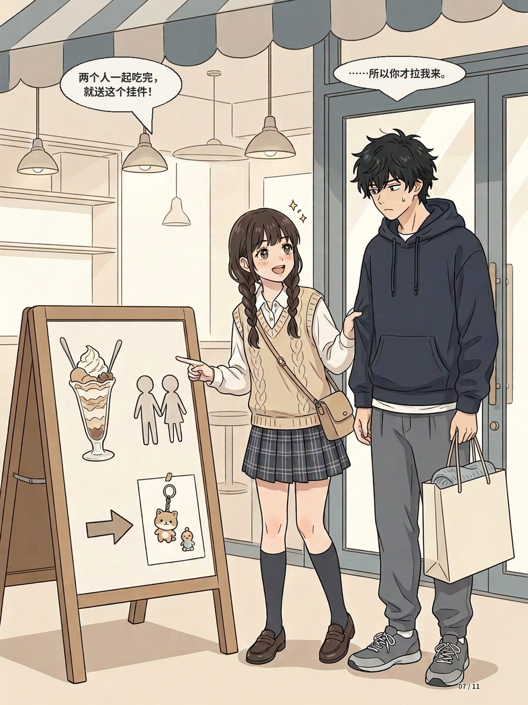

## 第08页

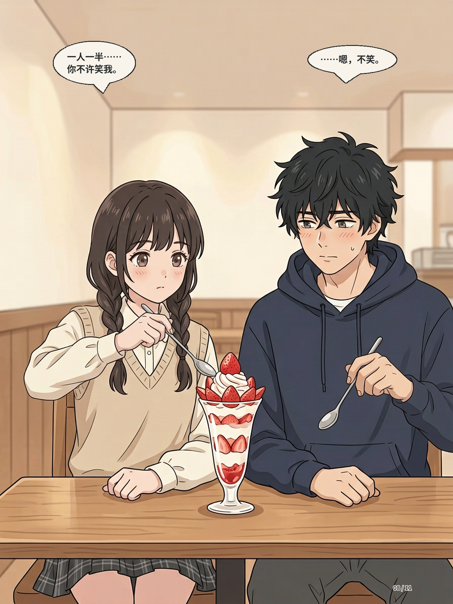

## 第09页

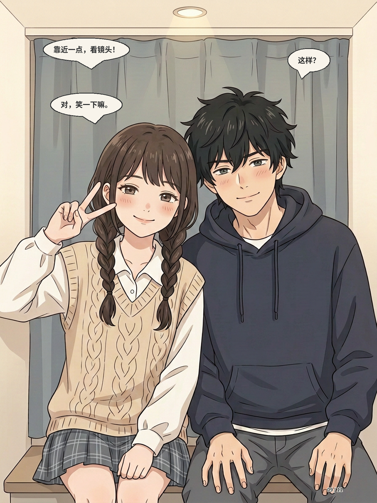

## 第10页

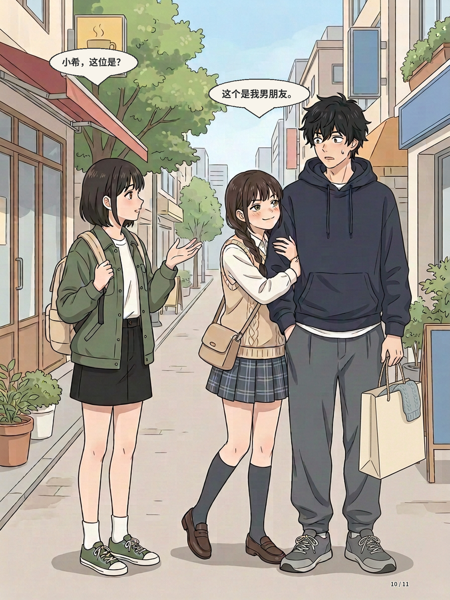

## 第11页

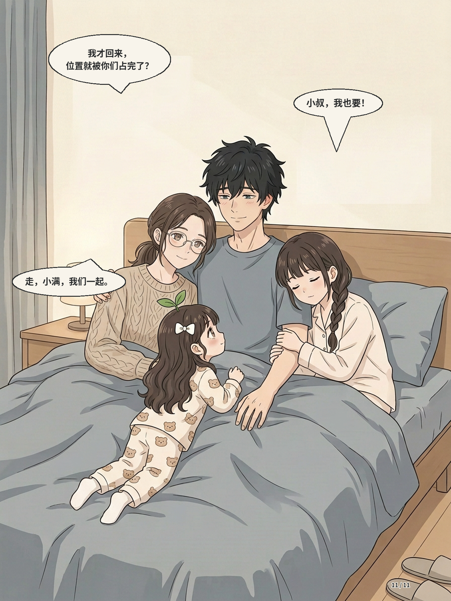
