# 第九话｜气泡台词试排 v11

基于v10未验收图像的工作试排，非定稿。部分气泡（尤其10–12页）说话归属不清，仍需返修；详见[检查与待修](检查与待修.md)。

## 封面

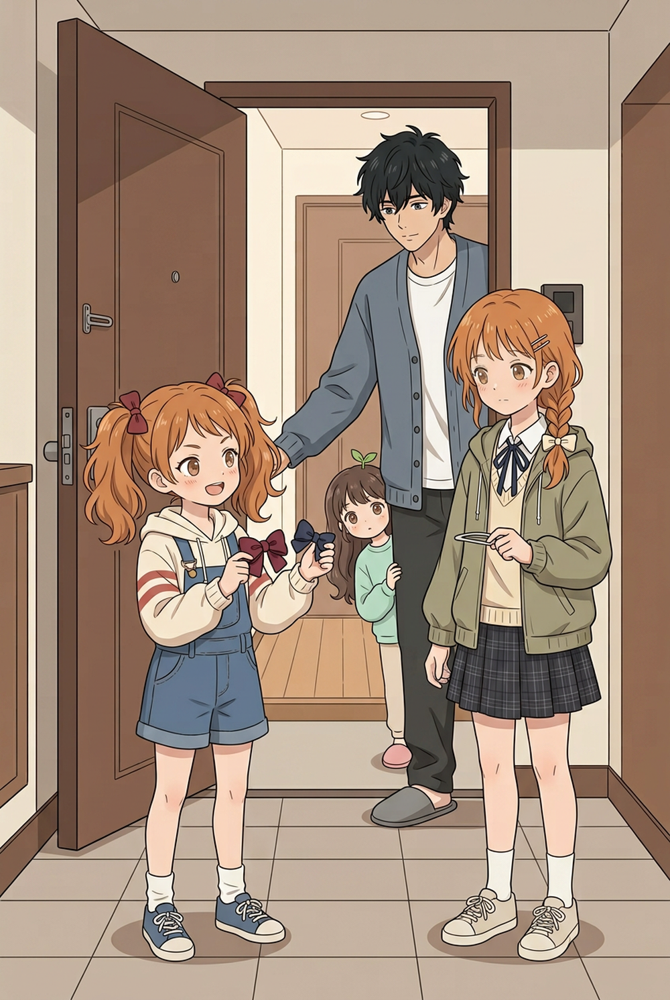

## 01

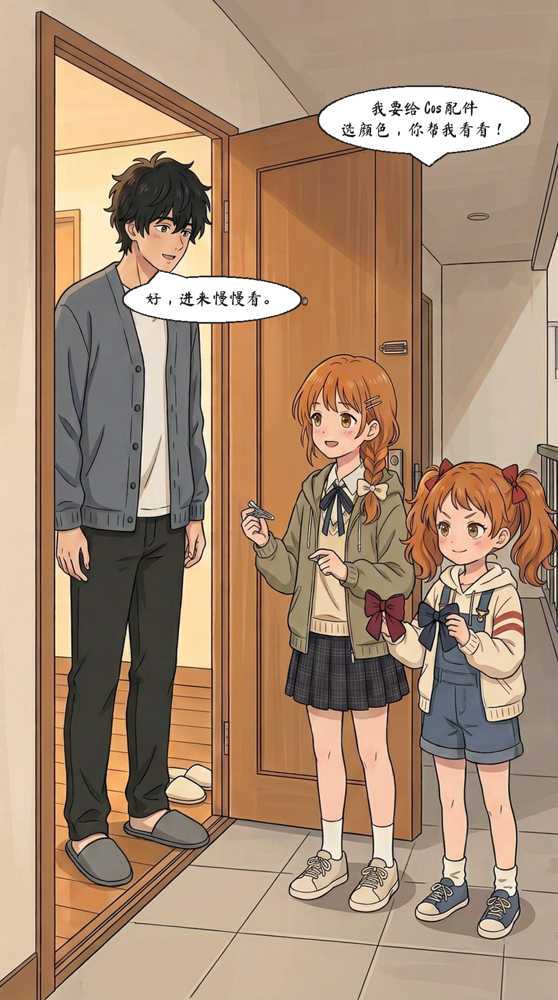

## 02

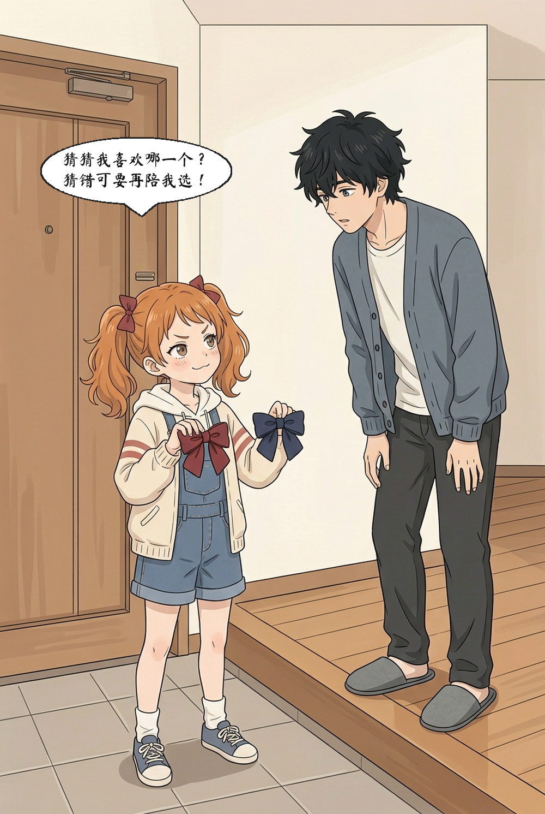

## 02a

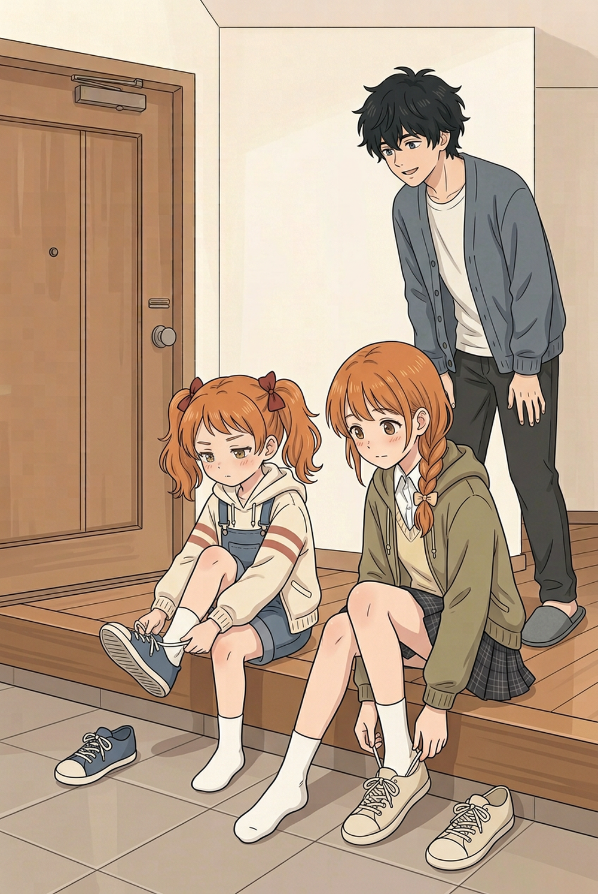

## 03

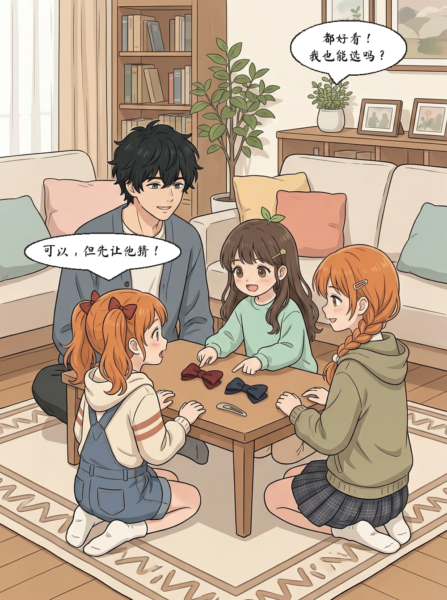

## 04

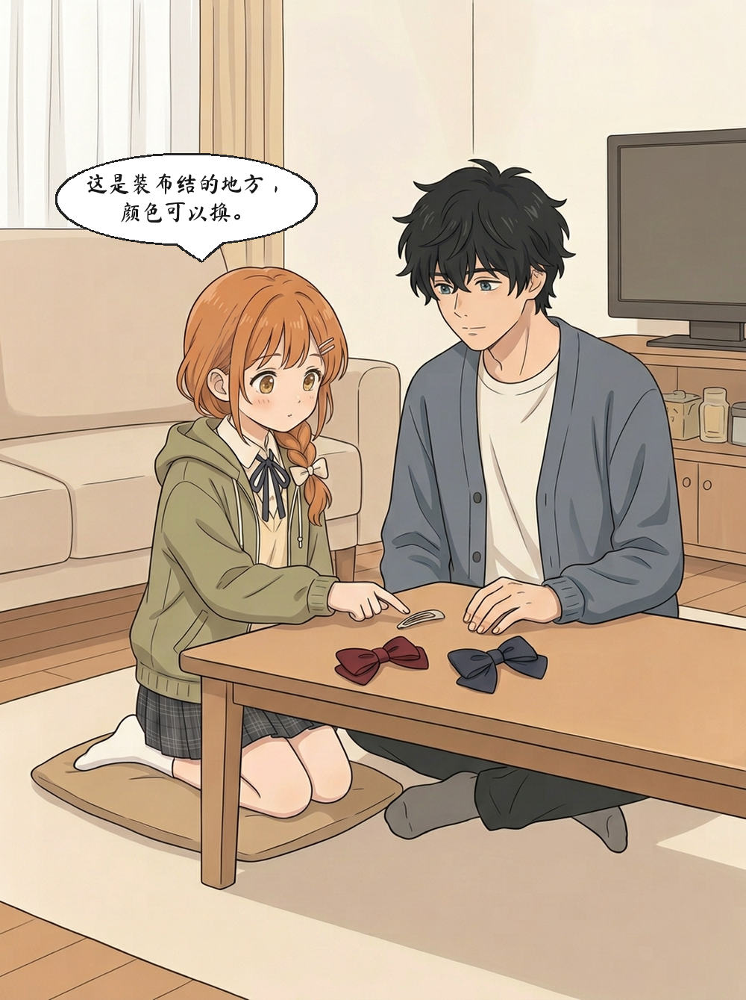

## 05

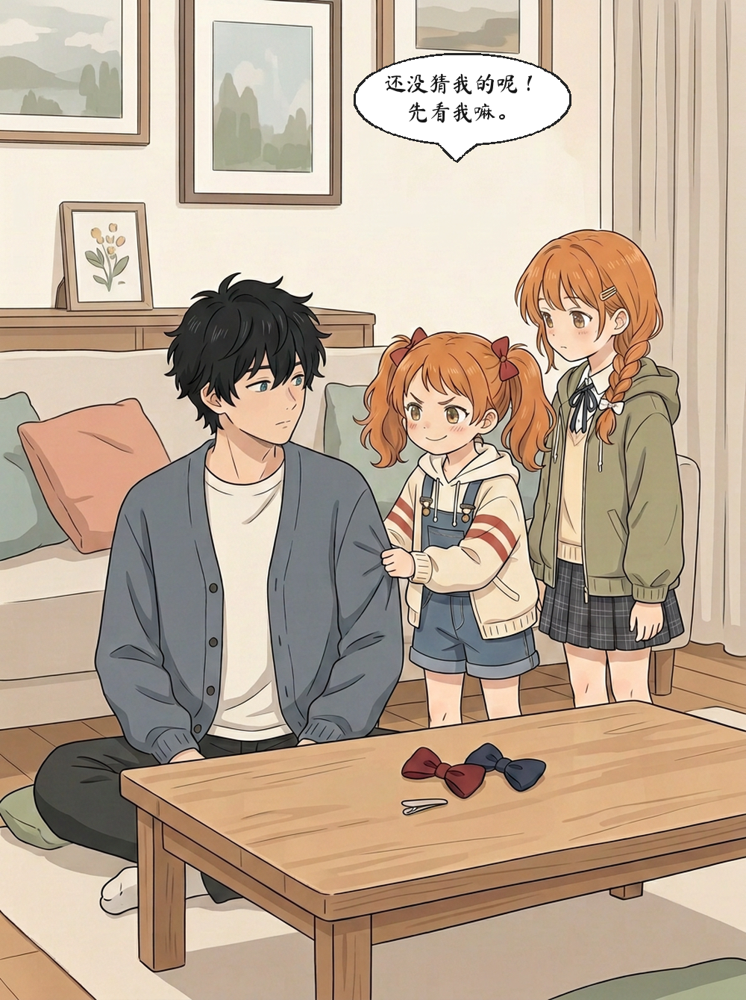

## 06

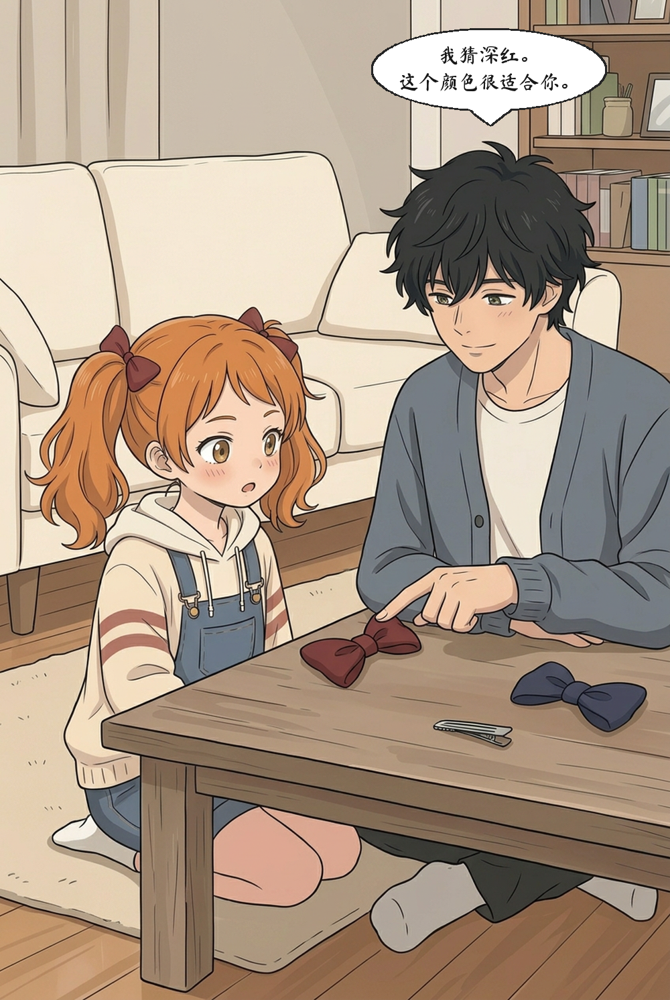

## 07

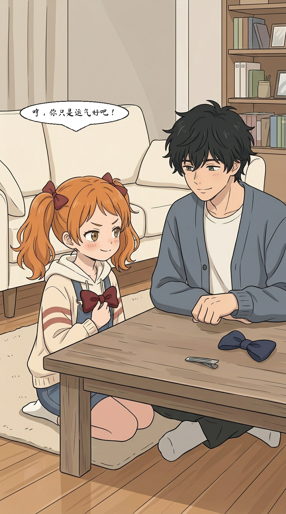

## 07a

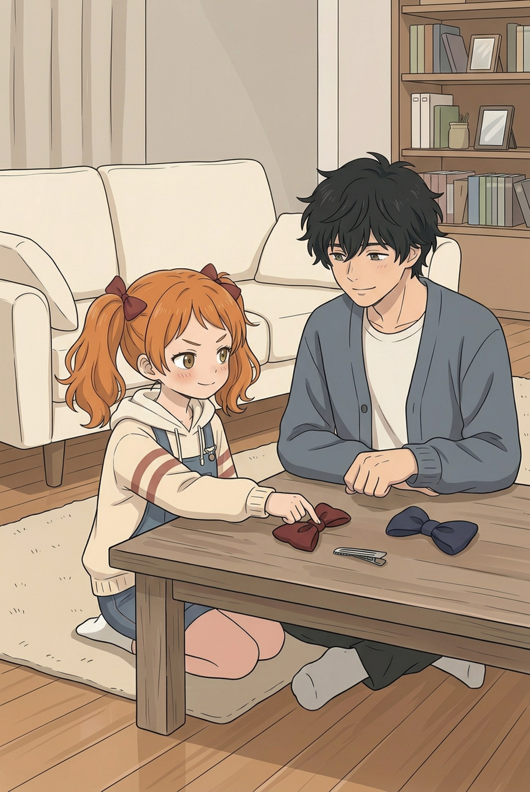

## 08

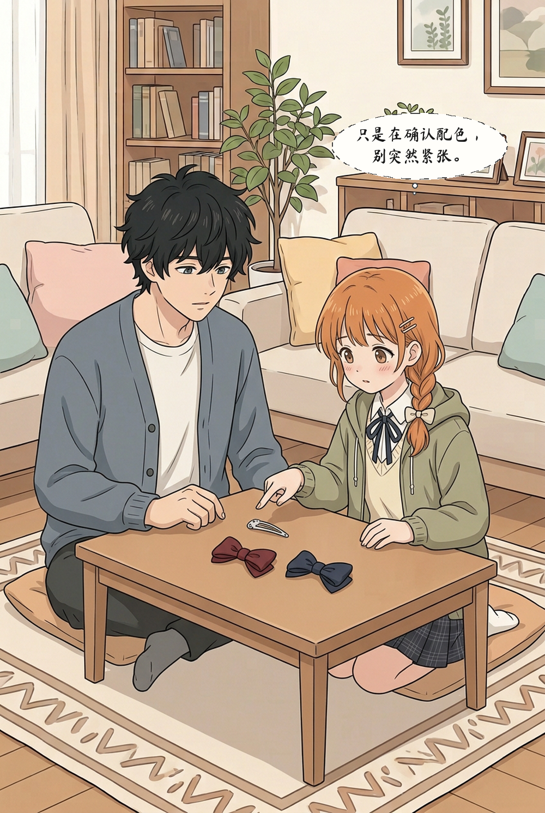

## 09

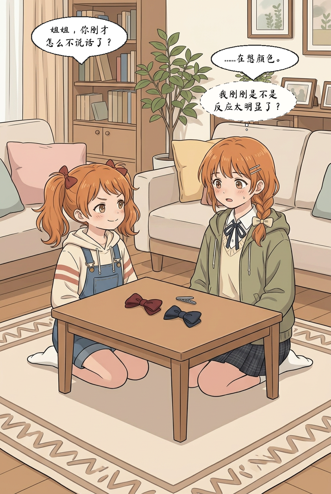

## 10

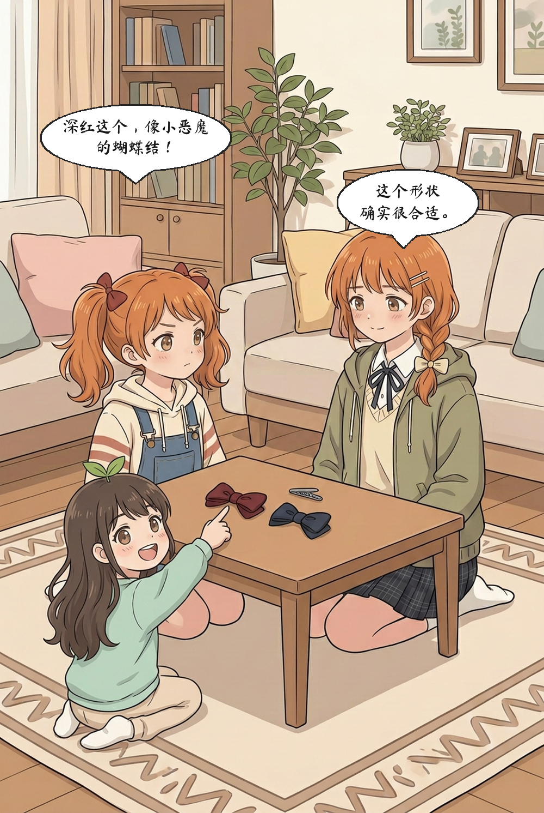

## 11

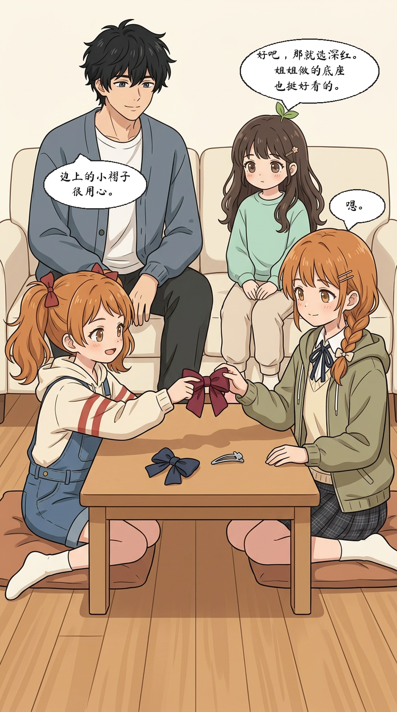

## 12

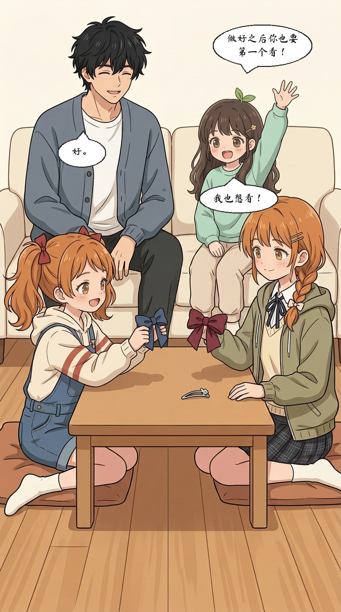
