# 第九话｜完整逐页图文台词预览 v9

工作代称：邻居姐妹的配件小讨论。封面＋12页＋两张过门，共15张。台词在图片下方，角色标注只用于预览；尚未上漫画气泡、未定稿。

画面与对白存在仍需处理的衔接问题，详见[检查记录](检查与待修.md)。

## 封面

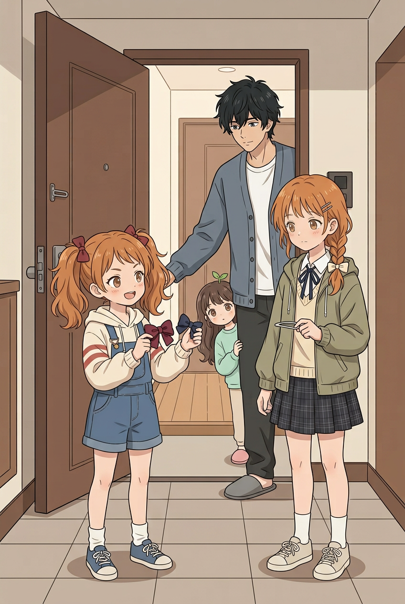

*工作封面；标题待定。*

（无对白）

## 01 来访

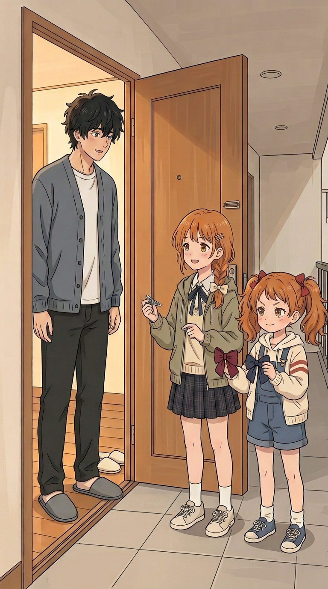

*妹妹带来样品；姐姐拿底座。*

- 邻居妹妹：我要给 Cos 配件选颜色，你帮我看看！
- 二哥：好，进来慢慢看。

## 02 小挑战

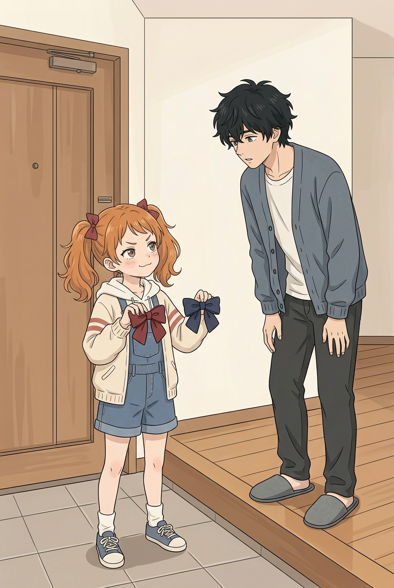

*妹妹举起两色样品，观察二哥反应。*

- 邻居妹妹：猜猜我喜欢哪一个？猜错可要再陪我选！

## 02a 玄关过门

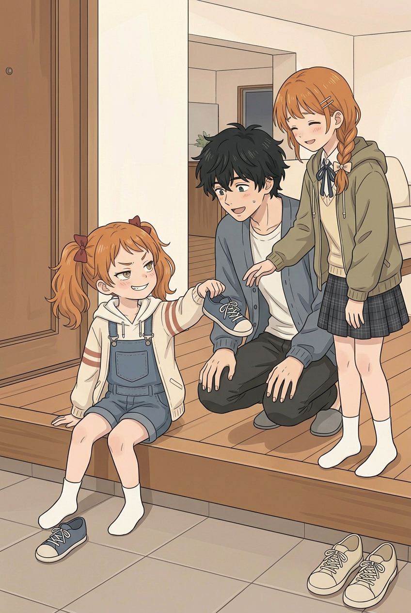

*妹妹拿自己的蓝鞋逗二哥，姐姐笑着制止。*

- 邻居妹妹：嘿嘿，看这个！
- 二哥：又有什么鬼点子？
- 邻居姐姐：别闹啦，先把鞋放好吧。

## 03 小满参与

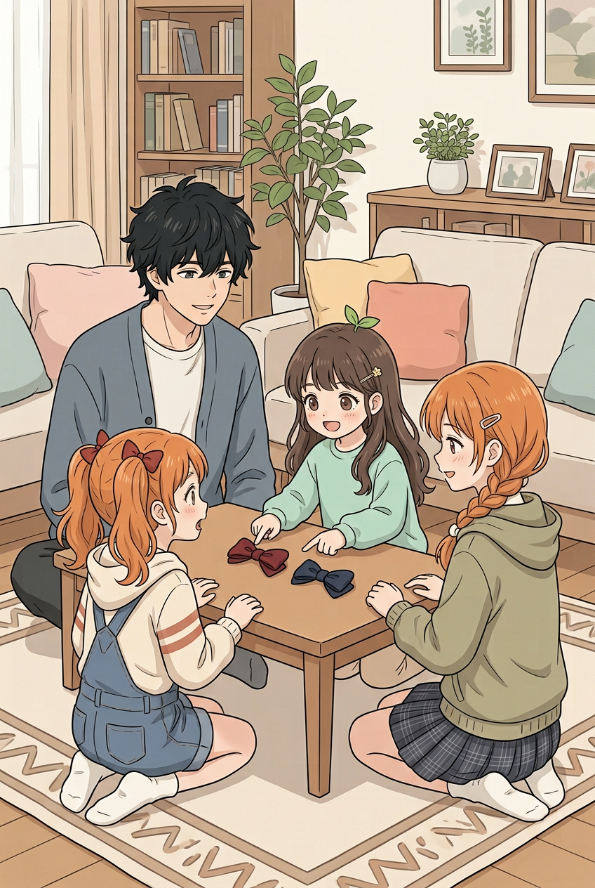

*四人在客厅看样品。*

- 小满：都好看！我也能选吗？
- 邻居妹妹：可以，但先让他猜！

## 04 姐姐说明

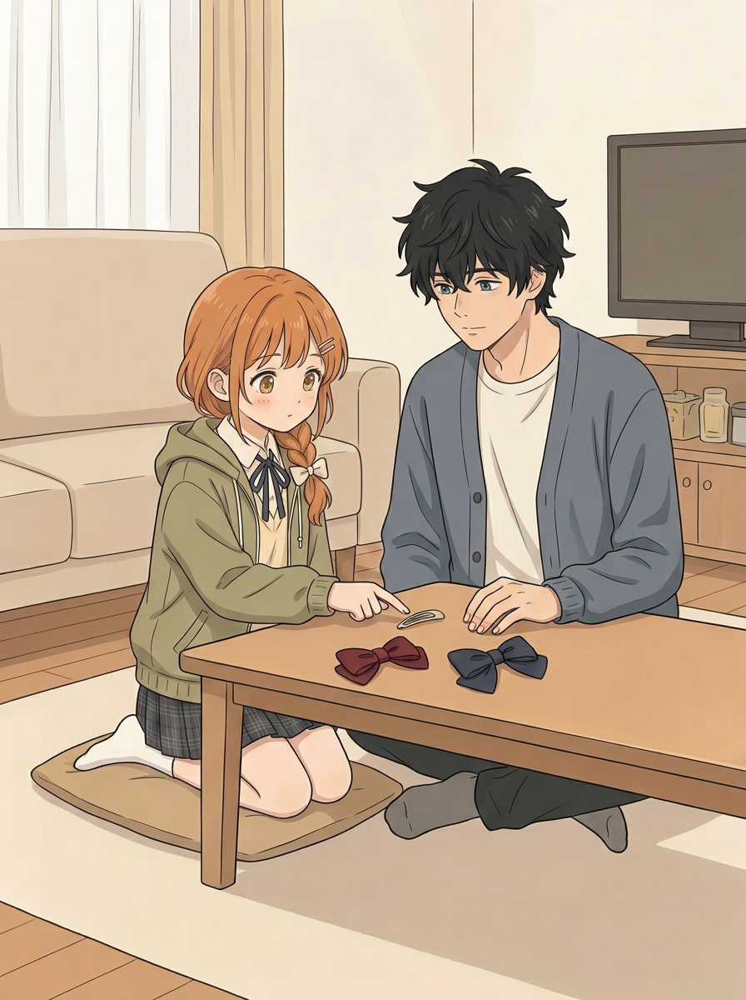

*姐姐指向底座，二哥认真看。*

- 邻居姐姐：这是装布结的地方，颜色可以换。

## 05 争取注意

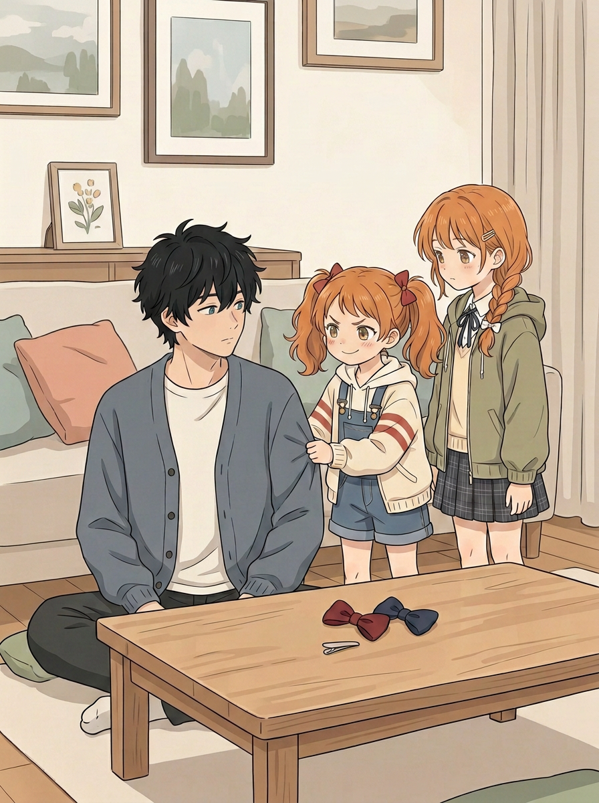

*妹妹轻拉袖子，期待二哥注意她。*

- 邻居妹妹：还没猜我的呢！先看我嘛。

## 06 二哥猜颜色

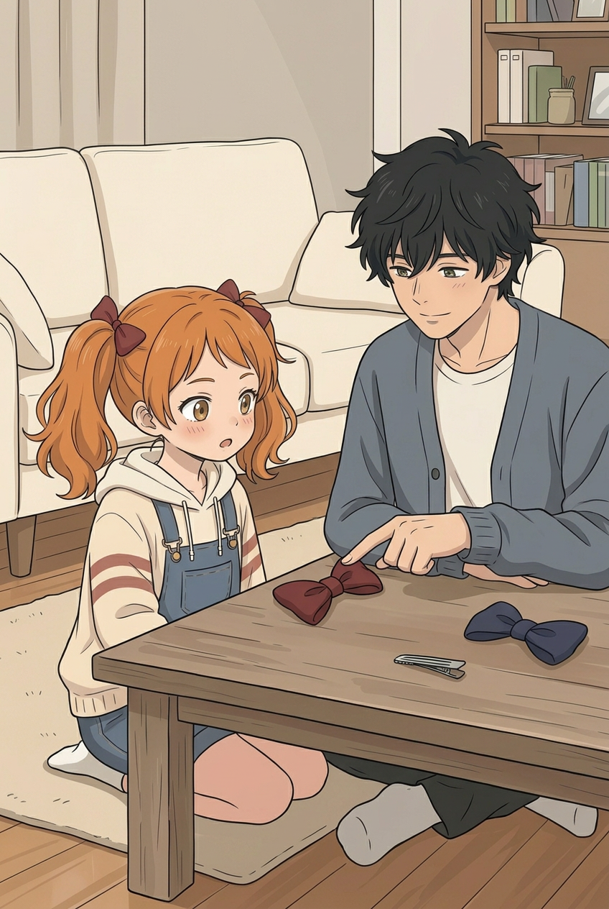

*二哥指着红结，妹妹露出意外表情。*

- 二哥：我猜深红。这个颜色很适合你。

## 07 嘴硬

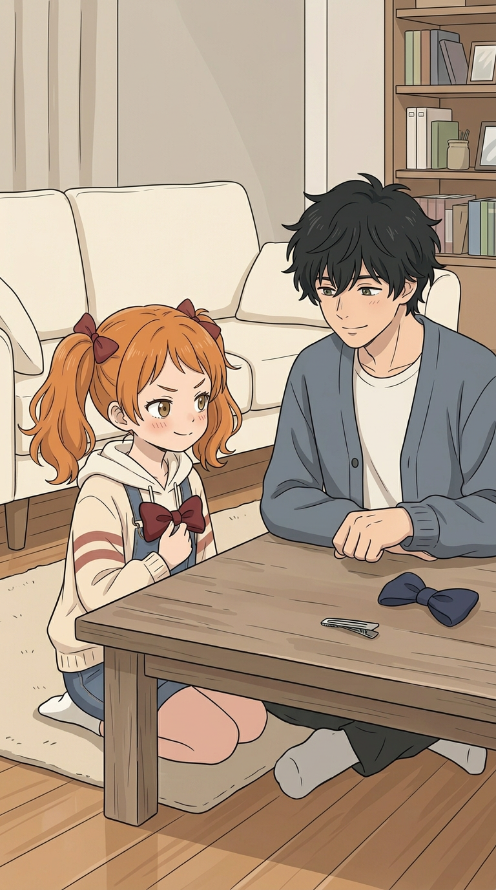

*她拿着红结比了一下。*

- 邻居妹妹：哼，你只是运气好吧！

## 07a 放回桌上

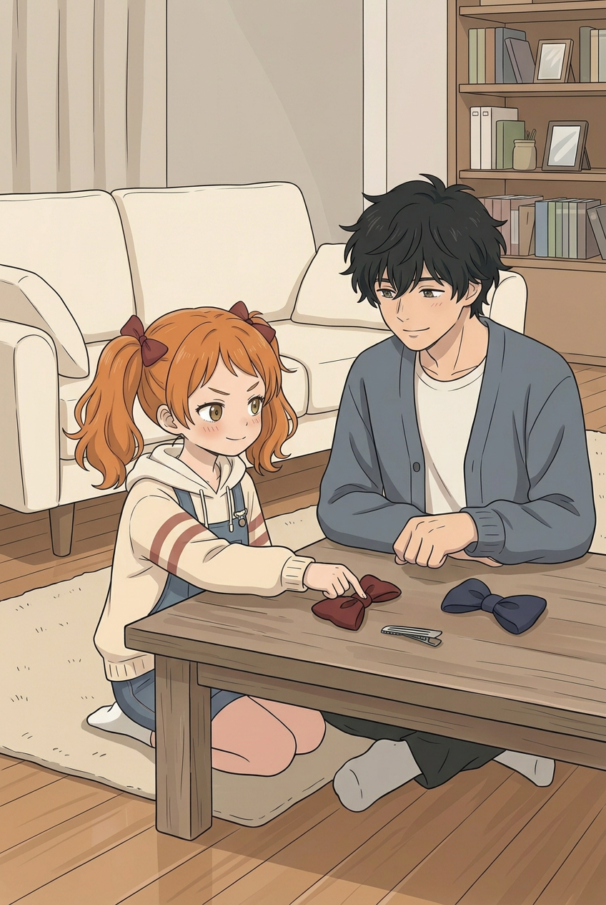

*妹妹将红结放回桌上，准备继续比较。*

（无对白）

## 08 姐姐的心思

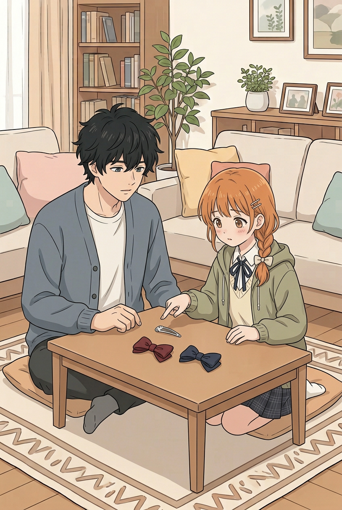

*姐姐靠近桌边指向底座。*

- 邻居姐姐（心声）：只是在确认配色，别突然紧张。

## 09 妹妹发现

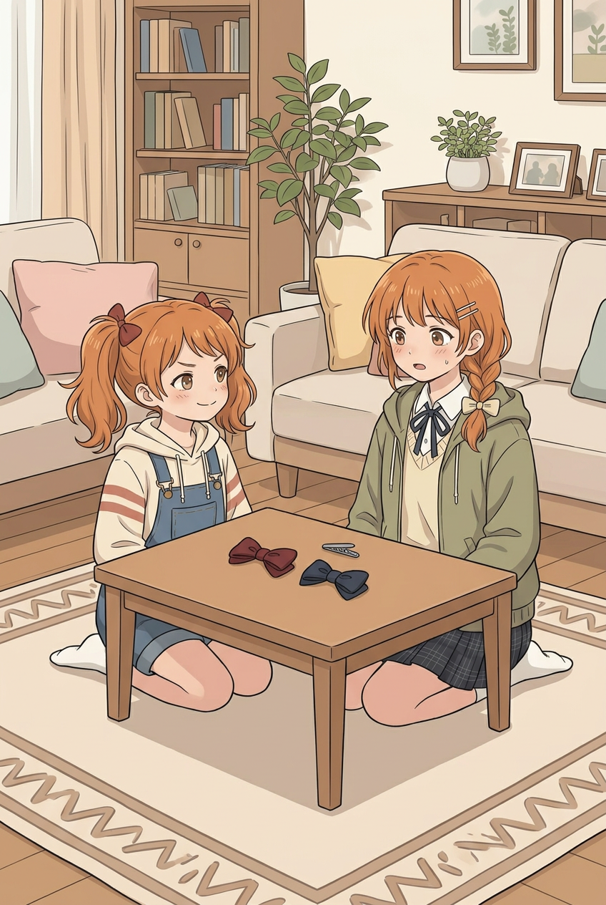

*妹妹留意到姐姐的反应。*

- 邻居妹妹：姐姐，你刚才怎么不说话了？
- 邻居姐姐：……在想颜色。
- 邻居姐姐（心声）：我刚刚是不是反应太明显了？

## 10 小满的想法

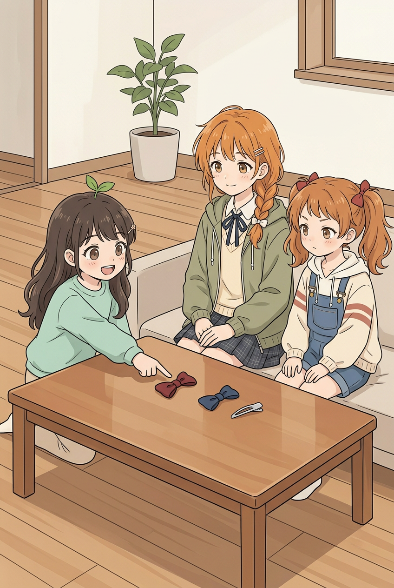

*小满指着桌上的深红布结。*

- 小满：深红这个，像小恶魔的蝴蝶结！
- 邻居姐姐：这个形状确实很合适。

## 11 决定

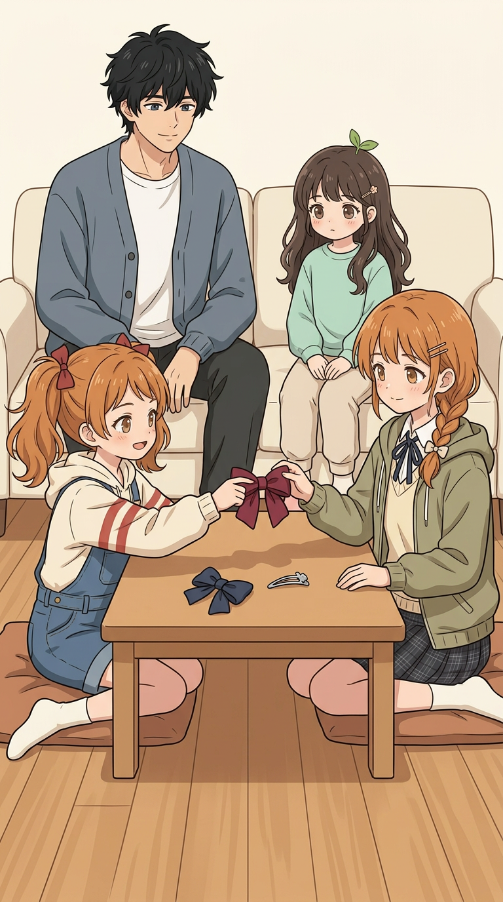

*妹妹将红结递给姐姐。*

- 邻居妹妹：好吧，那就选深红。姐姐做的底座也挺好看的。
- 二哥：边上的小褶子很用心。
- 邻居姐姐：嗯。

## 12 准备收拾

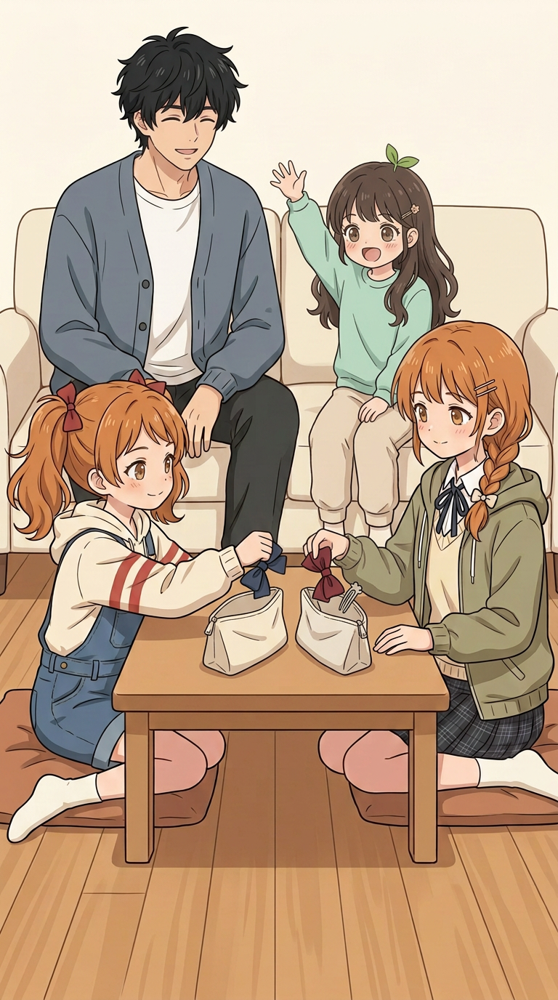

*姐姐准备收红结与底座，妹妹准备收蓝结。*

- 邻居妹妹：做好之后你也要第一个看！
- 二哥：好。
- 小满：我也想看！
