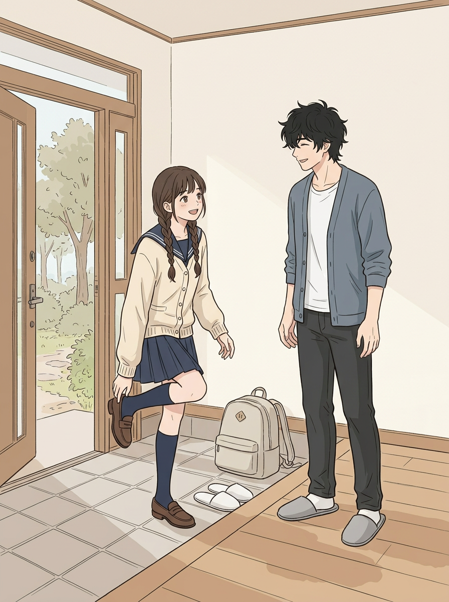
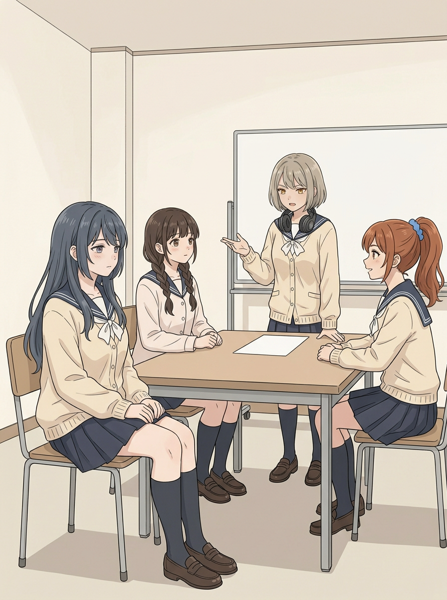
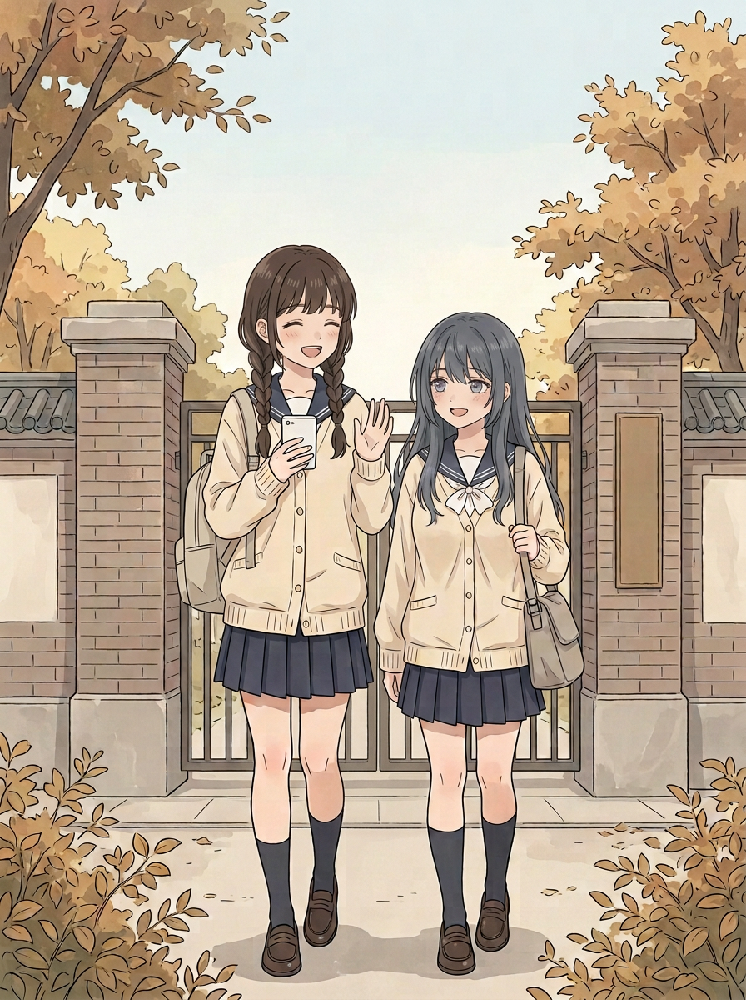

# 第八话｜好友身材、画风和剧情复查

> 基于第八话 v2 全11页逐页实看，并对照用户认可的好友立绘和第八话剧情草案v4。本次是复查与局部试画，不是整话v3，也不覆盖v2。好友自然丰满的体型是正常的人物特征，不能为了省事画成纤瘦或平直。新成员形象、对白和最终标题仍待用户确认。

[认可的好友立绘](../../../../art/角色形象区/妹妹好友_参考与候选/新同学_体型优化试案.png) · [第八话v2逐页](../../../review-chapter-08-v2/逐页看图.md)

## 一、好友出镜逐页检查

| 页 | 实看结果与建议 |
|---|---|
| 封面 | 正面全身可见，娇小和蓝黑发可辨；开衫下轮廓与参考相比偏直，保留但需以参考图再次核对。 |
| 01 | 侧后方坐姿，桌子、手臂和头发遮挡身体，**不能凭此角度断言身材正确或错误**；侧脸和发色偏蓝亮，正式版需与参考对照。 |
| 02 | 近景上半身有显示，但衣服下轮廓比参考更直，偏离自然丰满印象；建议重画，并保留好友自己的解题动作。 |
| 03 | 好友坐在桌边，部分身躯被桌面、他人手臂遮挡；可见的轮廓也较平直，不能仅因遮挡认定完全正确，建议以参考重画。 |
| 04 | 纸张正好挡住大部分上身，不能靠它判断体型；建议改构图让人物自然可辨。 |
| 05 | 好友在后方、被桌子遮挡，画面小；不据此断定身材错误，正式重排时需注意不要误画得纤瘦。 |
| 06 | 远景坐姿被桌面挡住，可见轮廓偏直；远景及姿势会影响观感，仍须对照参考修订。 |
| 07 | 正面站姿相对清楚，身形较直，与认可立绘的自然丰满轮廓有差距，建议重画并保持娇小。 |
| 08—10 | 好友不出场；不要因此改动其人设。 |

以上为对本版的视觉判断，不把透视和遮挡都当作画错，也不把不清楚当作通过。最终相似程度由用户判断。

## 二、截图中的进门画风｜局部试画

旧08页的纹理、水彩颗粒和阴影较重，人物五官及哥哥笑容也与作为参考的前话画面有差异；这是你指出的风格问题，不能以技术筛查结果代替你的判断。下面是新做的**无字风格候选**，线条和色块比旧图更简洁；是否达到你希望的第四话以后画风，请你看图决定。背包的形状仍需与最终07页统一；妹妹仍处在开始脱鞋的动作，09页已穿上拖鞋。

## 三、好友局部重画探索（尚不直接替换正文）

有些重新生成的图虽然完成，但并没有可靠修好身材；不能因为生成成功就算完成。下列图主要用于比较构图和比例，而非整页定稿：

### 03页重新构图候选

好友移到较清楚的前景，但座位和房间布局与v2第04页不同，妹妹开衫颜色和领结也不完全一致；会长的鞋与桌脚附近有遮挡，需要继续检查。图未排字，不能直接拼入成品。**好友体型是否接近认可图仍请你判断。**

### 07页候选

身形仍须按认可图核对，好友表情比原图活泼一些；妹妹的背包由手提变为背着，包形仍与08候选不完全相同。不能宣布连续性已解决。

其他探索也原样保存，供追溯：
- [02候选A](../../../../art/chapter-08-v3/scene-02-candidate.png)：与原画相近，身材改善不明显。
- [02候选B](../../../../art/chapter-08-v3/scene-02-candidate-b.png)：妹妹外套变成深色，违反连续段服装，暂不采用。
- [03候选A](../../../../art/chapter-08-v3/scene-03-candidate.png)、[04候选A](../../../../art/chapter-08-v3/scene-04-candidate.png)：仍有遮挡或变化太小，不能认定修好。
- [04候选B](../../../../art/chapter-08-v3/scene-04-candidate-b.png)：好友站起来后轮廓更可见，但委员领结变蓝、房间和桌面也变化，表上出现不可靠文字，暂不直接采用。
- [06候选](../../../../art/chapter-08-v3/scene-06-candidate.png)：仍是远景，好友身形不够清楚。

下一轮应先统一四人的标准正侧面、服装和学生会空间，再重画需要替换的页，逐张看人物而非简单套一张模板。先不删候选、不覆盖v2。

## 四、剧情场景与台词复查

| 位置 | 现状 | 问题性质和下一轮建议 |
|---|---|---|
| 01课堂 | 老师提问与辰希回答放在同一页，只有题目和答案18。 | 解答数学上正确，但恒等式和思路没有呈现；两人的气泡左右位置也容易让人先读到回答。建议拆成“老师提问→辰希写出关键变形→老师/同学回应”两页或多格，突出高智商与课堂魅力；公式用后期清晰排版。 |
| 01→02 | 直接跳到好友做出同类题。 | 看不到好友之前不懂、辰希讲解的过程，好友的进步来得突然。补一格或一页好友提问、辰希讲思路，再由好友独立完成并得到回应。 |
| 02→03 | 从教室突然到学生会。 | 不是逻辑错误，但午休及两人同为学生会成员没有交代。加“午休·学生会室”转场，或两人收好笔记一起去学生会。 |
| 03→04 | 会长交代三个社团的时间限制，辰希给顺序、好友画图、委员通知。 | “绘画社十二点二十**后**才到”与04排在12:20—12:30有边界歧义：可以改排**音乐12:10—12:20、手工12:20—12:30、绘画12:30—12:40**，满足“12:20之后才到”和音乐12:30之前结束；或明确改词“十二点二十起可到”。时间安排后期准确排版，不把生图里乱字当事实。加会长确认，说明会议结束。 |
| 04→05 | 从学生会直接回教室、男同学邀请。 | 时间段可用小字“下午课间”，并让学生会安排有一个确认/通知的收尾。男同学不需强加戏，妹妹的冷淡应自然明确，不改成对所有人都凶。 |
| 05→06 | 拒绝之后好友问想哥哥。 | 可保留反差。台词可更自然：“你这么急着回去，是想见二哥了？”“嗯，今天特别想他。”心想“好想快点回家抱抱二哥……”保留用户要求的想念。 |
| 06→07 | 前一页仍在课堂，后一页已经校门口同时发、收消息和道别。 | 缺少下课或放学提示；加“放学后”并分清消息先后；妹妹也回一句“明天见”。不必强行画整个回家路程。 |
| 07→08 | 校门道别直接到家。 | 正常时间跳切，可以加“回到家”标识。包颜色接近但细节、标志、提法均不统一；先选一个包的形状，再跨页照着画。 |
| 08→09 | 08开始脱鞋、09站在客厅穿拖鞋拥抱。 | 可合理理解中间完成换鞋，但如果要让动作更清楚，可增加放好鞋、穿拖鞋走进屋的一小格；注意两人鞋、书包位置统一。 |
| 09→10 | 站着拥抱后直接坐在沙发上；沙发花纹、靠垫不同。 | 缺少坐下的过渡，背景道具不一致。可加一句哥哥“先坐下吧”，随后坐在同一张沙发上；不用把正常家庭拥抱解释成别的关系。10页脸靠近胸前，实际贴合点仍不够清晰，需要重画或用户判断；吸气目前靠括号提示。 |
| 09→结尾 | 妹妹提到和朋友安排活动，哥哥说等会儿讲，但故事没有实际分享。 | 与v4“回家分享”的呼应偏简略。可以在坐下后让她具体说一句自己的解题、好友和大家的分工，哥哥自然回应；不必让新角色此时见到哥哥。 |

### 一段可供下一轮试排的对白（未定稿）

- 好友：“这里我没跟上，你是怎么想到的？” 
辰希：“先看式子的结构，试试这个恒等式。” 
好友：“这道我自己做出来了。” 
辰希：“对了，你画的图也很清楚。”
- 会长：“三个社团各用十分钟，从十二点十分开始。” 
委员：“音乐社十二点半前要结束，绘画社十二点二十之后才到。” 
辰希：“音乐先，手工第二，绘画最后，时间都赶得上。” 
好友：“我把时间和图标标清楚。” 
会长：“好，就按这个安排。” 
委员：“我去通知她们！”
- 好友：“你这么急着回去，是想见二哥了？” 
辰希：“嗯，今天特别想他。”
- 辰希：“二哥，你今天在家吗？” 
哥哥：“在家。路上慢点，等你回来。” 
好友：“明天见，路上小心。” 
辰希：“嗯，明天见！”
- 哥哥：“回来了？” 
辰希：“二哥！” 
辰希：“今天一直想你，好想快点回来抱抱你。” 
哥哥：“那就多抱一会儿。先坐下吧。” 
辰希：“（轻轻吸气）二哥，让我再靠一会儿。” 
哥哥：“好。” 
辰希：“今天学生会安排活动，大家都有帮忙。我还解出了一道题！” 
哥哥：“听起来很充实，慢慢讲给我听。”

以上顺序和用词只是提案，不替用户确认台词；保留学生会总共四名女生，以及未来哥哥与她们相识的空间。具体页数以把故事讲清楚为准，不强行压成原来的十页。
