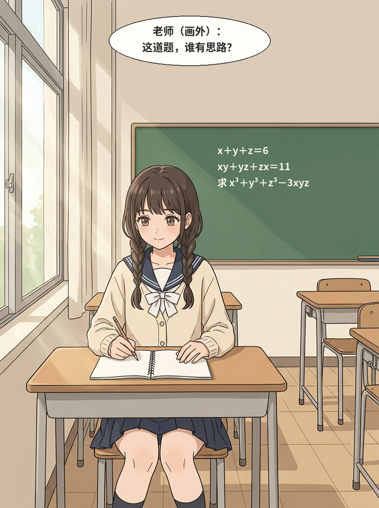
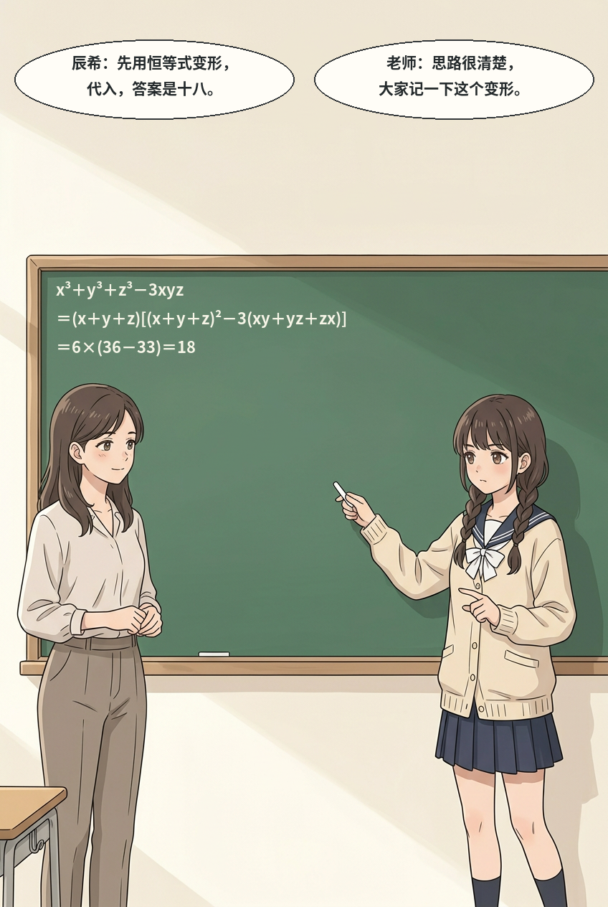

# 第八话｜本轮对照与逐页进度

> 本轮继续优先第八话。既有剧情工作稿中04、07、12、14以前缺少画面，现在都有了**待审候选**；这不代表这些画面全部符合要求。01、02只做了两个带文字的局部排版预览，其余仍是无字草图；整话尚未排版、尚未验收。用户指定的角色个人风格和原有已确认造型仍保留，不用试画取代正式人设。

[上一轮完整剧情和对白](../review-chapter-08-reset-v1/第八话_整话重置工作稿.md) · [好友获认可立绘](../../../../art/角色形象区/妹妹好友_参考与候选/新同学_体型优化试案.png) · [二哥身材表情补充参考](../../../../art/角色形象区/二弟_用户补充参考/二弟_身材表情_用户参考.jpg)

## 第一页：重新起稿并试排

这次仍未引用被用户否定的01旧图或上轮01图，而是以获认可的漫画风格和妹妹原人设独立起稿。老师在画外提问，避免上轮远景老师无脸的问题；黑板题目与对白是后期绘制，已核对 x＋y＋z＝6、xy＋yz＋zx＝11，目标式为 x³＋y³＋z³－3xyz。无尾椭圆有“老师（画外）”标记；教室其他座位空着，若表现全班上课的氛围不足需再调整。**风格是否符合要求仍由用户判断**；这只是首页试排，并未替换旧版漫画。

## 第二页：解法试排

这页借用上轮新画的黑板解题场景，后期排入关键恒等式和老师回应。数值核对：例如 x、y、z 为1、2、3时两条件成立，目标式等于18；并已按恒等式代入得 6×(36－33)＝18。椭圆气泡无指向尾，但写明说话人，且按“辰希→老师”顺序排；如正式版使用，要继续检查发言位置及读序。两页画幅不同，暂未统一到整话阅读格式。

## 全话候选与问题（页码以14页新剧情方案为准）

| 页 | 当前图像／对白 | 本轮实看及未完成项 |
|---|---|---|
| 封面 | [走路候选](../../../../art/chapter-08-v4/cover-walking-candidate.png) | 脚步前后分开，但两人步态同步，妹妹领口被书遮挡；用户尚未确认。标题仅候选，画幅比例尚需适配。 |
| 01 | [重置试排](page-01-typeset-preview.png)；[无字原图](../../../../art/chapter-08-reset-v2/01-new-class.png) | 老师在画外，题目已排；画风需判断，教室空座较多。原始重置页未被覆盖。 |
| 02 | [解法试排](page-02-typeset-preview.png)；[无字原图](../../../../art/chapter-08-reset-v1/02-solution.png) | 解法完整、内容正确；气泡无尾，身份靠文字标识；需和01教室布局及画风进一步核对。 |
| 03 | [好友询问](../../../../art/chapter-08-reset-v1/03-friends.png) | 两人同款校服、好友可见轮廓；本子是生成字，不能当正确题目，后续清理或重做；好友体型需和认可立绘及用户意见对照。 |
| 04 | [好友独立完成新候选](../../../../art/chapter-08-reset-v2/04-friend-solves.png) | 好友坐着看本子、妹妹站旁边，本子有生成的算式/乱码不能用；好友头发看起来比认可立绘短，体型是否吻合待核。**横幅1200×896**，不是正确竖页，可评估不裁主体的适配，但目前尚未适配，不能直接混排。 |
| 05 | [学生会讨论](../../../../art/chapter-08-reset-v1/04-council-discuss.png) | 四名女生和统一制服可辨、耳机在颈部；好友坐姿和桌面遮挡影响体型判断。 |
| 06 | [学生会解决新候选](../../../../art/chapter-08-reset-v2/06-council-solution.png) | 房间、桌椅、人物位置及颈部耳机较接近05；妹妹抬手讲、好友执笔，但画面与05相似、实际排程字未做，好友身形仍需对照。 |
| 07 | [学生会收尾新候选](../../../../art/chapter-08-reset-v2/07-council-close.png) | 场景和耳机位置较接近05；委员手里一张纸、桌上仍有另一张，可能是两份但页面未交代，不能直接说是同一张表连续移动；好友手与桌面遮挡，需复看。 |
| 08 | [拒绝男同学新候选](../../../../art/chapter-08-reset-v2/08-refusal.png) | 男同学浅棕发、脸型和着装与黑发二哥更易区分；妹妹、好友服饰相同。男同学鞋脚一部分出画；好友坐姿不能判断站高。 |
| 09 | [想哥哥新候选](../../../../art/chapter-08-reset-v2/09-friends-talk.png) | 同地面可见好友较妹妹矮，长发、制服可辨，但上身轮廓偏直，与认可立绘仍需对照；背景过于简洁，课堂地点辨识偏弱。 |
| 10 | [校门新候选](../../../../art/chapter-08-reset-v2/10-school-gate.png) | 好友头顶比妹妹低，两人同地面但前后位置略有差异；好友轮廓与认可图是否吻合由用户判断。妹妹书包正面被挡，不能确认与11的前袋细节完全一致。 |
| 11 | [玄关候选](../../../../art/chapter-08-reset-v1/09-entrance.png) | 妹妹穿棕鞋站在落脚区，哥哥穿灰拖，浅色拖鞋是一双；本图是换鞋之前。两人位置、包、地面需与10、12连续核对。 |
| 12 | [站立拥抱新候选](../../../../art/chapter-08-reset-v2/12-standing-hug.png) | 其人穿浅拖、二哥穿灰拖，另有一双棕鞋；书包由玄关移到客厅、鞋在木地板旁，需决定是否符合布局。放大看二哥两只可见手，一只的上臂受两人身体遮挡，不能据此断言有多手，也不能证明全部结构无误；妹妹另一只手受遮挡。与11换鞋及坐下仍在画外。 |
| 13 | [沙发靠近新候选](../../../../art/chapter-08-reset-v2/13-sofa-chest.png) | **未修好**：放大后妹妹更像靠在肩头，脸颊贴上胸不明确；吸气没有视觉提示。且为横幅1376×768，沙发及旁边像床的家具与12、14不一致，不能直接采用。 |
| 14 | [分享新候选](../../../../art/chapter-08-reset-v2/14-sharing.png) | 妹妹对二哥说话、二哥看她；她两只手挽他的臂，放大看各自手袖部分可追踪，另一处受遮挡，不机械判错。背景、沙发和上一张尚不统一，不能视为成品。 |

候选中不同画幅只是**技术适配问题**，不因尺寸单独判图画错误；仍须避免强裁主体或拉伸。确定性的缺陷（例如13的接触点不明确、04本子乱码）另行处理，不得靠裁切或程序通过掩盖。

## 人设优化方向继续保留

- 用户要求**每个人**的脸、身高体型、服饰发型与饰物、性格、习惯动作和表情都完整且有辨识度；不能只靠发色和一个饰物，也不能为了区分而乱编新设定。
- 二哥以用户给的补充图呈现穿衣显瘦、自然健身的身体和不同情境的表情；日常服饰无需为了展示肌肉而改变。姐姐、妹妹、小满的已认可表现优化及四人各两套造型全部保留。朋友的娇小自然丰满以获认可立绘为准，同校穿同款制服；会长和委员名字、背景、形象仍待确认。
- [完整人物设计与跨话核查](../../../../docs/人物完整设计与跨话核查_首轮.md)和[江家三人表现优化](../../../../docs/江家三位主角_表现优化讨论.md)仍是制作基准。用户本轮要求记住，并未要求此时转去重做人设图；当前先完成第八话。

## 仍需完成

继续修04数学乱码和发长、07纸张、09好友体型、10—12书包鞋履及坐下过渡，特别是重做13脸颊清楚贴上胸的动作并统一13—14沙发；逐页复看人物、四肢、服饰、场景、对白和公式。之后再做完整排版、读序检查、阅读版及PDF，不能把本轮局部试排当成整话完成。所有图片仍是AI视觉检查，最终以用户判断为准。
