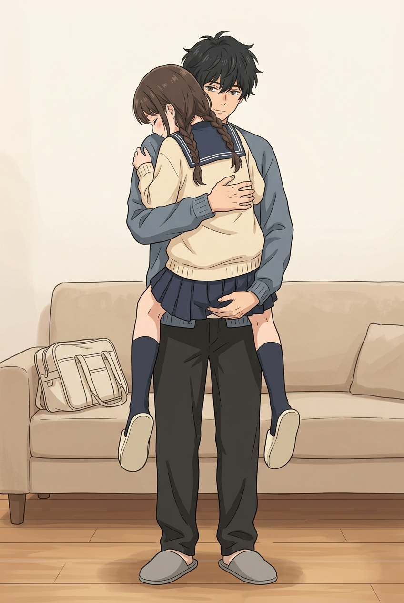

# 第八话｜考拉抱靠近胸口：本轮检查

> **后续用户确认更新：用户认可 `14-koala-clear.png` 的考拉抱动作，要求直接保留并在此基础上优化。以下为确认前的历史观察，不再以肩侧位置或遮挡否定该动作；后续进度见 [动作保留与衔接试画](../review-chapter-08-reset-v6/动作保留与衔接试画.md)。**

用户希望考拉抱时妹妹的脸也靠近哥哥胸口。本轮以回家同段服装和已认可画风为参考独立尝试多个构图，不改旧图；下面均是**未获用户验收的试画**，不把生图成功当作达标。

## 主要试画

[完整图片](../../../../art/chapter-08-reset-v5/14-koala-clear.png)可见妹妹两条穿深袜的腿分别在哥哥两侧、两只浅拖离地；哥哥两条裤腿及两只灰拖落地，一手托着衣裙下部、一手护背。与上一轮横抱相比，构图更接近所需考拉抱。但放大后**妹妹脸靠的是哥哥肩侧，而不是可以明确辨认的胸口**；妹妹一条手臂在两人身体后被遮挡，无法完整追踪，不能仅凭遮挡判错或判对；双腿位于两侧但是否环住腰部被遮挡，仍需判断。书包跑到沙发上且形状与前后页不同，沙发环境也需衔接；白领结位于画外，无法确认。**因此仅保留为姿势探索，不宣称问题已经解决。**

## 其他试画及排除原因

| 文件 | 实图观察与处理 |
| --- | --- |
| [正面](../../../../art/chapter-08-reset-v5/14-koala-front.png) | 裙下两腿之外又出现一只深袜浅拖的脚，共三只妹妹的脚，确定多腿，弃用；脸靠近胸口不能抵消多腿错误。 |
| [侧面](../../../../art/chapter-08-reset-v5/14-koala-side.png) | 妹妹脚离地、脸靠近，但双腿向同一侧垂，哥哥手在后背和腰部，并未清楚呈现托住下方或考拉抱。 |
| [背面](../../../../art/chapter-08-reset-v5/14-koala-rear.png) | 左边一只浅拖、右边两只浅拖，共三只妹妹的脚，确定多腿，弃用。 |
| [斜向](../../../../art/chapter-08-reset-v5/14-koala-diagonal.png) | 画成两组同样的兄妹并排，共四人；是人物重复，弃用。 |
| [侧身另一构图](../../../../art/chapter-08-reset-v5/14-koala-profile.png) | 双腿向同一侧垂，哥哥手主要在腰侧，没有清楚托住下方；衣色偏绿而非同段蓝灰开衫。 |
| [坐下衔接](../../../../art/chapter-08-reset-v5/15-sit-transition.png) | 妹妹已坐在沙发、哥哥仍弯腰站立；手叠在手腕处，放大有局部遮挡及指部重叠，暂不能确认结构；兄妹左右位置与现有分享页相反，转场仍不清楚。 |
| [沙发靠近](../../../../art/chapter-08-reset-v5/16-sofa-rest.png) | 两人鞋袜和制服可见，但妹妹靠的是哥哥肩部而非胸口，不能冒充靠胸动作。背景家具也与上页不同。 |
| [好友做完题](../../../../art/chapter-08-reset-v5/04-friend-finished.png) | 好友放下笔、指向空白本；可作为独立解题之后的补充镜头。纸面没有题目或答案，需精确后期排版；好友的脚靠画面底部，切换画幅不可裁脚，体型仍由用户判断。 |

另一次坐下转场生图失败、没有生成文件；本轮共尝试十次，实际生成九张，全部看过整图，并放大考拉抱面部／手腿、坐下握腕、好友本子与手。判断可能有误，用户确认优先。

## 下一步

优先在**两腿分居两侧、哥哥托稳、脸实际靠到胸前**三个条件同时成立的基础上重画：采用能看见胸口接触的斜侧后视角，同时保留全身与两人的手足；避免三脚、重复人物与服饰变化。再补可信的放下坐好过渡，统一书包、沙发、鞋袜以及镜头左右关系；后续还须完整校对校园部分、好友身材、画风与正式排字。整话不是成品，第01页画风及封面仍须用户最终判断。
