# 第八话｜整话新版整合预览

> **封面＋18页，整话工作预览，不是正式成品。** 本文件把此前各轮已有图按故事顺序整合，并将你认可的三页原样放入第14—16页。01、02已有局部文字试排；其他页的对白写在图下，尚未正式排字。封面是新试画，画风、人物、台词与整话仍需核对；页码是暂定的，后续可能调整。
>
> [整话图片轻量 PDF](第八话_整话新版_图片预览.pdf)（仅图片，除01、02已有的试排字外，下面的说明和对白没有印入 PDF） · [制作状态与封面检查](本轮整合与待办.md)

## 封面｜一起上学（新试画，待确认）

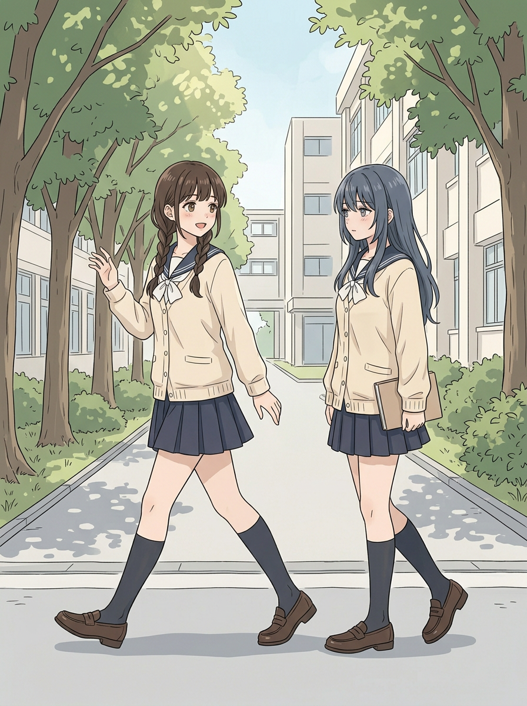

两人的步幅大小、手势有变化；但两人仍同一侧脚在前，妹妹跨步偏大，是否足够自然仍需你判断。好友体型和画风也需对照认可参考。此图不含标题，封面标题仍待确定。

## 01｜老师提出问题

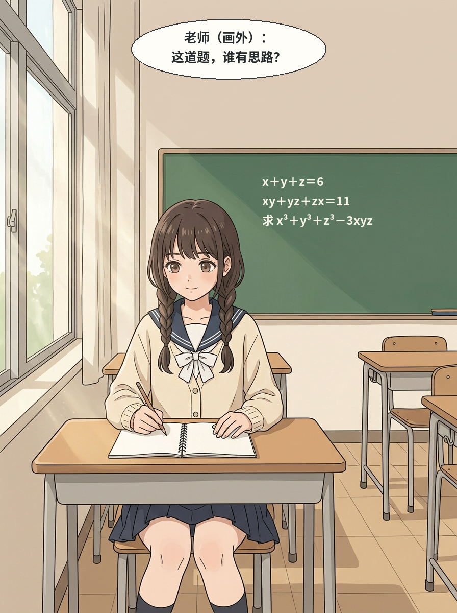

老师在画外；数学题和对白为后期排字。画风尚未经用户确认；空教室氛围需判断。

## 02｜辰希解题

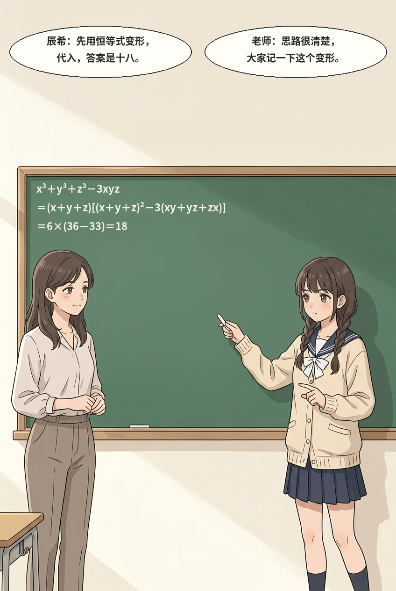

恒等式和答案18已核对。气泡未画尾，靠人名辨认，画面使用与01不同的原始画幅，尚未统一排版。

## 03｜好友请教

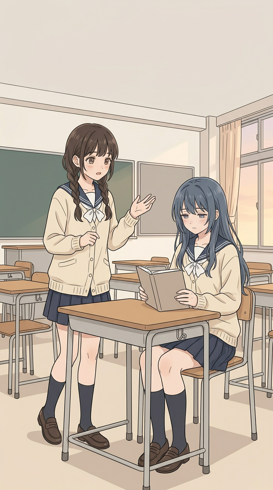

**好友**：这里我没跟上，你怎么想到这样拆？ 
**辰希**：先看式子的结构，试试这个恒等式。

好友拿开放书本，页内没有明显乱码；她部分身体被书与桌面遮挡，不能据此确认完整体型；窗外偏暖的光线与下一页需结合时间核对。

## 04｜好友独立尝试

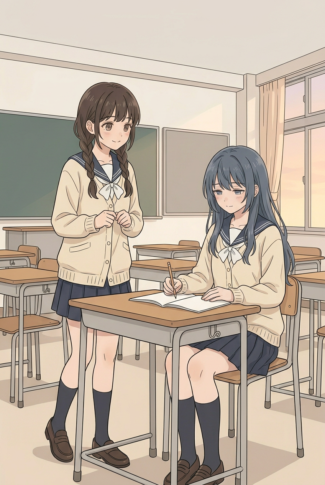

**好友**：我试着自己做这道。 
**辰希**：好，你慢慢来。

好友自己执笔，笔尖贴纸、纸面留白供后期写准确题目；此刻正在解题而非已经完成。两人坐站不同不用于判断身高；鞋子靠近画面底缘，正式适配不可裁切。是否达到认可体型须由用户判断。

[好友做完后的补充试画](../../../../art/chapter-08-reset-v5/04-friend-finished.png)：放下笔、指向本子，可作下一镜候选；本页空白算式仍需后期处理，不能据此说题目已经画出。

## 05｜午休：学生会讨论

**会长**：三个社团各用十分钟，从十二点十分开始。 
**委员**：音乐社要在十二点半前结束，绘画社十二点二十之后才到。

四位都是女生，会长和委员形象仍是待确认候选。

## 06｜一起安排

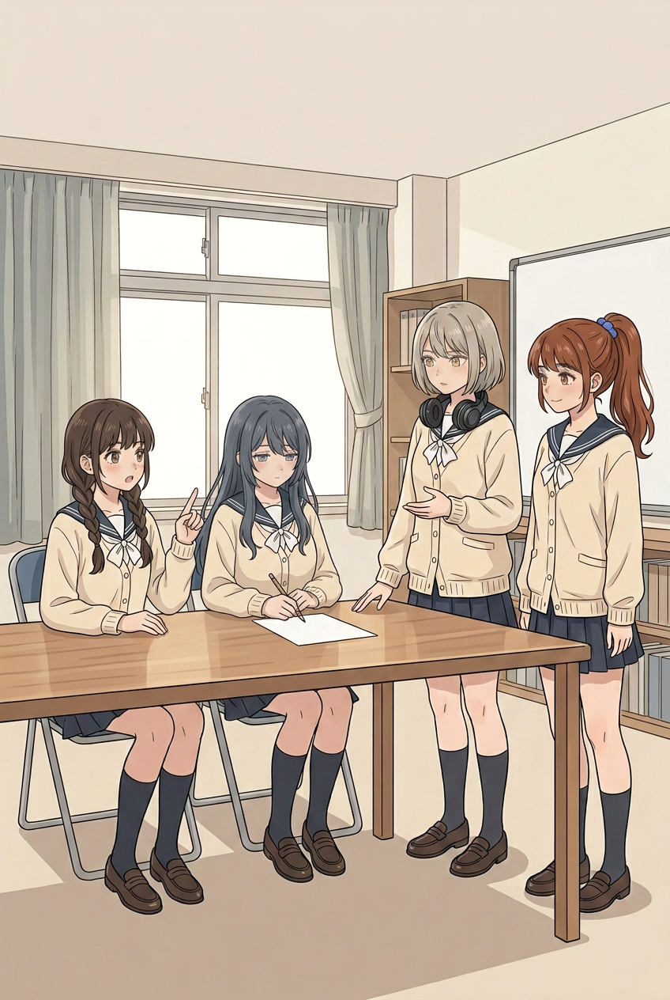

**辰希**：音乐先、手工第二，绘画最后，时间就不冲突。 
**好友**：我把时间和标记整理清楚。

安排为音乐12:10—12:20、手工12:20—12:30、绘画12:30—12:40，避免“12:20之后”边界歧义。纸上仍无正式排字。

## 07｜会议收尾

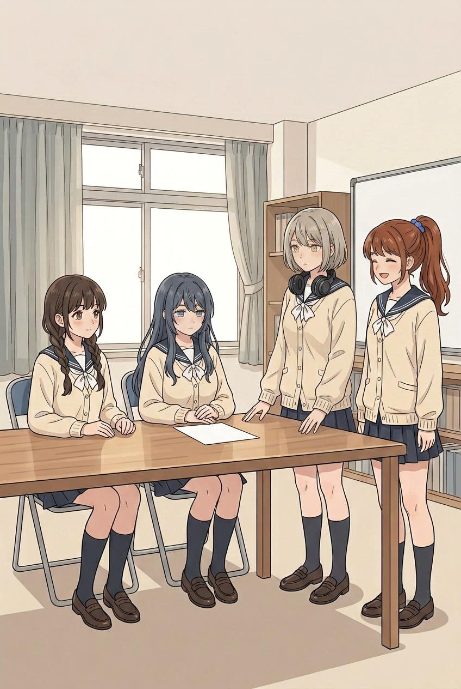

**会长**：好，就按这个安排。 
**委员**：我去通知三个社团！

本页只有桌上一张纸，委员说准备去通知，不再暗示手上拿着同一张纸；耳机在颈部。05—07构图相近，动作表现仍需检查是否太重复。

## 08｜下午：婉拒邀请

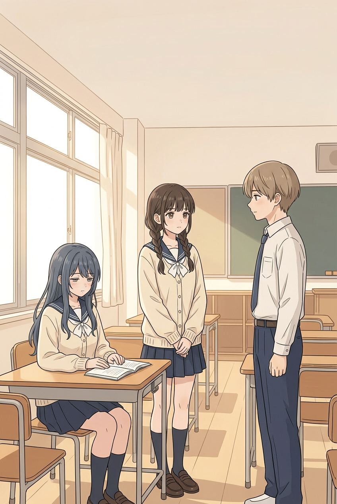

**男同学**：放学后一起去买饮料吗？ 
**辰希**：不了，我要回家。

男同学的浅棕发与二哥有区分；好友坐姿影响体型和身高判断。

## 09｜想念二哥

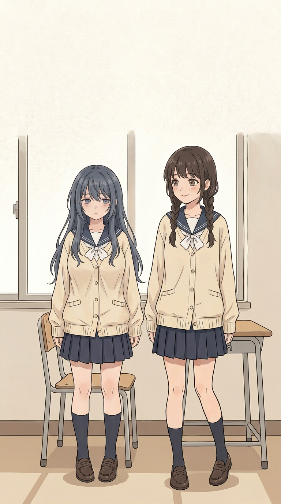

**好友**：你这么急着回去，是想见二哥了？ 
**辰希**：嗯，今天特别想他。

两人全身同地面，好友明显较矮且穿同款校服；好友朝向前方、两人互动视线不够明确，且好友体型是否达到认可立绘仍需判断。

## 10｜放学道别

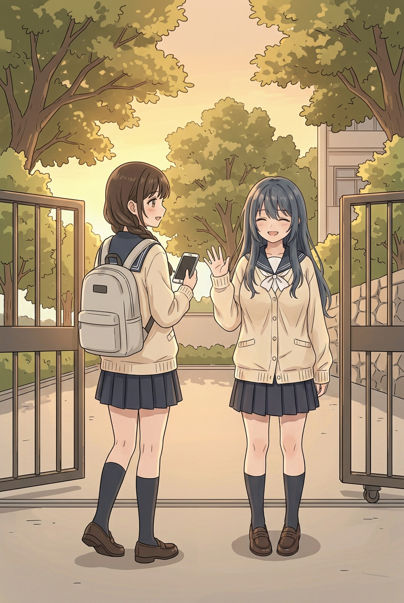

**辰希发消息**：二哥，你今天在家吗？ 
**哥哥回复**：在家。路上慢点，等你回来。 
**好友**：明天见，路上小心。 
**辰希**：嗯，明天见！

两人站位仍有前后差，好友看起来略矮，但不能据此确定身高比例；妹妹的灰书包正面口袋可见，需与玄关图对照。画外好友的书包是否携带仍待明确。

## 11｜回到家

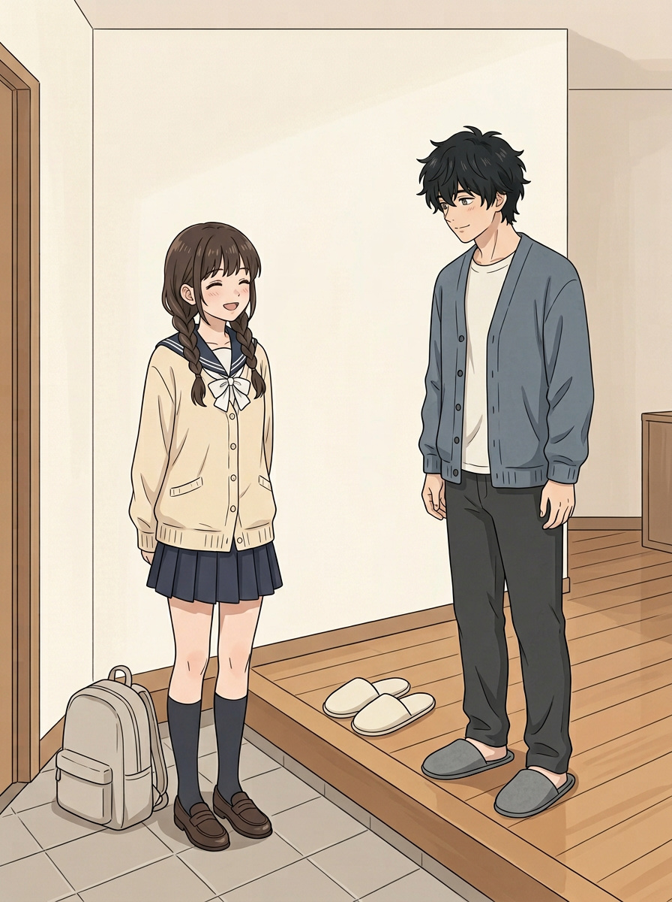

**哥哥**：回来了？ 
**辰希**：二哥！

妹妹穿室外鞋站在玄关，二哥穿灰拖；浅色拖鞋待换。

## 12｜脱鞋换拖鞋

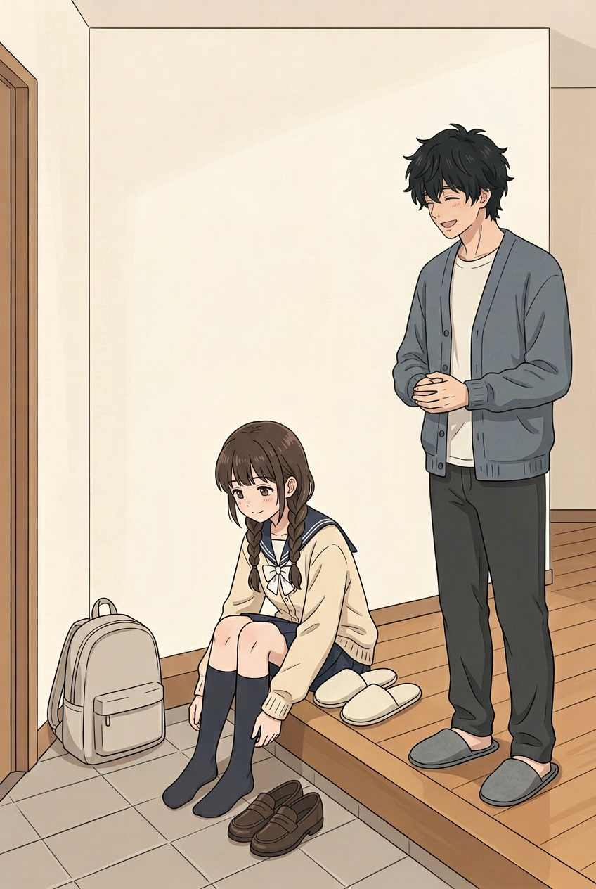

妹妹坐在玄关边，已脱下两只棕鞋，两只脚穿深色袜；一双浅色室内拖鞋放旁边，哥哥仍穿灰拖。这个画面补足11和13之间的换鞋过程；需核对相邻页空间、包和室内环境。

## 13｜想了一天的拥抱

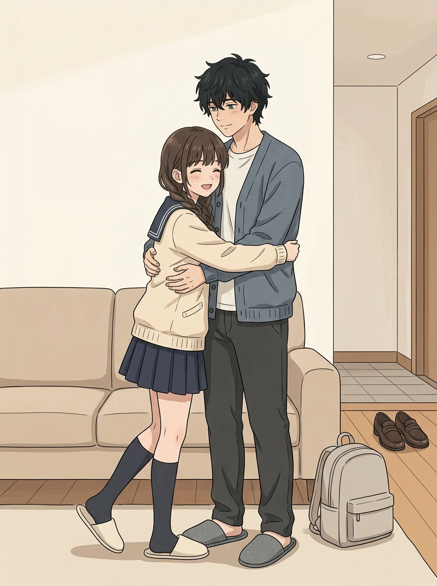

**辰希**：今天在学校就一直想你，好想快点回来抱抱你。 
**哥哥**：那就多抱一会儿。

妹妹换成浅拖、二哥仍穿灰拖；书包和鞋的位置与玄关图有变化，移动发生在画外；两人手臂部分遮挡，需要结合整图判断。

## 14｜二哥托住妹妹（用户认可）

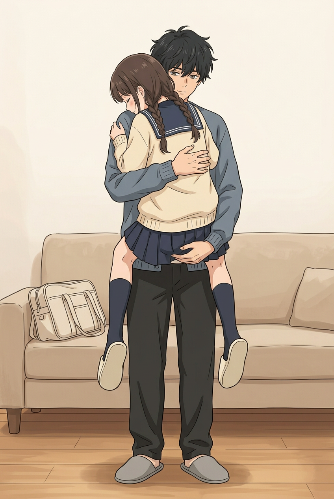

你认可这一页的动作，按原图保留。书包在沙发上的样式和前面不同，需统筹其他页与道具去向，不改动这张已认可的图。

## 15｜放下后站稳（用户认可）

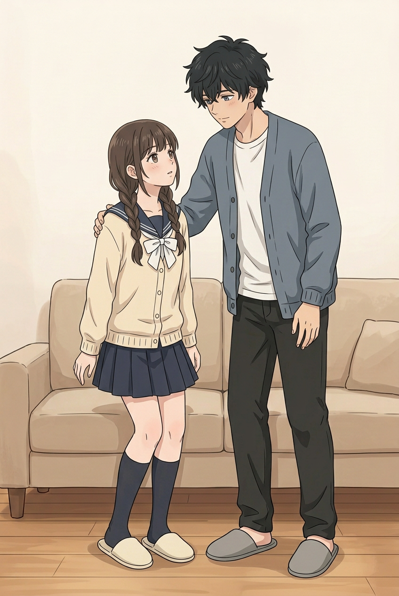

你认可这一新增页，按原图保留。本页呈现已经站稳的状态；书包的画外去向仍需通过其他镜头交代。

## 16｜两人坐到沙发上（用户认可）

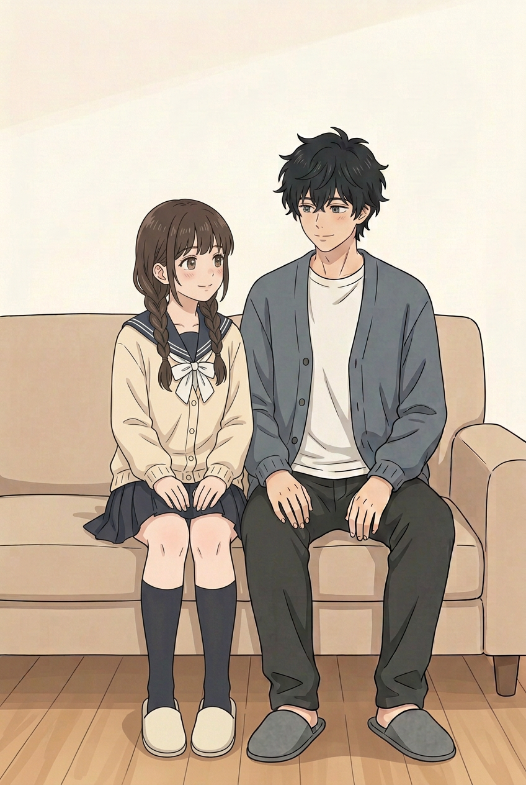

你认可这一新增页，按原图保留。妹妹坐在左侧、二哥坐在右侧，承接后面沙发上的镜头。

## 17｜靠在二哥胸前（待完善）

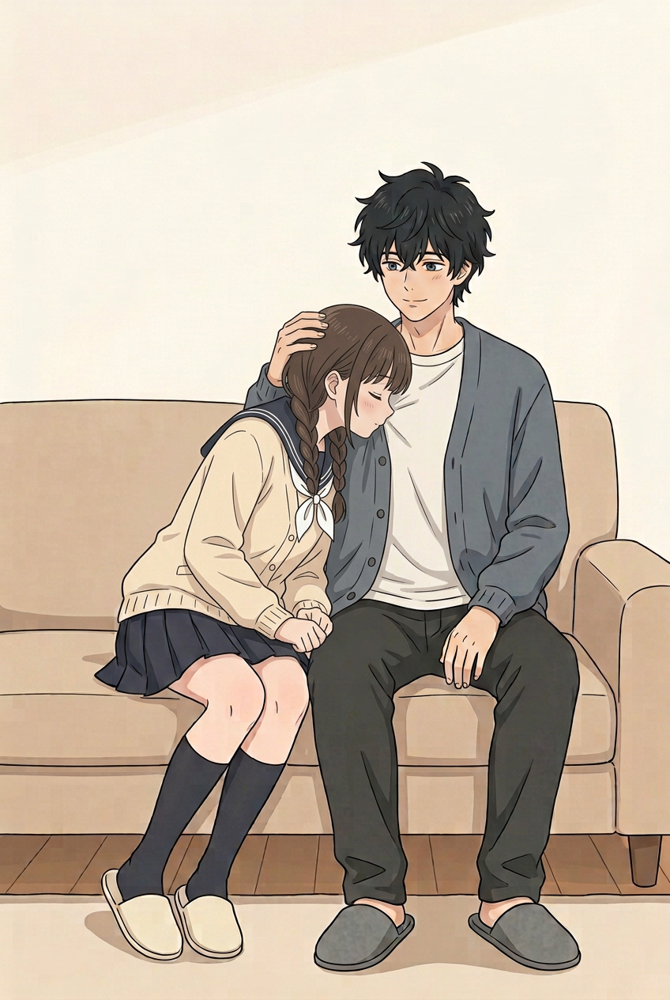

**辰希**：（轻轻吸气）二哥，让我再靠一会儿。 
**哥哥**：好。

这张旧候选中脸颊与胸口的接触不够清楚，吸气也要结合后期对白呈现；这页还需优化，不影响上面你认可的三页。

## 18｜分享校园日常（待完善）

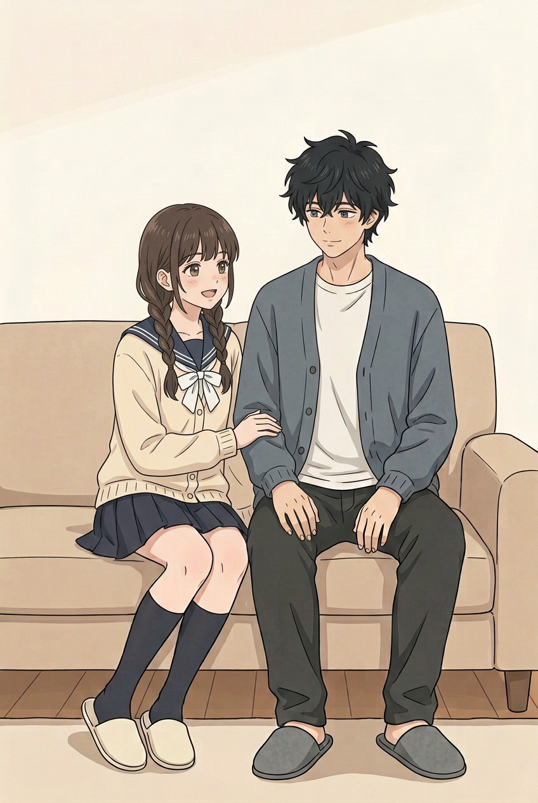

**辰希**：今天我解出一道题，朋友也自己做出来了。学生会的事，我们四个人一起安排好了。 
**哥哥**：听起来很充实，慢慢讲给我听。 
**辰希**：好，不过先让我再靠一会儿。

沙发与前页接近；对白量、气泡及连贯性仍需检查。整话并非正式排版成品。
