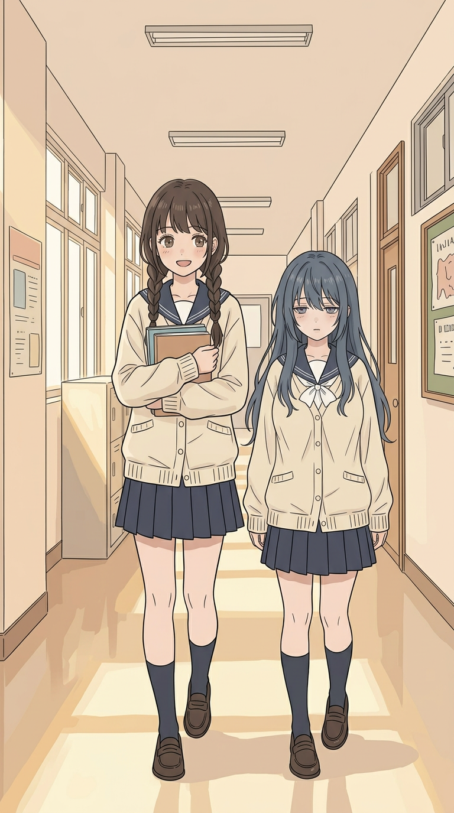
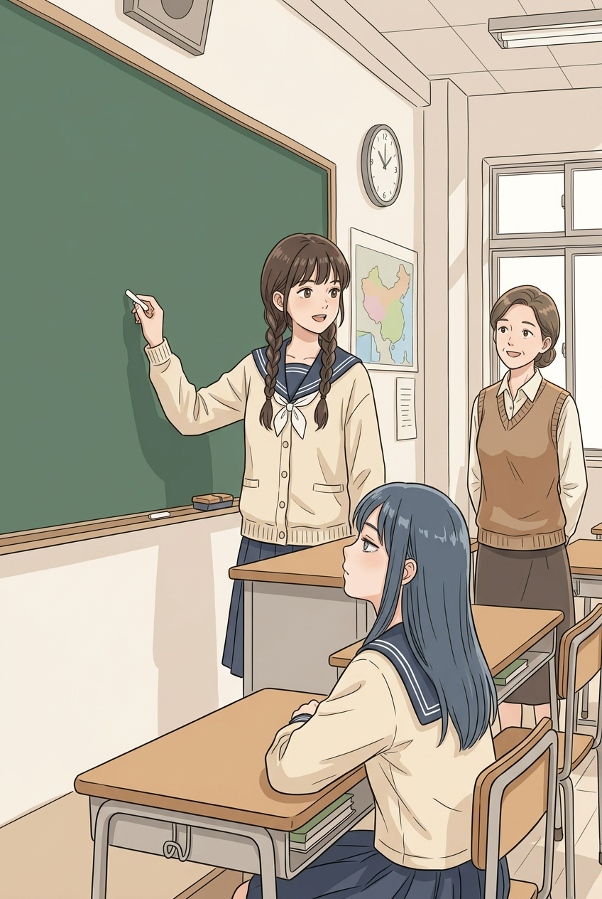
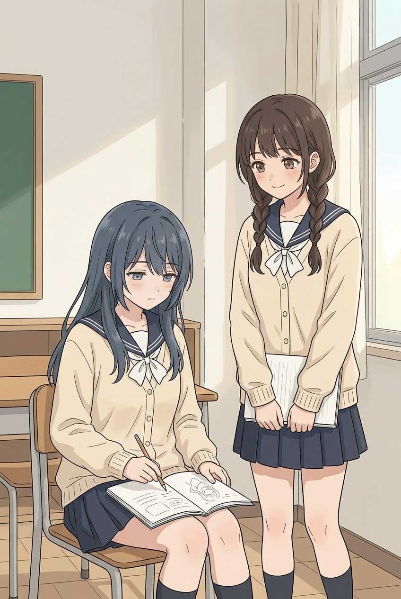
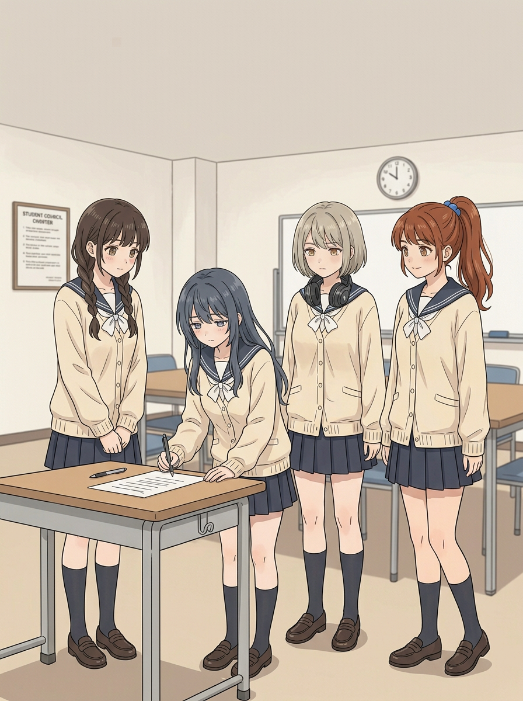
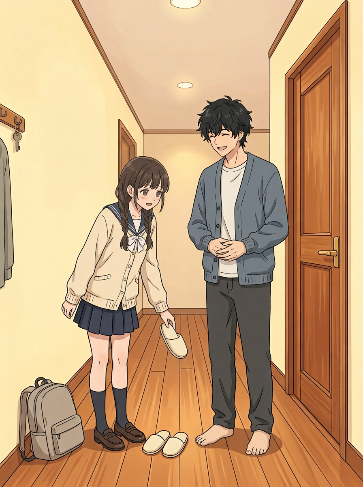

# 第八话用户截图反馈｜局部试画与人物优化进度

本轮根据用户新给的主角身材设定，以及第八话封面、01、02、03、08的截图反馈制作**无字独立候选**。这是局部试画，不是整话v4，也没有替换v2或任何已确认章节。下列判断是制作检查，画风和像不像本人仍由用户判断；身材不能凭被遮挡部分认定通过。

## 一、二哥补充参考与角色优化方向

[用户提供的主角身材与表情原图](../../../../art/角色形象区/二弟_用户补充参考/二弟_身材表情_用户参考.jpg)已原样保存并校验，作为现有人设的补充：穿宽松衣服显瘦，实际有锻炼形成的肌肉与腹部线条；面部可有温和自信、专注、对家人无奈宠溺等不同表情。图内标注“18—20岁”“作息不规律但坚持居家健身”，是这张用户参考的内容；**确切年龄、生活习惯是否逐项作为最终剧情设定，暂不擅自扩写**。模糊乱码不采信。画日常服装时不必为了证明身材而强行露肌肉或改变获认可服装；需要表现体态时按场景自然呈现。

[二哥画风统一单人试案](../../../../art/角色形象区/二弟_用户补充参考/二弟_画风统一_候选b.png)：深色套头卫衣、黑发，身形穿衣显瘦；表情自然，左侧手插口袋，手指不可见，无法核对该手。宽衣遮挡身体，**不能拿它证明肌肉细节已画对**；不是替换原人设，须和参考、用户意见共同核对。[另一试画](../../../../art/角色形象区/二弟_用户补充参考/二弟_画风统一_候选.png)违背单人构图，生成为五个重复人物，不采用，保留以便追溯。

四主角各两套已认可造型仍完整保留在[原目录](../../../../art/角色形象区/四位主角_造型v1/造型逐页.md)，依据时间场景切换；不拿新参考覆盖先前确认的内容。

## 二、第八话截图逐项处理

### 封面：正在走路

两人各有前后错开的脚步，好友身高明显较矮，同款开衫、裙袜可见；比原封面的并立更接近行走，但左右步态较同步、幅度有限，是否足够自然请用户判断。妹妹的领口被书和手遮住，**不能确认白结是否完整**；好友体型和脸也需要对照用户认可立绘，不以一次生图宣称已完成。角落有类似文字的背景装饰，需在正式制作清理；无标题，标题“妹妹的学校日常”仍是候选。原图768×1376，与既有896×1200排版不同比例，不能直接裁切替换，需要保留人物全身并设计安全排版。

### 01：课堂画风偏移

线条及色块比截图更简洁，构图延续课堂回答；画风是否真正贴近用户认可漫画待判断。黑板刻意留空，**不是数学题已经排版**；需要把题目与正确恒等式、老师提问/妹妹作答顺序后期准确排入，必要时拆页，不把空板当完成。好友背侧及桌椅遮挡，不能判断体型。原图848×1264，尚未做适配排版。

### 02：好友自然身形

好友坐姿、上身轮廓较不受桌面遮挡，蓝黑长发和困倦表情可辨；妹妹站在旁边、同款校服。**坐立不同不能由头顶高低判断实际身高差**；身材是否足够接近认可图仍需用户判断。书页出现像图案的生成内容，不能充当数学题；需要重排为可信的解题内容。两人的腿脚在画外，手部局部重叠，不能据此做完整肢体验收。与原坐在一起的构图有变化，衔接和台词需重新安排。[02候选A](../../../../art/chapter-08-v4/scene-02-figure-candidate.png)过于接近原页，好友可见轮廓改善不足，不作为已修复结果。

### 03：学生会四人和好友身形

仅四名女生，灰金短发耳机会长和栗红高马尾委员仍是未定稿候选；四人同款校服，好友的上身较容易看见，但前倾与宽松衣物影响轮廓，**不能认定已完全达到好友获认可立绘**。同框中好友低头弯腰，不能据此量站立身高。人物原有坐位和讨论动作发生变化，纸页及墙上出现生成的字样，应重做或后期清理，不能直接当正式剧情。桌腿与鞋有交叉遮挡，需再核对局部。[03候选A](../../../../art/chapter-08-v4/scene-03-figure-candidate.png)四人和衣着可辨，但好友部分身体仍被桌面遮挡，与认可体型的接近程度未解决。

### 08：回家画风偏移

比截图更加平涂，二哥保持蓝灰居家开衫、妹妹保持双辫及校服；画风是否达到要求仍要由用户判断。**不能直接采用**：哥哥赤脚，妹妹手拿一只拖鞋而地上还有一双（共三只），且场景改成平地走廊、妹妹仍穿室外鞋，换鞋动作和玄关衔接均不清楚；书包也要与最终07页统一。[08候选A](../../../../art/chapter-08-v4/scene-08-style-candidate.png)依旧接近用户指出的原有画风及构图，也不能视为修好。

## 三、全人物优化的当前进度与原则

这次不是把所有人物重画完毕，而是建立各人必须保留的视觉及表现依据，二哥先做一张单人候选，其余人物的表情、站姿和多角度资料还需分批制作、逐图实看和请用户判断。图片生成本轮达到10张上限，姐姐、妹妹、小满的新表情试画未生成；既有[角色完整性盘点](../../../../docs/人物完整设计与跨话核查_首轮.md)和[江家表现优化方向](../../../../docs/江家三位主角_表现优化讨论.md)继续有效。

| 人物 | 不该丢失的辨识基础及本轮制作方向 | 状态 |
|---|---|---|
| 二哥 | 黑发、原人物脸型；穿衣显瘦、按用户新图表现自然健身体态；放松、专注与对家人温柔反应有层次。 | 用户新图已保存；穿衣候选待确认；身体细节尚未新画。 |
| 姐姐 | 棕发、眼镜；在外干练、有主见，对家人也能自然依赖；原造型和获认可的两套新造型都保留。 | 没有新增试画；后续补不同场景表情、姿态。 |
| 妹妹 | 双辫与校园制服为校园段基准；独立聪明、对其他男性冷淡、想哥哥的亲切反差；其他已认可居家/外出造型按场景使用。 | 本轮有漫画试画，无单人人设新图。 |
| 小满 | 幼童年龄感、芽芽及发饰；童龄表达、主动关心和好奇，不能画成缩小版大人。 | 本轮无新图，保留原图及获认可两套造型。 |
| 蓝黑发好友 | 困倦神情、娇小且自然丰满；与妹妹同款校服，但脸型、身高、体态、神情不可混同。 | 已有用户认可立绘；漫画02/03修订仍待确认。 |
| 灰金短发耳机会长、栗红高马尾委员 | 外形及性格均为候选：耳机、短发及较沉静眼神；蓝发绳、高马尾及较活泼表现。不可仅依赖发色或饰物，名字背景未确认。 | 03双候选中可见，非个人正式定稿。 |
| 母亲、父亲、大哥 | 保留既有年龄感、人脸、发型及原衣着；用户此前说暂不制作新造型。 | 不为追求统一而擅自换装或改人设。 |
| 邻居姐妹、小姨等新角色 | 以用户原图为参考：姐妹同橙发、妹妹两张是同一人的不同造型；小姨是大哥妻子的妹妹。 | 保留为预案，具体形象和剧情不因本轮自动定稿或进入正文。 |

下一轮：先完成其余人物表情/角度参考，分清已确认特征和待用户裁定的提案；逐页继续第四话起的人物核查；重新处理08鞋履并回看07—10连续性，02/03围绕好友认可立绘继续核对。所有漫画页仍需补足课堂推导、转场与学生会的四人分工，再排字、核对手脚及剧情；不能因为候选生成成功就宣称整话完成。
