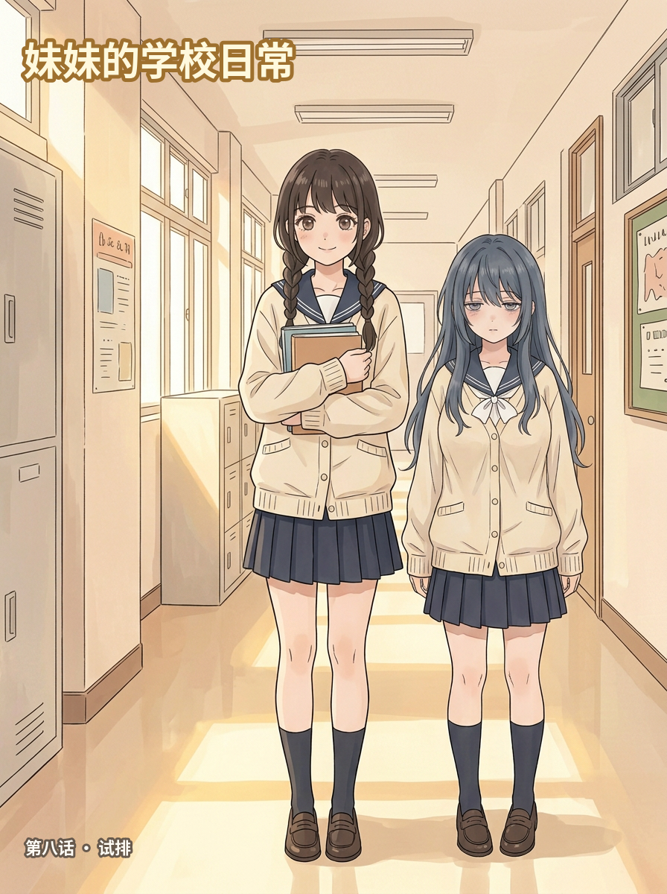
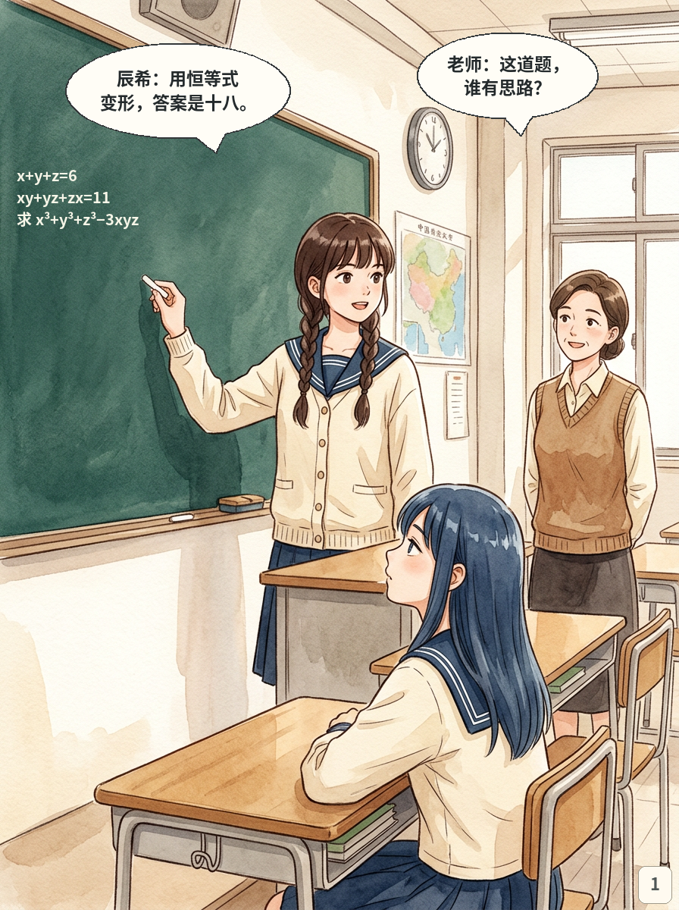
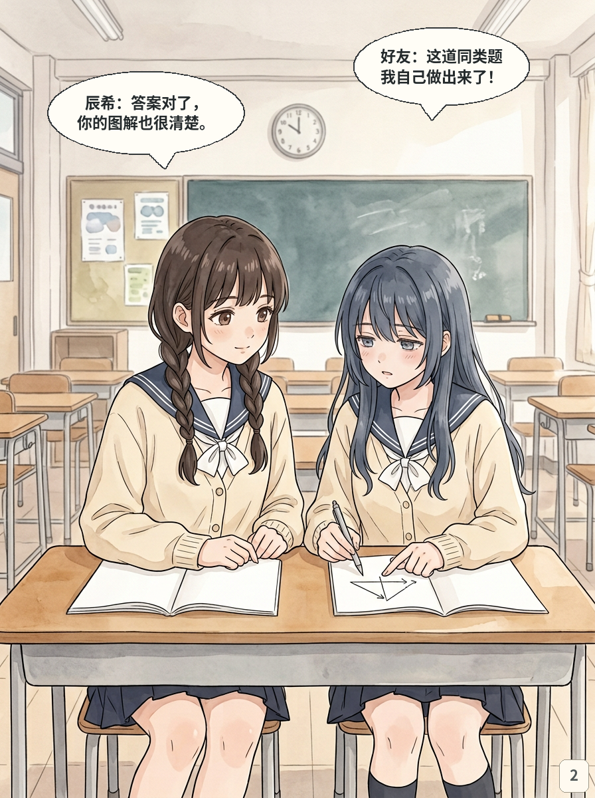
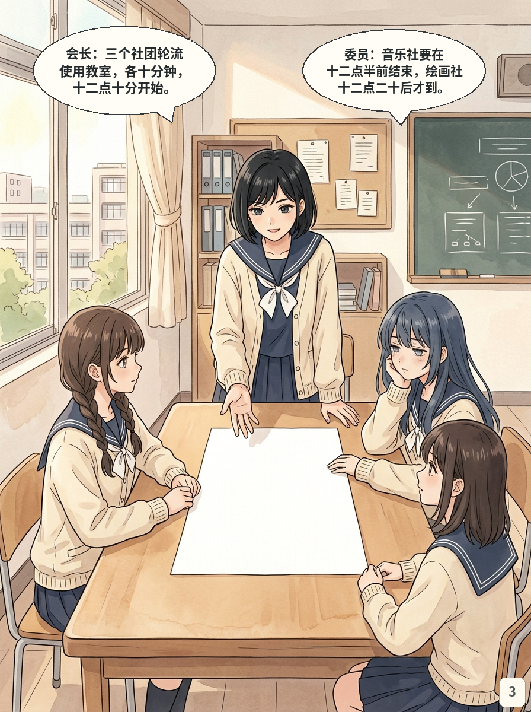
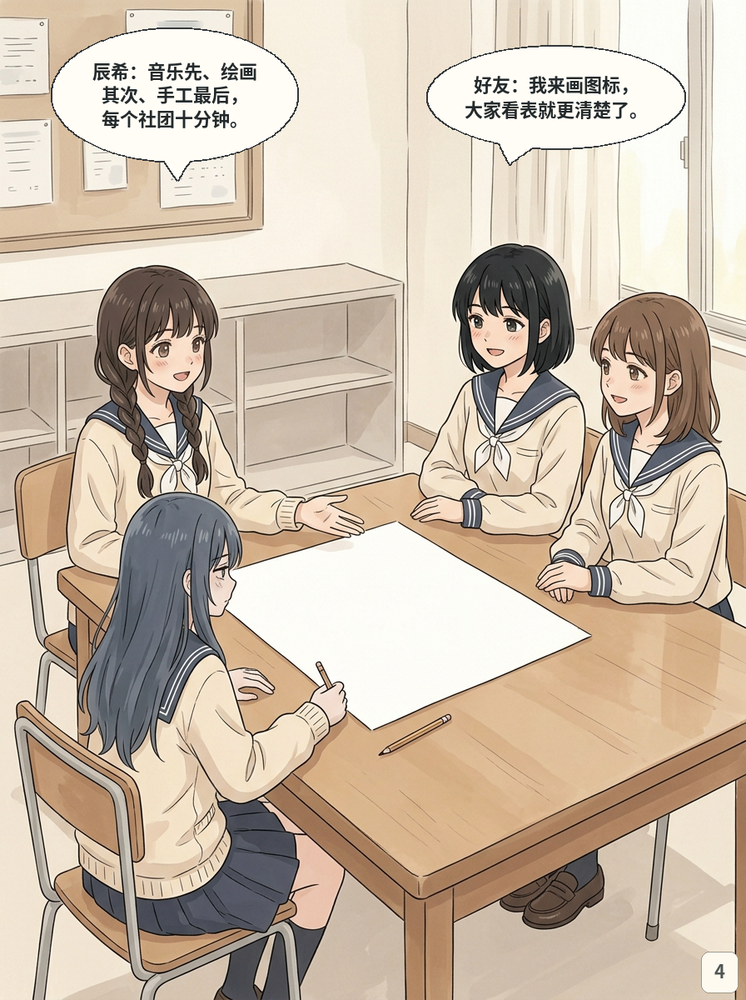
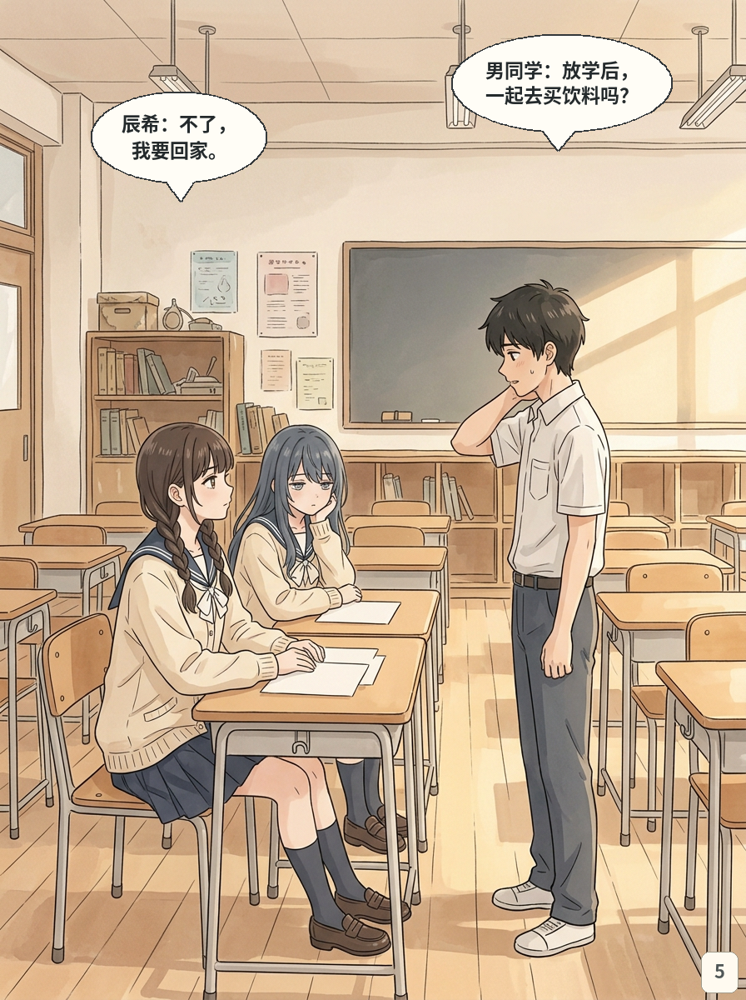
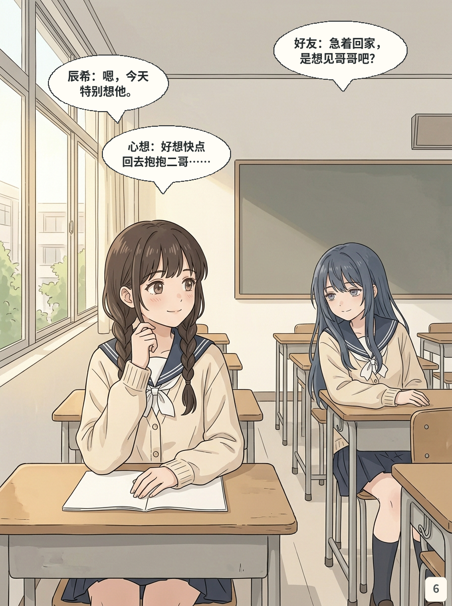
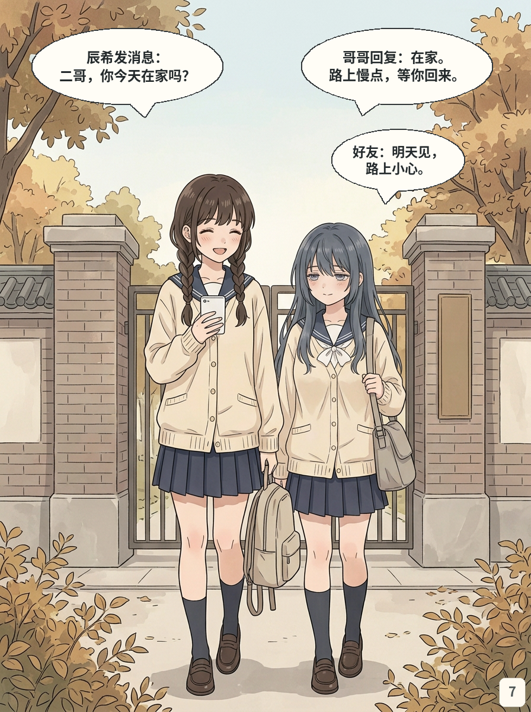
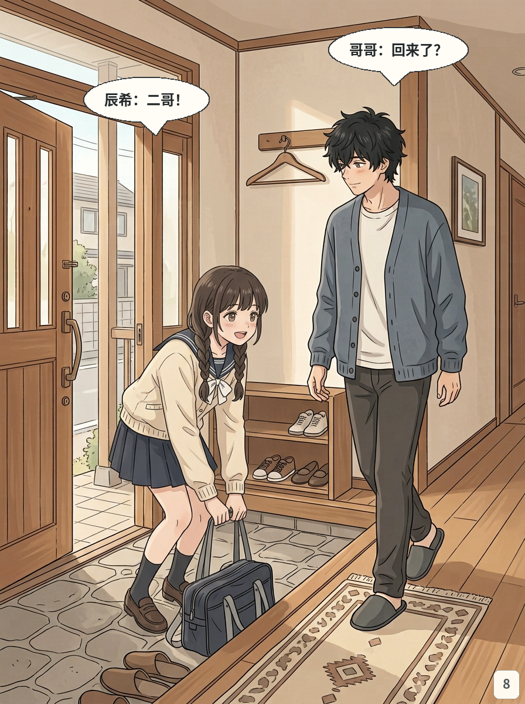
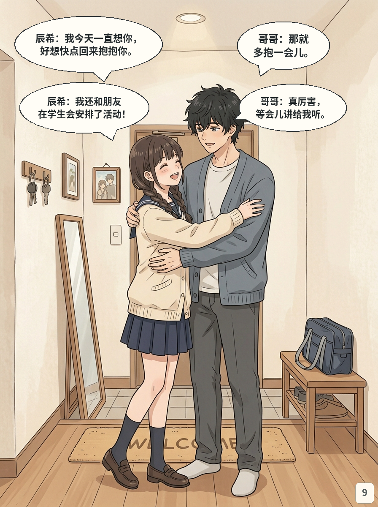

# 第八话｜妹妹的学校日常（紧凑初版试排）

> 封面标题为候选；为先看全话节奏，将v4草案压缩为封面＋9页。画面、对白及衔接均待用户审阅，非定稿。已知事项见复查记录。

[人物和剧情来源](../../../../docs/第八话_妹妹学校日常_剧情草案v4.md) · [四页人物设定](../../../新人物设定试案v1/逐页看图.md) · [复查记录](../../../../docs/第八话_初版试排复查.md)

## 封面

## 第01页｜课堂解题

## 第02页｜好友的笔记

## 第03页｜学生会开会

## 第04页｜一起安排

## 第05页｜冷淡拒绝

## 第06页｜想念哥哥

## 第07页｜放学后

## 第08页｜回到家

## 第09页｜想了一天的拥抱

