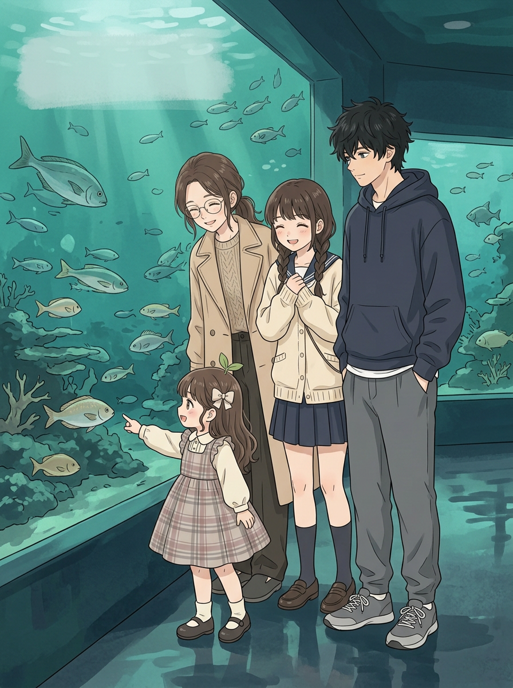
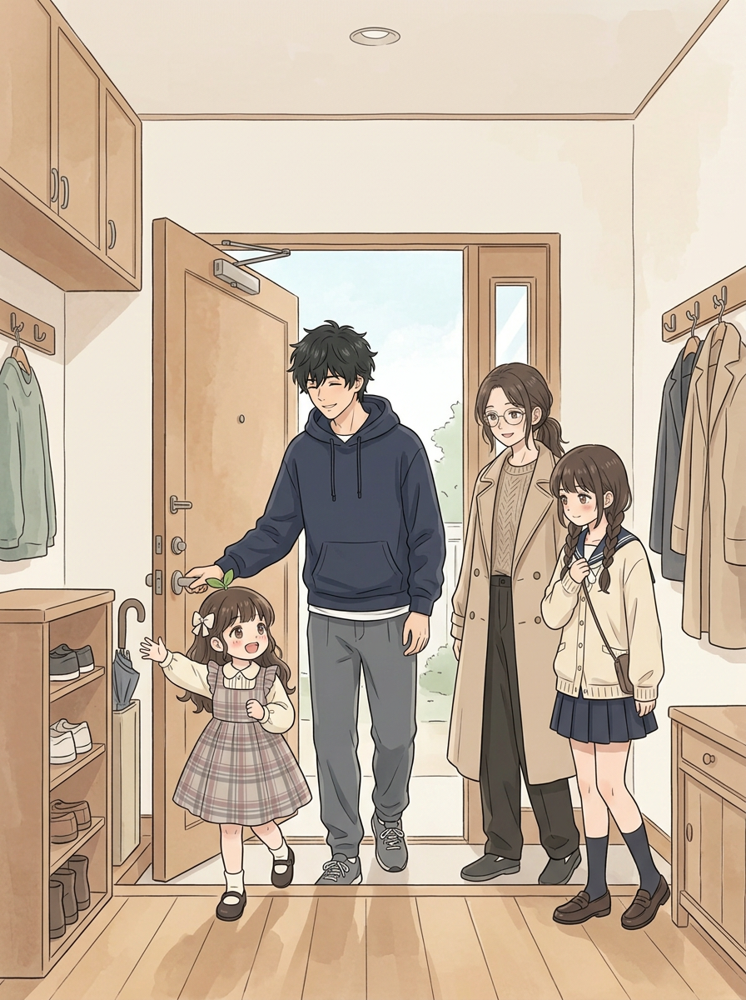
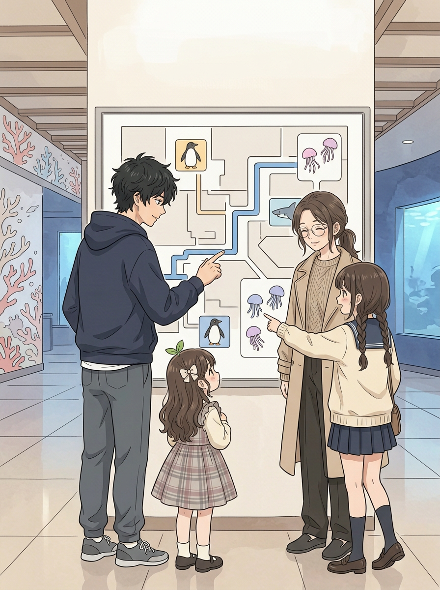
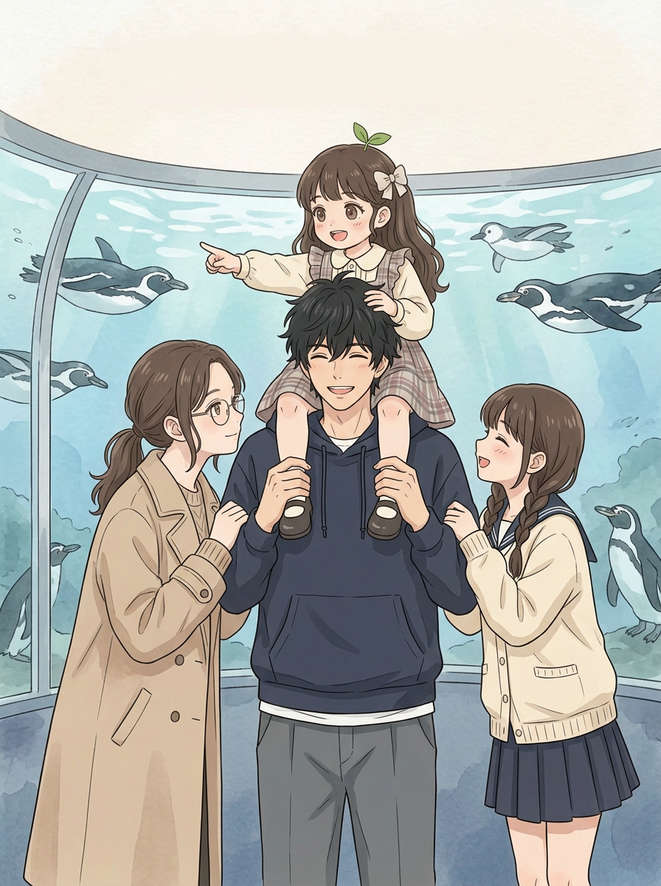
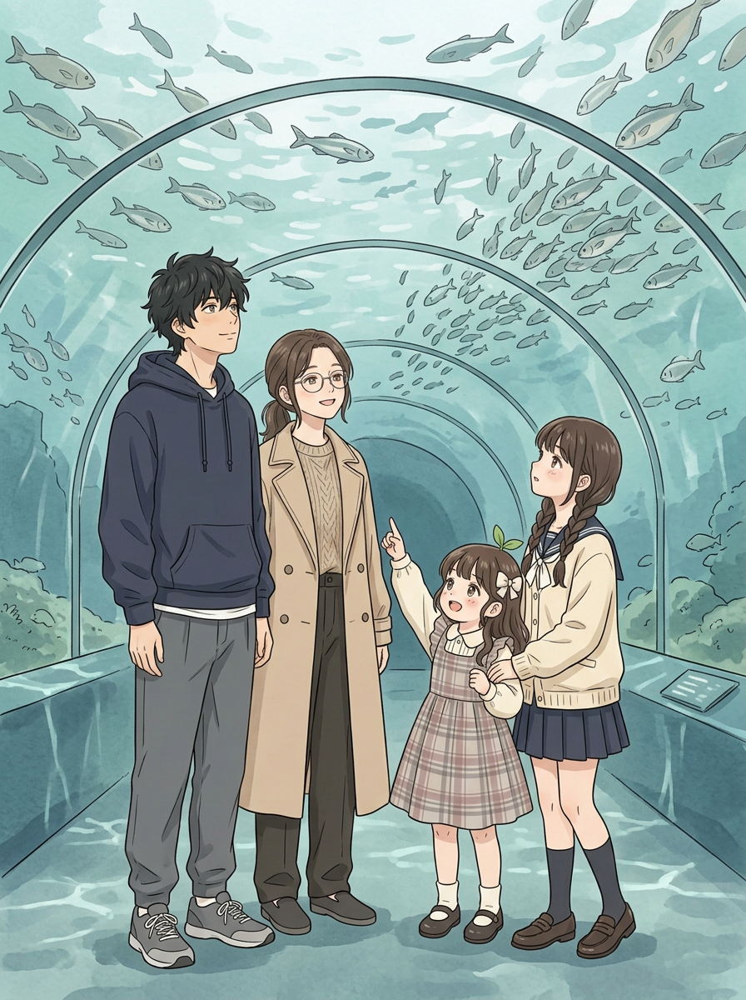
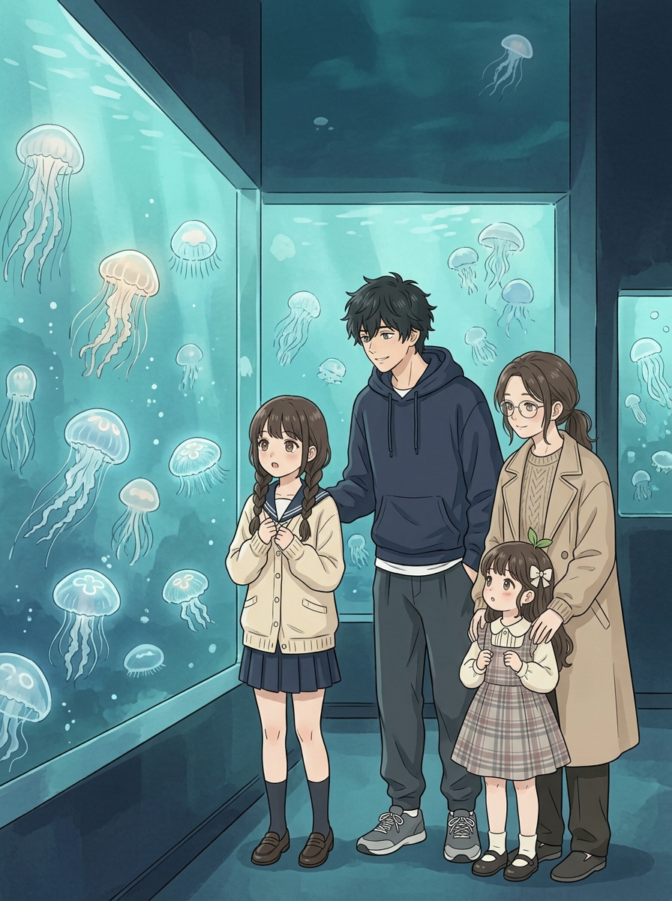
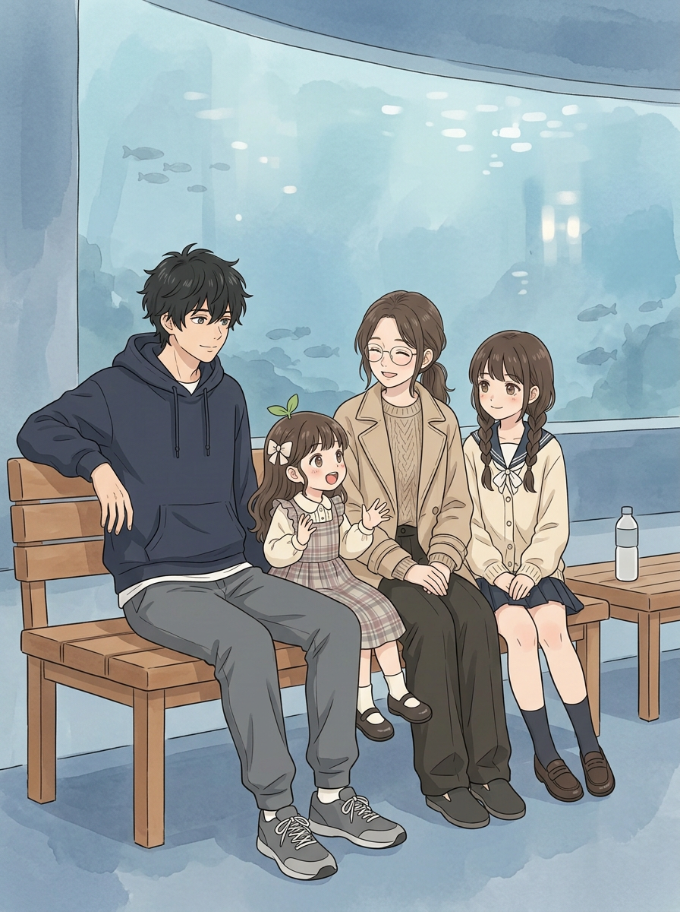
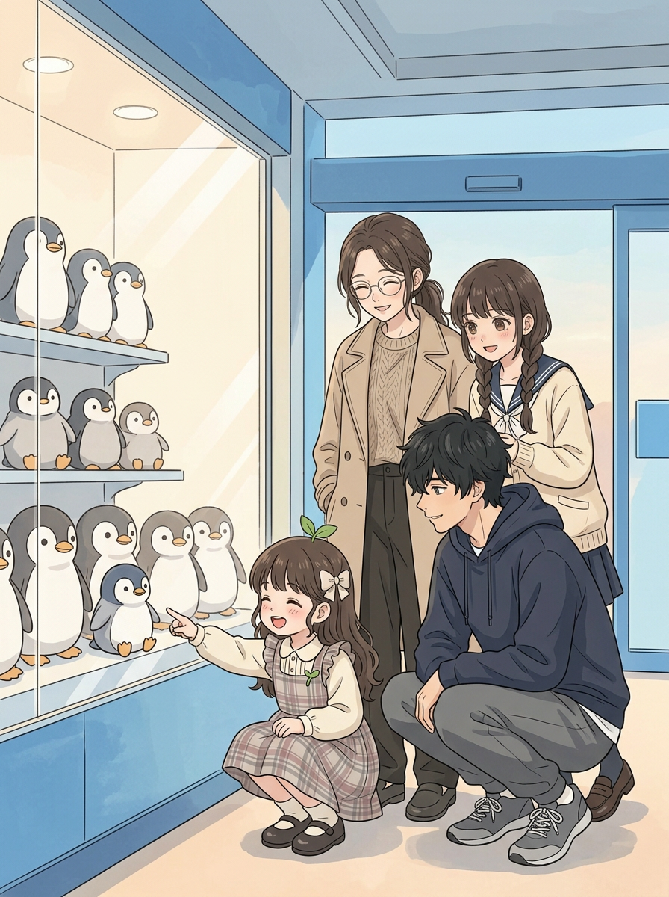
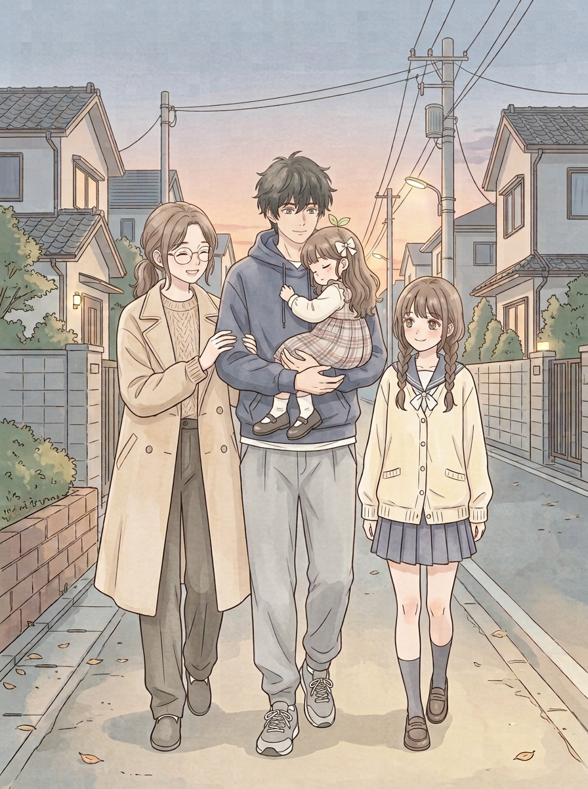

# 第五话｜水族馆：原画与剧情草稿

这是**制作中的原画草稿**，不是最终漫画：还没有排入对话、页码和封面标题，也未完成画面复核和用户验收。对白中仅末页男主所说为用户提出的原句，其余为可修改的提案。第一张回家候选小满的鞋未画出，故先以补鞋候选展示；该候选画风仍需对照复核。

## 封面（标题待定）

## 1｜出发

小满：“小叔，快走！企鹅在等我们！”  
二弟：“来了，别跑太快。”

画面中的出门方向可能不够明确，待检查并调整。

## 2｜商量路线

小满：“我要先看企鹅！”  
妹妹：“我想看水母。”  
二弟：“好，都去看。”

## 3｜企鹅与肩上骑

妹妹：“有两个女人这么喜欢你，二哥是不是很幸福呀？”  
姐姐：“明明是三个。”  
小满：“还有小满！”

## 4｜海底隧道

小满：“鱼在天上飞！”  
二弟：“它们是在游。”  
姐姐：“今天就让它们飞一会儿吧。”

## 5｜水母

妹妹：“它们好像在发光。”  
二弟：“嗯，慢慢看。”

## 6｜休息

姐姐：“今天最喜欢哪个？”  
小满：“企鹅！还有水母！”  
妹妹：“这已经不止一个了。”

## 7｜离开前

小满：“这个和刚才的企鹅一样！”  
姐姐：“你今天最喜欢企鹅，对吧？”

## 8｜回家

小满睡着了，二弟抱着她，姐姐和妹妹陪在身边。  
二弟：“能和你们一直在一起……我真的是最幸福的人。”

