# 第九话｜第一版工作预览（未完成）

> 邻居姐妹带配件来请二哥帮忙：妹妹主动争取注意力，姐姐表面平静、内心有反差，小满也参与。具体台词以下为草案，并非定稿；标题尚未定。本轮补齐缺失事件的原画候选，但人物、道具和连贯性仍有明确问题，**不是可验收的完整漫画**。旧原画未覆盖。
>
> 身高设定：二哥 186 cm、邻居姐姐 138 cm、邻居妹妹 122 cm；同地面同视角先按数据核查，再看姿势和透视。用户同意以后身高不好判断时使用这种方法；未知数据不擅定。

## 封面候选

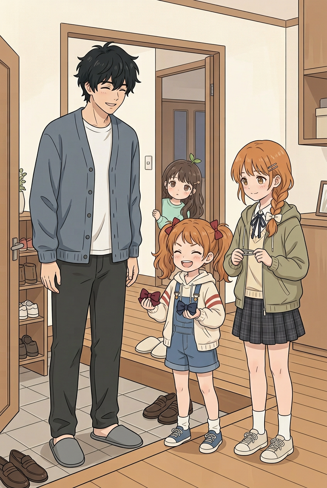

姐妹带着红、蓝布结来找二哥，小满探头。**待处理**：鞋仍穿在室内木地板，进出空间不够明确；标题未定，不上标题。

## 01｜来意

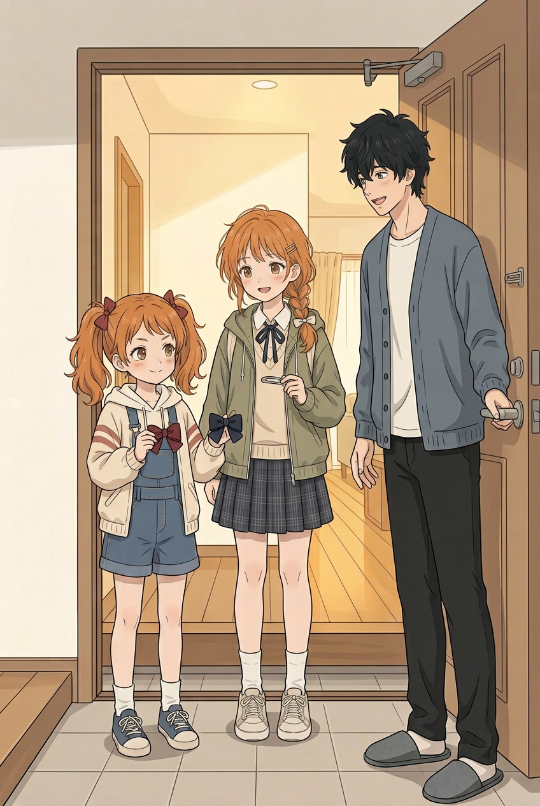

妹妹：「我要给 Cos 配件选颜色，你帮我看看！」二哥：「好，进来慢慢看。」

待检查：门口双方处于门内外的关系不清；鞋底位置并非完全同平面，不能只凭头顶判定身高。红、蓝各一，姐姐拿底座。

## 02｜挑战

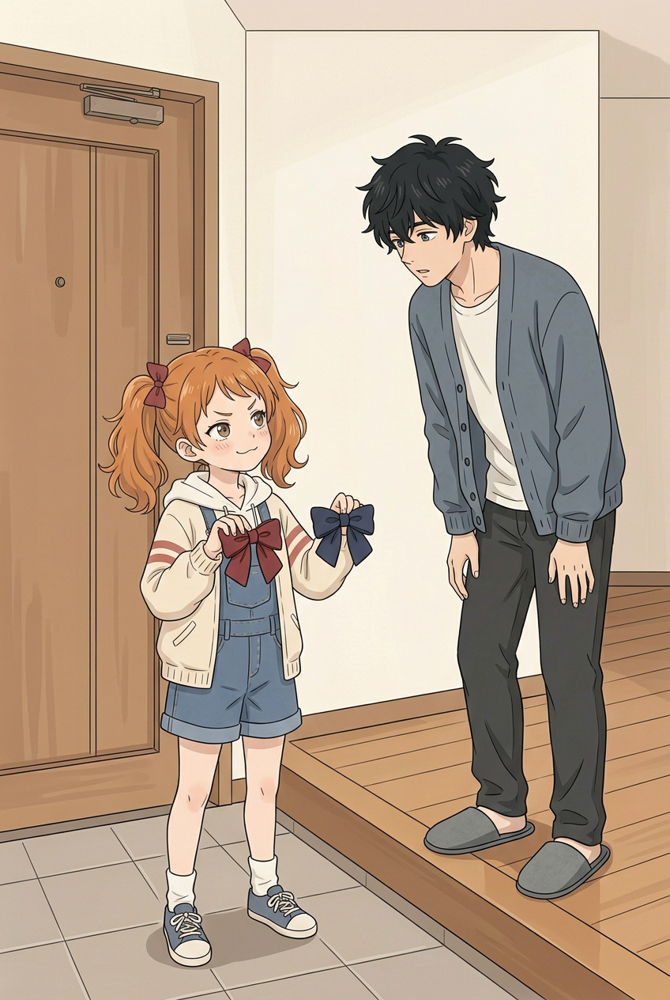

妹妹：「猜猜我喜欢哪一个？猜错可要再陪我选！」二哥俯身看两种样品。图仍为上一批候选；不同地面台阶和俯身不能用于身高量测，门口到室内过渡需再核对。

## 03｜小满参与

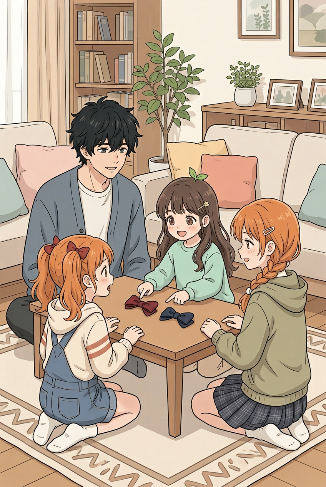

小满：「都好看！我也能选吗？」妹妹：「可以，但先让他猜！」红、蓝两结在桌上，四人各自参与。桌下部分肢体被遮挡，不能推定其正确；需检查室内布置跨页变化。

## 04｜姐姐介绍底座

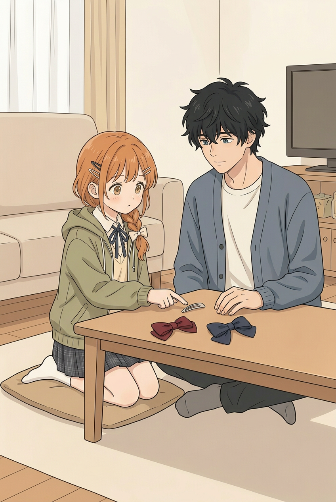

姐姐：「这是装布结的地方，颜色可以换。」二哥看向桌面。**待修**：重画后仍在姐姐刘海两侧出现多组发夹，与单侧两枚参考不一致；人物部分手脚受桌面遮挡。

## 05｜争取注意

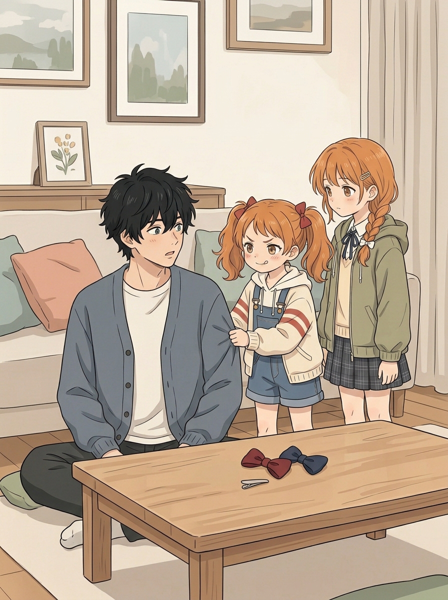

妹妹轻拉袖子：「还没猜我的呢！先看我嘛。」二哥转头，姐姐在旁；两结和底座在桌上。姐妹脚部在桌后，不能据头顶差精确验身高；姐姐仍显得偏高，需以完整站姿参照重新核对。

## 06｜猜颜色

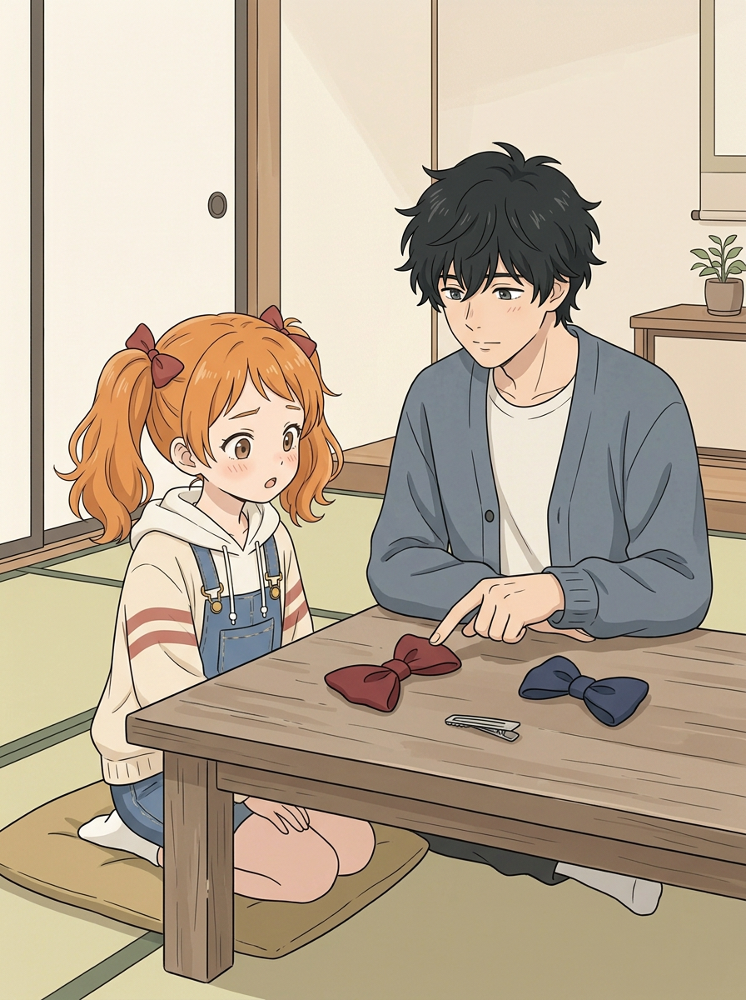

二哥：「我猜深红。你拿起它时，眼睛都亮了。」妹妹愣住。两结和底座在桌上；桌面下局部遮挡，房间地面与相邻页不一致。

## 07｜嘴硬

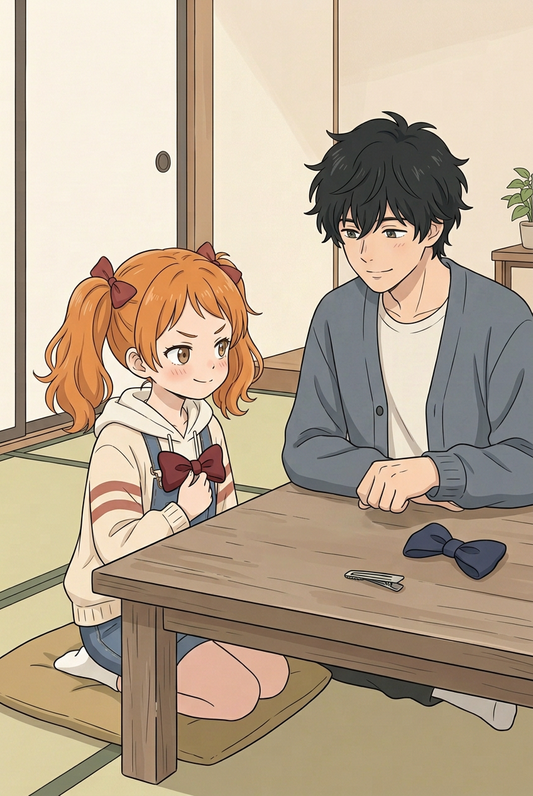

妹妹：「哼，你只是运气好吧！」她把红结比在身前；蓝结与底座在桌上。桌下部分手脚不可见；室内地面由木地板变成榻榻米，需统一。

## 08｜姐姐的反差

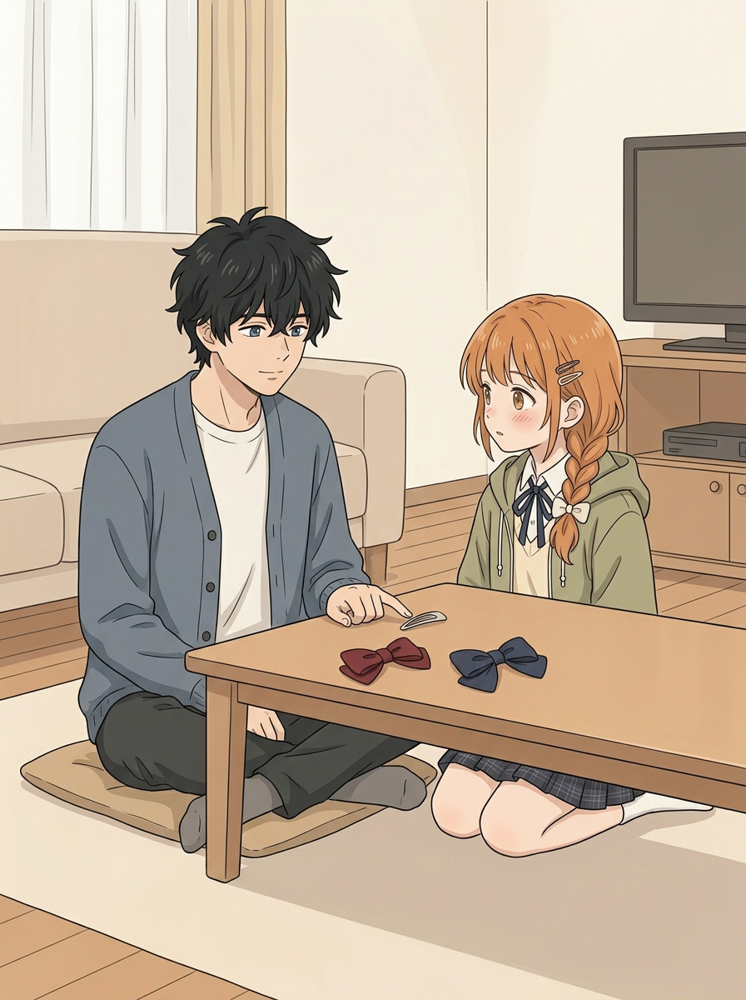

建议心声：「只是确认配色，别突然紧张。」**待修**：画面变成二哥指底座，姐姐在桌对侧，没有表现草案里的姐姐主动靠近、指底座；与07桌面背景也不一致。不能仅加心声冒充动作已画出。

## 09｜妹妹发现

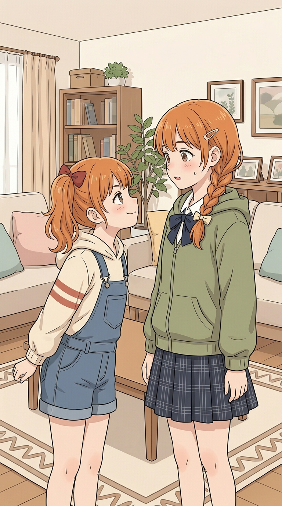

妹妹：「姐姐，你刚才怎么不说话了？」姐姐：「……在想颜色。」这是两人对视的新构图，不用第一次误画成拉袖场景的 `09.png`。**待修**：姐姐外套变成拉拢状、内搭大部分不见；发夹只有一枚，妹妹另一条马尾因角度无法确认。截腿画面不能精确测同地线高度。

## 10｜小满提议

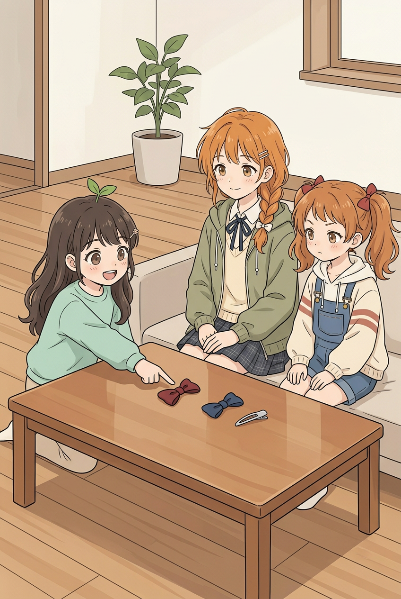

小满：「深红这个，像小恶魔的蝴蝶结！」姐姐：「这个形状确实很合适。」红、蓝、底座可见；坐姿不用于核算站高，桌后脚部遮挡。

## 11｜妹妹作出选择

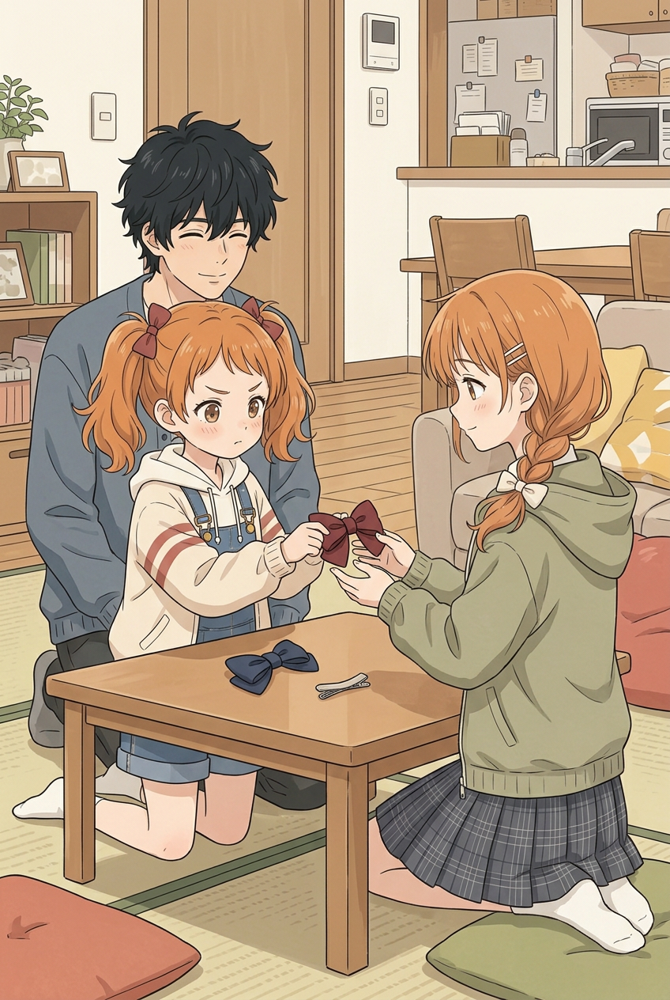

妹妹：「好吧，那就选深红。姐姐做的底座……也挺好看的。」二哥：「边上的小褶子很用心。」红结在两人手之间，蓝结和底座在桌上。交接手指靠近，需放大核查；画面没有表现二哥特指褶子，台词须考虑动作证据。

## 12｜收尾

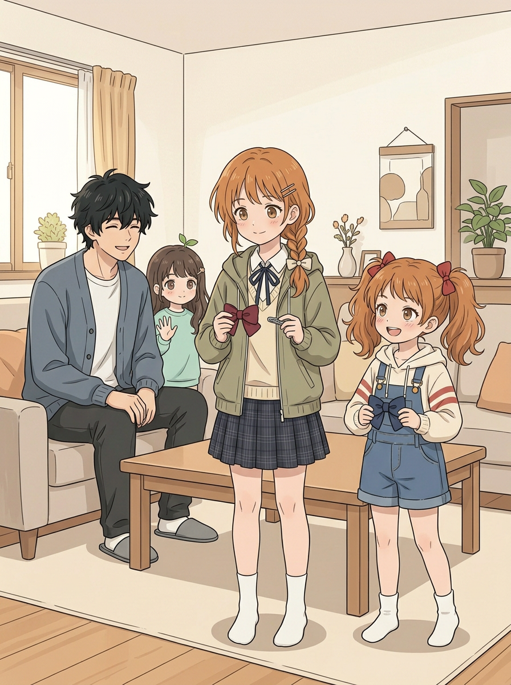

妹妹：「做好之后你也要第一个看！」二哥答应，小满说也想看。姐姐拿红结与底座，妹妹拿蓝结。**待修**：同地面站姿中姐姐明显偏高，与 138/122 的比例仍不符；二哥和小满部分身体被遮挡。虽改成室内袜子，不能以此宣称画面合格。

## 下一步

本轮已达到单轮 10 次生图上限。先处理 04 发夹、08 动作、09 造型、12 身高，以及封面／01 门口和鞋袜、跨页房间连续性；逐角色检查袖→手、髋→腿→脚。然后再做正式气泡、阅读顺序、全话风格核查及排版；标题待用户裁定。不得把这份工作页当完整第一版，也不要把被否定的旧候选悄悄替换成成品。
