# 第九话｜继续制作工作预览 v4（未完成）

本轮继续修原画，未排气泡，以下台词只是分镜草案；**不是完成的第一版**。用户确认的人物身高为二哥 186 cm、邻居姐姐 138 cm、邻居妹妹 122 cm，站立且同地面同视角应按此核对，坐姿及前后位置不能直接拿头顶相减。人设与旧图不覆盖。

## 封面｜两种布结
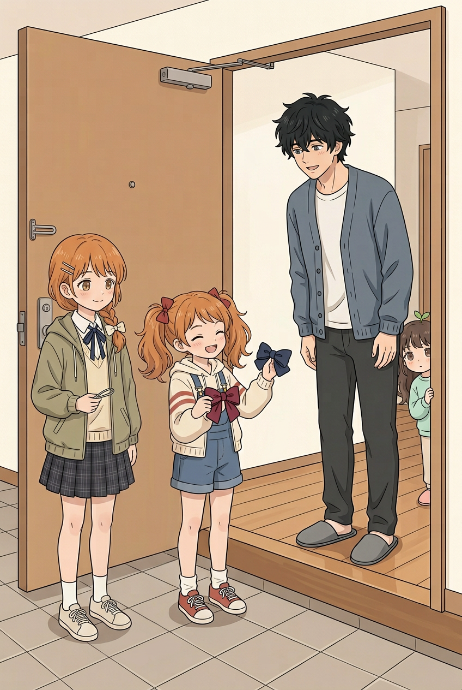

妹妹带红、蓝布结来到门口，姐姐拿底座，小满在屋内探头。室内外边界比前版明确。**待修**：妹妹鞋由蓝变红；姐姐相对妹妹看起来偏高，但人物位置和鞋底不在同一平面，不能凭图精确测身高；正式标题未定，暂不加标题。

## 01｜来意
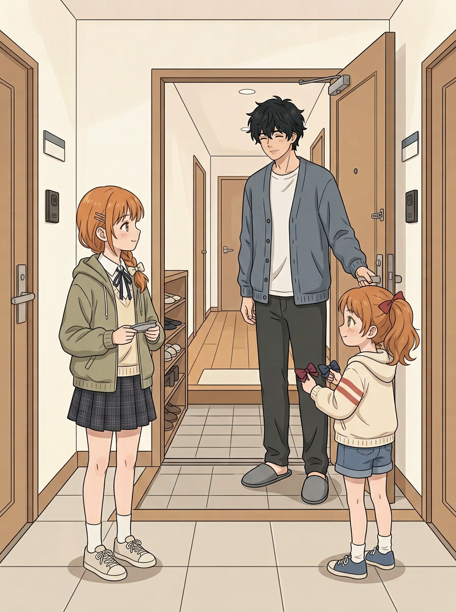

妹妹：「我要给 Cos 配件选颜色，你帮我看看！」二哥：「好，进来慢慢看。」屋外姐妹与门内哥哥的方向较清楚。**待修**：姐妹近同平面站立，姐姐与妹妹头顶差距明显偏大，可能超过138/122关系；妹妹侧身仅见一条马尾，不能确认另一条；二哥身后场景处于另一深度不能直接计算身高。

## 02｜颜色挑战
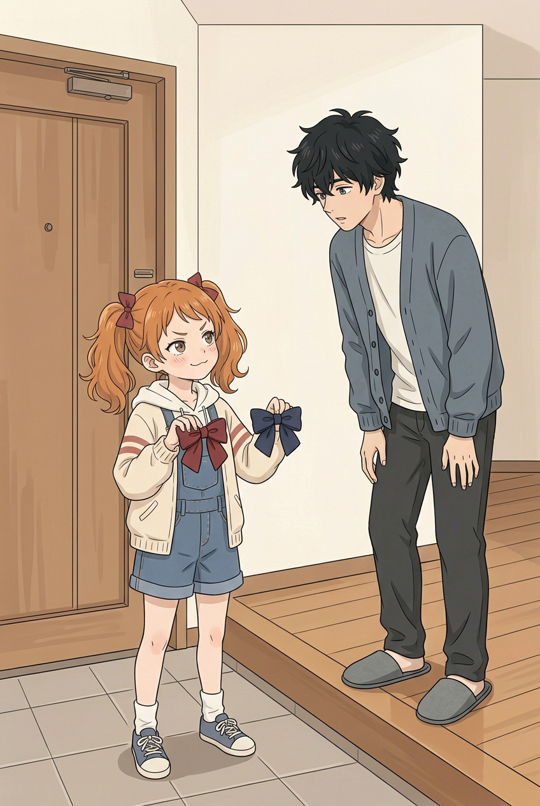

妹妹：「猜猜我喜欢哪一个？猜错可要再陪我选！」红、蓝结各一；沿用上一批候选。二哥俯身和两人站不同高度，不能直接验身高；门口进入客厅的过程尚需连续检查。

## 03｜小满参与
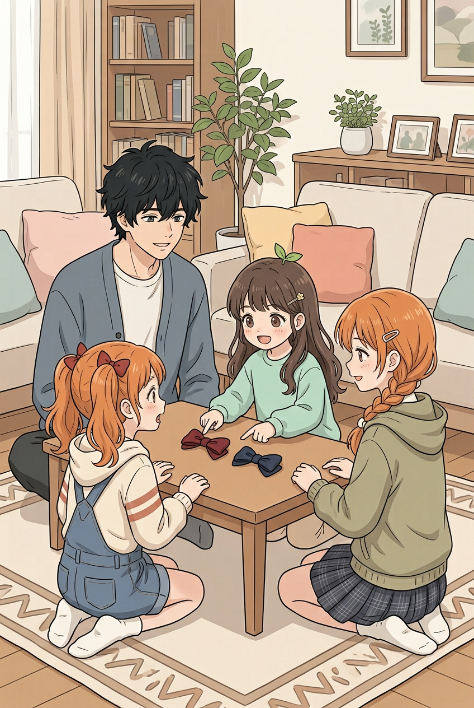

小满：「都好看！我也能选吗？」妹妹：「可以，但先让他猜！」两结在桌上，四人同场。桌后部分肢体被遮挡，不能断言全部正确。

## 04｜姐姐介绍底座
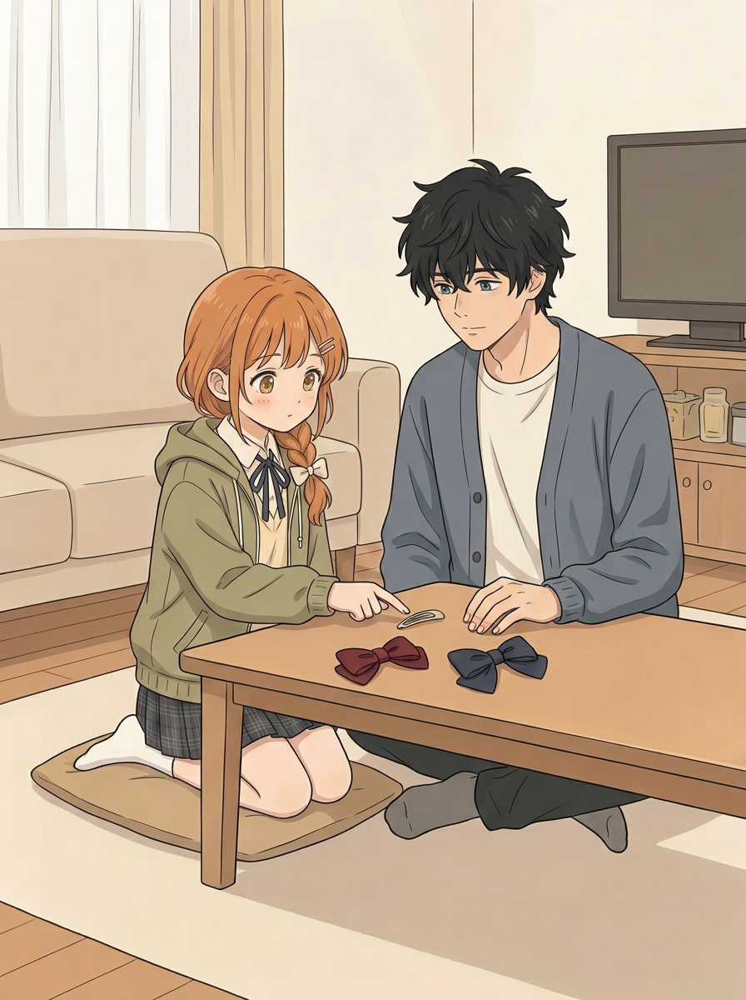

姐姐：「这是装布结的地方，颜色可以换。」姐姐指底座，二哥看桌面；红、蓝结各一。放大复看可见发夹集中在一侧的两条，不再有另一侧那组；眼睛仍有较亮的渐变，画风观感待用户判断。部分手脚受桌遮挡。

## 05｜争取注意
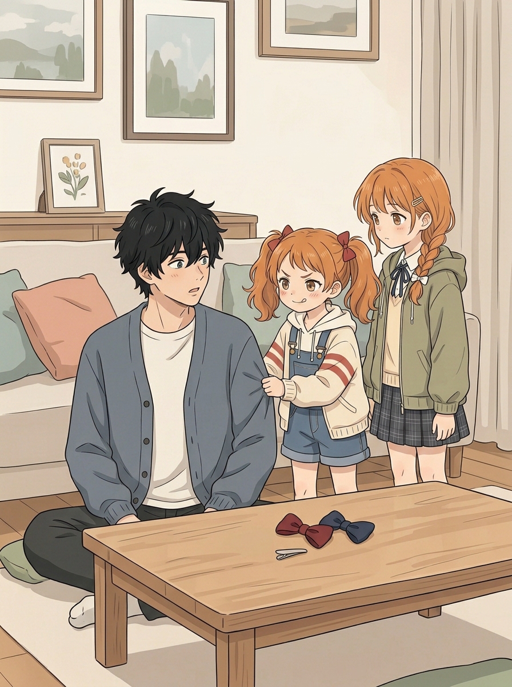

妹妹轻拉袖子：「还没猜我的呢！先看我嘛。」两结和底座在桌上。姐姐脚被桌遮挡、站姿无法准确量身高，视觉上仍偏高；袖口与手的接触还需细看。

## 06｜哥哥猜颜色
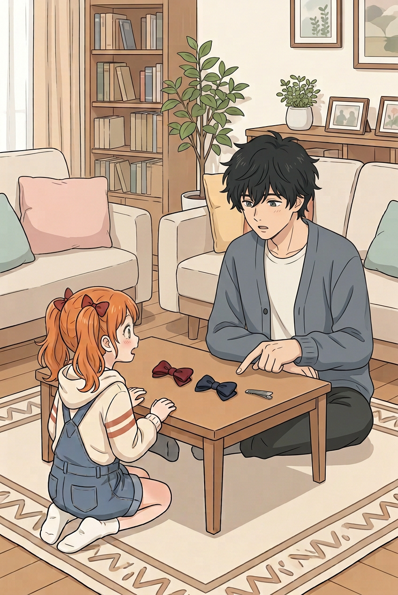

二哥：「我猜深红。你拿起它时，眼睛都亮了。」妹妹惊讶，红、蓝结和底座在桌上，改为木地板和地毯。手指方向在两结之间，指向哪一枚不够清楚；部分手脚受遮挡。

## 07｜妹妹嘴硬
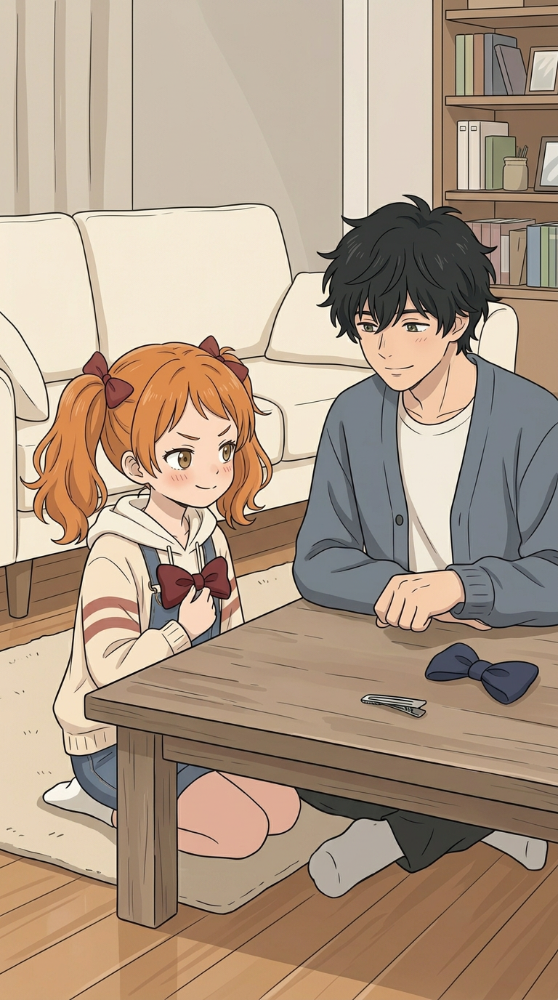

妹妹：「哼，你只是运气好吧！」她握深红结，桌上是蓝结和底座。首次生成的 `07.png` 多出了第二个二哥，已弃用；重画仅一位二哥和妹妹，地板为木地板。二哥两手局部重叠，部分手指遮挡不能完全确认。

## 08｜姐姐的反差
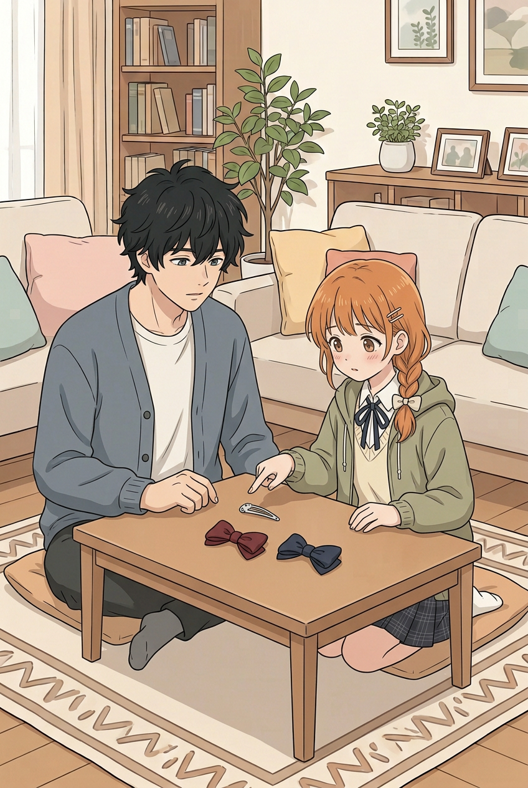

姐姐靠到桌边指底座，心声草案：「只是确认配色，别突然紧张。」二哥在旁看着；两结在桌上。相比前版，这次指底座的是姐姐；两人有同桌靠近但未接触。部分下肢受桌遮挡，不能用坐姿验站高。

## 09｜妹妹发现
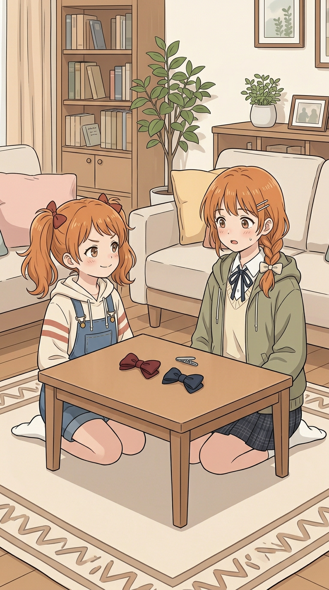

妹妹：「姐姐，你刚才怎么不说话了？」姐姐：「……在想颜色。」姐姐外套开放、露针织衫，单侧两枚发夹；妹妹双马尾可见。首张 `09.png` 两人站立身高差过大且仍穿鞋，未采用。重画坐姿无法按头顶量站高，手被桌挡；书架有一处微小伪文字，待处理。

## 10｜小满提议
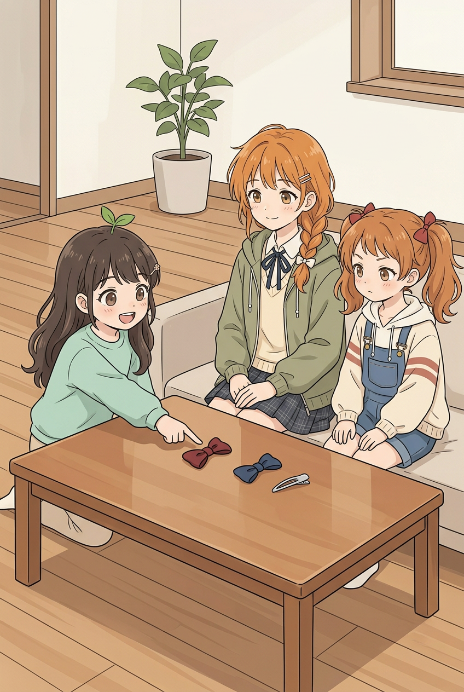

小满：「深红这个，像小恶魔的蝴蝶结！」姐姐：「这个形状确实很合适。」沿用上一批候选。两结和底座在桌上，桌后肢体被遮挡。

## 11｜妹妹选择
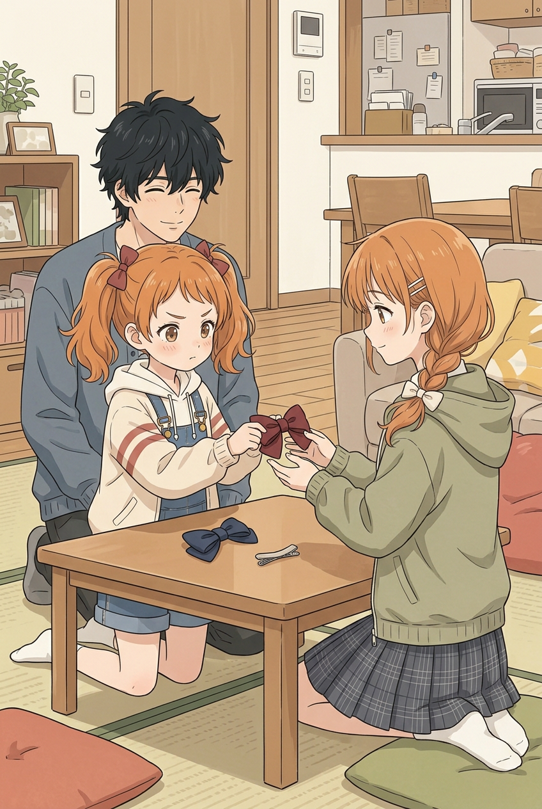

妹妹：「好吧，那就选深红。姐姐做的底座……也挺好看的。」二哥：「边上的小褶子很用心。」交接处已放大，姐姐两只手在红结附近，妹妹一只手握结，另一只手受遮挡；不能确认遮挡处所有手指。该图仍有榻榻米，与木地板为主的连续场景不一致；二哥台词与画面的具体观察也需审校。

## 12｜收尾
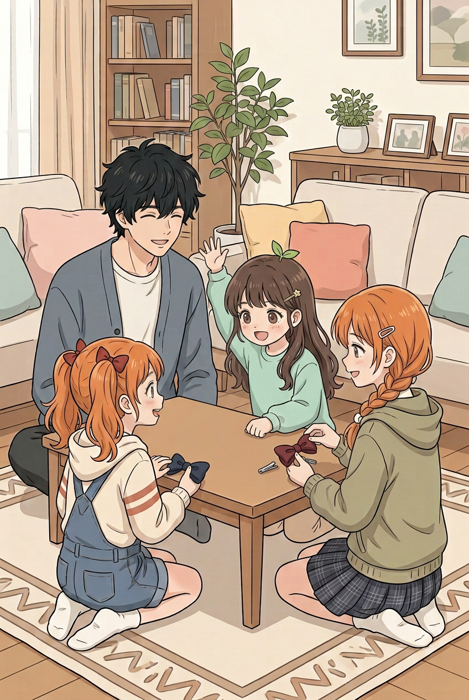

妹妹：「做好之后你也要第一个看！」二哥答应，小满说也想看；四人围桌、姐姐拿红结、妹妹拿蓝结。改变为坐姿避免把旧错误的站高画面当成已修，但坐姿本身不证明身高通过。**明确待修**：放大后桌上的银色底座左边有一枚，红结后还伸出一条银色夹状物，疑似重复底座；姐姐发夹在侧面只看出一枚；二哥及桌下部分肢体受遮挡。不能排成正式成品。

## 本轮检查与待办

- 本轮生图10次：封面、01、04、06、07、08、09、12，及07、09各一次整张重画；07首次有两个二哥，未使用。其他旧候选均保留。
- 风格与身份：已对照第八话锚点和姐妹新形象，新04脸部仍偏柔亮；逐页一致性及09伪文字待解决。
- 身高：01两姐妹差距偏大，05无法准确量；12改坐姿不能代替校准。需要在合适的同平面站姿中核对设定，而不是通过遮挡绕过问题。
- 道具与空间：12疑似第二个底座、06手指方向不明、11房间仍是榻榻米；门口进屋／脱鞋、封面妹妹鞋色需处理。07手上红结需在08前放回桌上，画面未明确画出中间动作。
- 肢体：检查过整图并放大04头部、07手部、11交接与12物件；遮挡处只记为不可确认。12的重复夹状物应实际修正，不得靠解释当通过。
- 对白：仍是图片外的逐页草案，普通有尾气泡、阅读顺序、心声、最终文字排版均未完成。封面正式标题未决定。
- 本轮生图上限已用完，下一轮需修明确缺陷、逐页全量核查和正式试排；不能把这份工作预览称为第九话第一版完成。AI目检可能出错。
