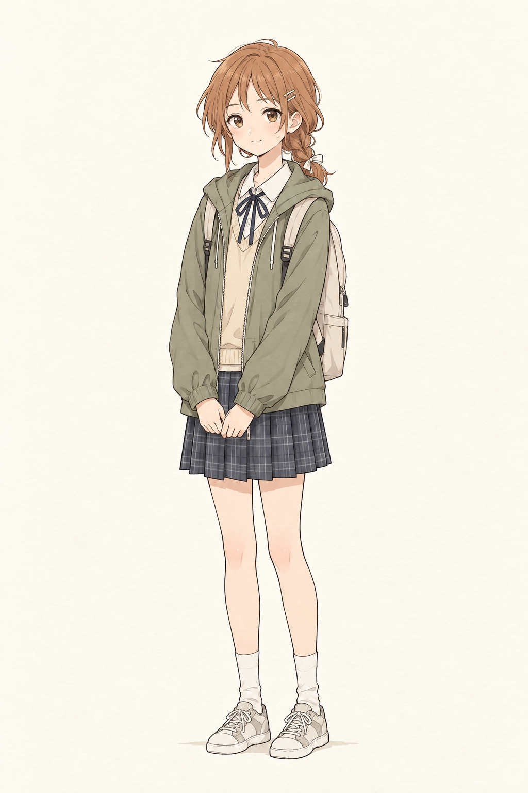
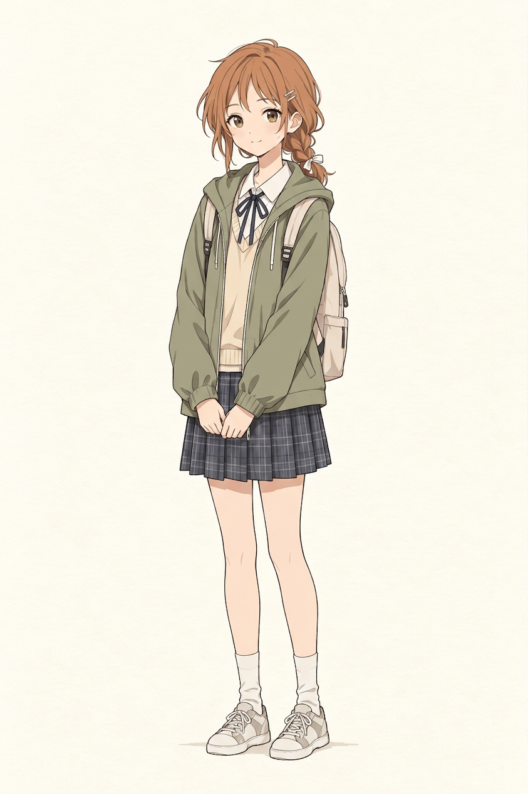

# 邻居姐姐｜新选人设画风调整候选

你回传的[原图](../../art/角色形象区/隔壁姐姐_用户新选与画风优化v1/用户新选原图.png)中，服装、发型和长相已获你认可；此前希望完全重新生成人设，因此后续以这张新选图为形象依据，不再使用旧的半扎发、蓝灰开衫与蓝米格裙作为现行设计。旧图保留作历史参考。你要求只优化画风；[画风调整候选](../../art/角色形象区/隔壁姐姐_用户新选与画风优化v1/人设画风调整候选.png)以原图及第八话已认可画面为参考，供你确认，尚未定稿。

## 核对与待办

- **形象**：候选保留橙棕侧辫、发夹、浅色发结、橄榄绿连帽外套、浅色针织衫、白领和深色领结、深色格裙、浅色背包、白袜和浅色运动鞋。原图表情柔和；AI重绘后眼睛和五官细节、姿态及颜色会有细微变化，是否仍是你喜欢的感觉请你判断。
- **画风**：与第八话参考相比，候选采用较清晰细线和平涂式柔和色彩；单人背景简洁，与场景画面的细节密度不同，画风是否合适仍由你决定。
- **体态**：整图可见两只手、两条腿与两只脚；前方手部靠近但未见明确多余手臂。单人图没有身高标尺，不代表与妹妹的实际身高关系已经确定。
- **接下来**：你确认画风后，以新形象做二哥和邻居姐妹同一地面、同视角的比例对照；姐姐只比小学四年级的妹妹高一点，不设具体厘米数。先前第九话原画仍是旧形象/旧比例候选，尚未修正、尚未完成；不覆盖任何旧文件或已确认章节。
